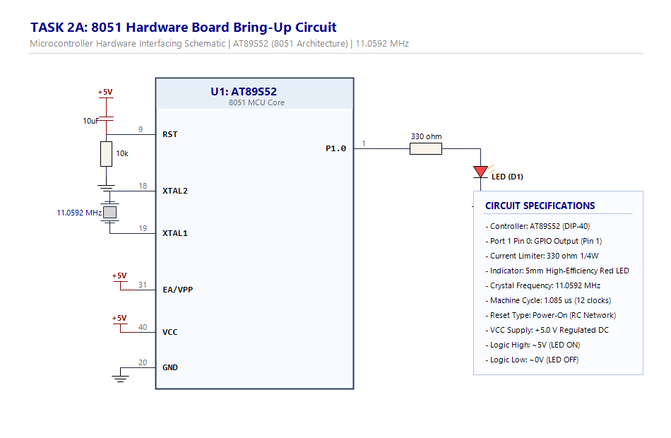

# EXPERIMENT DETAILS

* **Course Code & Title:** 25CS2741 – Fundamentals of Internet of Things Laboratory
* **Experiment Identifier:** CAT 2 (Continuous Assessment 2)
* **Date of Evaluation:** 20/07/2026
* **Student Name:** Venkataprabu V
* **Registration Number:** 25011102114
* **Hardware Platform:** 8051 Microcontroller (AT89S52) + Keil µVision IDE

---

## TASK 2A: 8051 Development Board Bring-Up & Toolchain Setup

### 1. Experiment Name and Aim
* **Experiment Title:** 8051 Tool Chain Setup – Development Board – AT89S52
* **Aim:** To establish the Keil C51 embedded development environment, configure the target microcontroller project for the AT89S52, implement a bare-metal board bring-up routine controlling an on-board LED via General Purpose Input/Output (GPIO) Port 1 Pin 0 (P1.0), compile the firmware into an Intel HEX binary, and verify basic processor execution.

### 2. Components / Tools Required
| Component / Tool | Specification / Version | Quantity / Purpose |
|---|---|---|
| Microcontroller | Microchip / Atmel AT89S52 (40-pin DIP) | 1 |
| Crystal Oscillator | 11.0592 MHz Quartz Crystal | 1 (System Clock Generation) |
| Ceramic Capacitors | 33 pF | 2 (Oscillator Tank Circuit) |
| Electrolytic Capacitor | 10 µF, 16V | 1 (Power-On Reset Network) |
| Resistors | 330 Ω (1/4 W), 10 kΩ (1/4 W) | 1 each (LED Limiter & RST Pull-Down) |
| Light Emitting Diode | 5 mm Red LED | 1 (Output Indicator) |
| DC Power Supply | +5V Regulated Direct Current Supply | 1 |
| In-System Programmer (ISP) | USBASP / Keil µVision Simulator | Firmware Upload / Emulation |
| Development IDE | Keil µVision (C51 Compiler v9.60+) | Project Compilation & Hex Generation |

### 3. Hardware Setup
* **Target MCU Architecture:** 8-bit 8051 core with 8 KB on-chip In-System Programmable Flash memory and 256 bytes of internal RAM.
* **System Clock:** 11.0592 MHz crystal oscillator connected across `XTAL1` (Pin 19) and `XTAL2` (Pin 18), stabilized to ground via dual 33 pF capacitors. One machine cycle evaluates to:
  $$\text{Machine Cycle} = \frac{12}{11.0592\text{ MHz}} \approx 1.0851\ \mu\text{s}$$
* **Active Connections & Wiring:**
  1. **Power Supply:** Connect Pin 40 ($V_{CC}$) to regulated +5V DC and Pin 20 ($V_{SS}/\text{GND}$) to system ground.
  2. **External Access Enable:** Tie Pin 31 ($\overline{EA}/V_{PP}$) directly to $V_{CC}$ to force instruction fetching strictly from internal program memory (0000H–1FFFH).
  3. **Reset Circuit:** Connect Pin 9 (`RST`) to a series resistor-capacitor network comprising a 10 µF capacitor to $V_{CC}$ and a 10 kΩ pull-down resistor to GND, ensuring a high pulse during power-up exceeding two machine cycles.
  4. **Peripheral Output:** Connect Port 1 Pin 0 (`P1.0`, Physical Pin 1) to the anode of the 5 mm Red LED through a 330 Ω current-limiting resistor. Connect the LED cathode directly to system ground.

### 4. Circuit Diagram
The circuit schematic below illustrates the AT89S52 microcontroller minimal system configuration together with the P1.0 LED output stage:

### 5. Pseudocode and Code Logic

#### Step-by-Step Program Walkthrough
1. **Header Inclusion:** Include `<reg51.h>` to grant symbolic access to the Special Function Registers (SFRs) of the 8051 architecture.
2. **Bit Address Definition:** Declare the output line using the `sbit` keyword (`sbit led = P1^0;`), binding the identifier `led` to bit 0 of SFR Port 1 (address 0x90).
3. **Software Delay Generator:** Implement a nested double-loop software delay function (`delay()`) with iteration counts $i \in [0, 299]$ and $j \in [0, 399]$. This consumes machine cycles inside the CPU without utilizing internal hardware timers.
4. **Infinite Execution Super-Loop:**
   * Assert `led = 0;` (drives P1.0 to 0V / logic LOW).
   * Call `delay()` to maintain the logic LOW state.
   * Assert `led = 1;` (drives P1.0 to +5V / logic HIGH).
   * Call `delay()` to maintain the logic HIGH state.
   * Repeat perpetually within `while(1)`.

#### Key Registers & Hardware Characteristics
* **Port 1 SFR (Address 0x90):** Bit-addressable 8-bit bidirectional quasi-bidirectional I/O port equipped with internal pull-up resistors.
* **`P1^0` Pin Driving:** Writing `0` to `P1^0` discharges the internal FET to ground (logic 0), sinking current. Writing `1` turns off the pull-down FET, allowing the internal pull-up to pull the pin high, sourcing current through the current-limiting resistor to illuminate the LED.

### 6. Procedure
1. Launch Keil µVision IDE and open `TaskSource.uvproj`.
2. Inspect **Project $\rightarrow$ Options for Target $\rightarrow$ Target**:
   * Verify that the selected device is `AT89S52`.
   * Ensure the clock frequency is configured to `11.0592 MHz`.
   * In the **Output** tab, ensure the checkbox **Create HEX File** is enabled (`lab-4.hex`).
3. Include `bringup.c` and `STARTUP.A51` in **Source Group 1**.
4. Rebuild the project using **Project $\rightarrow$ Rebuild all target files** (`F7`).
5. Confirm that compilation completes with `0 Error(s), 0 Warning(s)` and produces `Objects/lab-4.hex`.
6. Load the generated `.hex` binary onto the target development board using an ISP programmer or test via the Keil µVision built-in logic analyzer / GPIO peripheral simulation window.

### 7. Expected Output and Inference
* **Expected Output:** Upon powering the development board or releasing the hardware reset switch, the red indicator LED attached to `P1.0` blinks rhythmically at a frequency determined by the nested software delay loop.
* **Hardware Observation:** The LED alternates between illuminated (HIGH) and extinguished (LOW) states continuously [CONFIRM ON BOARD/SIMULATION].
* **Inference:** Successful periodic toggling of `P1.0` confirms that:
  * The AT89S52 crystal oscillator has struck oscillation cleanly.
  * The internal reset cycle terminated correctly and instruction execution commenced from vector address `0x0000`.
  * The Keil C51 compiler, startup initialization code (`STARTUP.A51`), and ISP flash loading chain are fully operational.

### 8. Conclusion
The 8051 toolchain bring-up for the AT89S52 development platform was successfully verified. The software delay and GPIO bit manipulation effectively control the on-board indicator, validating the core foundation required for subsequent peripheral interfacing experiments.
