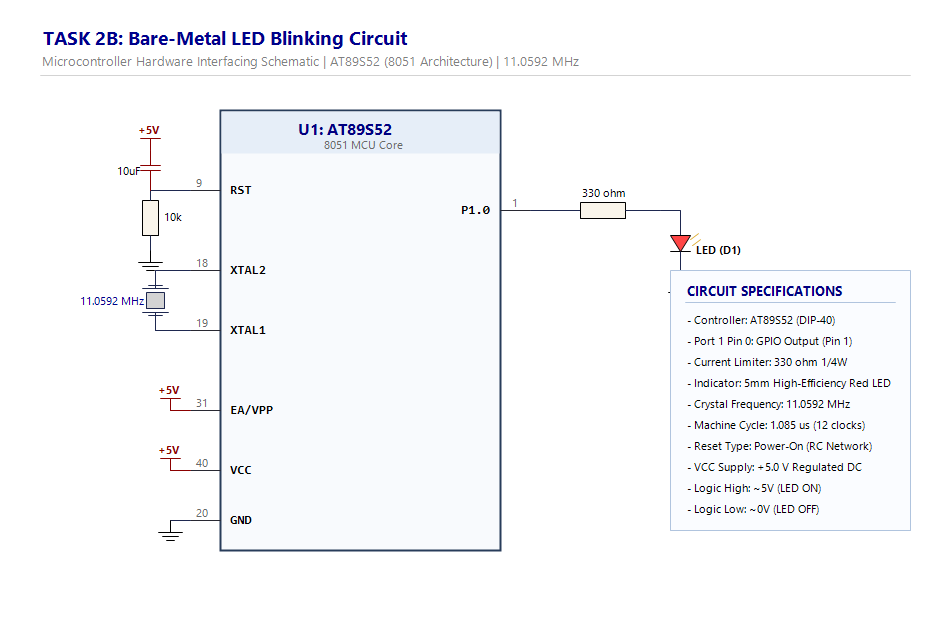

# EXPERIMENT DETAILS

* **Course Code & Title:** 25CS2741 – Fundamentals of Internet of Things Laboratory
* **Experiment Identifier:** CAT 2 (Continuous Assessment 2)
* **Date of Evaluation:** 20/07/2026
* **Student Name:** Venkataprabu V
* **Registration Number:** 25011102114
* **Hardware Platform:** 8051 Microcontroller (AT89S52) + Keil µVision IDE

---

## TASK 2B: Bare-Metal GPIO Output & LED Blinking Routine

### 1. Experiment Name and Aim
* **Experiment Title:** Bare-Metal LED Blink Programming on AT89S52
* **Aim:** To develop, flash, and analyze a bare-metal embedded C routine that toggles an external LED interfaced to Port 1 Pin 0 (P1.0) of an AT89S52 microcontroller, investigating software timing loops, electrical current limitations, and CPU register behavior.

### 2. Components / Tools Required
| Component / Tool | Value / Part Number | Description |
|---|---|---|
| Microcontroller | AT89S52 (Atmel / Microchip) | 8-bit MCU, 40-pin Dual In-Line Package |
| Quartz Crystal | 11.0592 MHz | Master system oscillator |
| Decoupling Capacitors | 33 pF ceramic (×2) | Frequency stabilization for crystal tank |
| Timing Capacitor | 10 µF, 25V electrolytic | Power-on reset charge timing |
| Bias Resistor | 10 kΩ, 1/4 W | Pull-down resistor for RST line |
| Current Limiting Resistor | 330 Ω metal film | Protection resistor for LED forward bias |
| Visual Indicator | 5 mm Diffused Red LED | $V_f \approx 1.8\text{V} - 2.0\text{V}$, $I_f \approx 10\text{mA}$ |
| Regulated Bench Supply | +5V DC Rail | System DC electrical power source |
| Development Software | Keil µVision IDE (C51 Compiler) | Assembly, C compilation, and Hex building |

### 3. Hardware Setup
* **Processor Configuration:** AT89S52 operating in standard single-chip mode with internal program execution enabled by tying $\overline{EA}$ (Pin 31) to $V_{CC}$ (+5V).
* **Clock System:** 11.0592 MHz crystal connected between `XTAL1` (Pin 19) and `XTAL2` (Pin 18), providing a base clock period of:
  $$T_{OSC} = \frac{1}{11.0592\text{ MHz}} \approx 90.42\text{ ns}$$
  Since the classical 8051 architecture divides the oscillator by 12 to yield one machine cycle, each instruction state cycle lasts $12 \times T_{OSC} \approx 1.0851\ \mu\text{s}$.
* **Reset Circuit:** A passive differentiator network on Pin 9 (`RST`) maintains a voltage $> 0.7 V_{CC}$ for at least 24 clock cycles upon power activation to guarantee clean internal initialization.
* **GPIO Interface:**
  * Pin 1 (`P1.0`) is configured as an active-high driver.
  * Connect `P1.0` to the anode terminal of the LED via an external 330 Ω series resistor.
  * Connect the cathode terminal of the LED to $0\text{V}$ (System GND).
  * Calculated forward current:
    $$I_{LED} = \frac{V_{OH} - V_F}{R} \approx \frac{5.0\text{ V} - 1.8\text{ V}}{330\ \Omega} \approx 9.7\text{ mA}$$
    which safely complies with the AT89S52 Port 1 maximum sink/source ratings.

### 4. Circuit Diagram
The schematic diagram below illustrates the exact interconnection between the AT89S52 microcontroller and the external indicator circuit:



### 5. Pseudocode and Code Logic

#### Step-by-Step Program Execution Flow
1. **Incorporate Architecture Definitions:** Include `<reg51.h>` to access special function register addresses and bit vectors.
2. **Assign Control Bit:** Bind the symbolic name `led` to bit 0 of Port 1 using the statement:
   ```c
   sbit led = P1^0;
   ```
3. **Software Loop Delay Function:**
   * Allocate integer iteration registers `i` and `j`.
   * Outer loop executes 300 iterations (`for (i = 0; i < 300; i++)`).
   * Inner loop executes 400 iterations (`for (j = 0; j < 400; j++);`).
   * The total executed machine instructions within the nested loops introduce an execution delay of approximately $100\text{ ms} - 150\text{ ms}$ depending on compiler instruction scheduling.
4. **Main Function Super-Loop:**
   * Enter the non-terminating control structure `while(1)`.
   * Set `led = 0;` (Output 0V at P1.0, extinguishing the diode).
   * Invoke `delay();`.
   * Set `led = 1;` (Output +5V at P1.0, illuminating the diode).
   * Invoke `delay();`.

#### Register Mechanics & Port Architecture
Port 1 consists of an internal output latch, a pair of input buffers, and an internal pull-up FET. Writing `1` into the latch bit sets the internal output FET to OFF; the internal pull-up pulls the pin to $+5\text{V}$, sourcing the current necessary to light up the LED. Conversely, writing `0` drives the output transistor to saturation, grounding the pin and extinguishing the LED.

### 6. Procedure
1. Open Keil µVision IDE and load the project file `TaskSource.uvproj`.
2. Inspect `blink.c` in the editor window and confirm target settings under **Options for Target $\rightarrow$ Target** (`AT89S52`, `11.0592 MHz`).
3. Verify that the linker output is set to generate an Intel HEX format file (`Objects/lab-4.hex`).
4. Execute **Project $\rightarrow$ Rebuild all target files** (`Ctrl + F7`).
5. Ensure zero compilation warnings and zero fatal errors.
6. Transfer the resulting `lab-4.hex` to the AT89S52 flash memory via the programmer utility or verify register state toggling inside the Keil debugger.

### 7. Expected Output and Inference
* **Expected Output:** The red LED connected to `P1.0` blinks continuously with approximately 50% duty cycle.
* **Timing Observation:** The alternation speed is controlled purely by software loop iteration time, exhibiting an eye-perceptible blink cadence [CONFIRM ON BOARD/SIMULATION].
* **Inference:**
  * Direct port-bit access in Keil C51 (`sbit`) compiles to single-cycle bit instructions (`CLR P1.0` and `SETB P1.0`).
  * Software delay loops tie up 100% of the CPU execution cycles during delay intervals, underscoring the necessity of hardware timers for multi-tasking applications.

### 8. Conclusion
Bare-metal GPIO toggling was implemented and validated on the AT89S52 microcontroller. The experiment confirmed proper software-level bit control and established the electrical behavior of 8051 Port 1 outputs.
