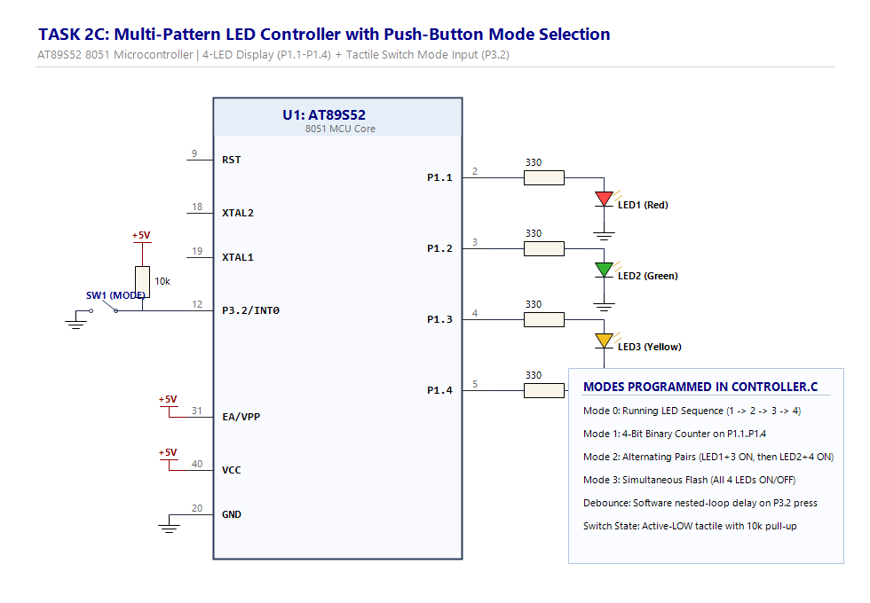

# EXPERIMENT DETAILS

* **Course Code & Title:** 25CS2741 – Fundamentals of Internet of Things Laboratory
* **Experiment Identifier:** CAT 2 (Continuous Assessment 2)
* **Date of Evaluation:** 20/07/2026
* **Student Name:** Venkataprabu V
* **Registration Number:** 25011102114
* **Hardware Platform:** 8051 Microcontroller (AT89S52) + Keil µVision IDE

---

## TASK 2C: Multi-Pattern LED Controller with Push-Button Mode Selection

### 1. Experiment Name and Aim
* **Experiment Title:** Multi-Mode LED Pattern Controller and Debounced Push-Button Interface
* **Aim:** To design and implement a multi-functional embedded controller using the AT89S52 microcontroller that monitors a tactile push-button switch connected to Port 3 Pin 2 (P3.2), performs software debouncing, and dynamically cycles through four distinct visual display modes across a 4-LED array connected to Port 1 Pins 1 through 4 (P1.1–P1.4).

### 2. Components / Tools Required
| Component / Tool | Specification | Quantity | Functional Role |
|---|---|---|---|
| Microcontroller | Atmel AT89S52 (40-pin DIP) | 1 | Master control processing unit |
| Tactile Push Button | 6×6 mm momentary tactile switch | 1 | Mode selection user input |
| Light Emitting Diodes | 5 mm Diffused LEDs (Red, Green, Yellow, Blue) | 4 | Multi-channel visual pattern display |
| Current Limiting Resistors | 330 Ω, 0.25 W metal film | 4 | Forward current limitation for LEDs |
| Pull-Up Resistor | 10 kΩ, 0.25 W carbon film | 1 | External pull-up for P3.2 push-button |
| Crystal Oscillator | 11.0592 MHz Quartz | 1 | Master clock frequency source |
| Tank Capacitors | 33 pF ceramic disc | 2 | Crystal load frequency trimming |
| Reset Capacitor | 10 µF, 16V electrolytic | 1 | Power-on reset capacitive charging |
| Reset Resistor | 10 kΩ pull-down | 1 | RST pin discharge path |
| DC Power Source | +5.0 V regulated DC supply | 1 | VCC board supply rail |
| IDE & Compiler | Keil µVision v9.60 (C51 Compiler) | 1 | Embedded C build toolchain |

### 3. Hardware Setup
* **Microcontroller Core:** AT89S52 operating on an 11.0592 MHz fundamental quartz crystal. Each machine instruction cycle evaluates to $1.0851\ \mu\text{s}$.
* **Input Interface Configuration:**
  * Pin 12 (`P3.2 / INT0`) is used as a digital input pin for mode selection.
  * An external 10 kΩ pull-up resistor pulls `P3.2` to $+5\text{V}$ (logic HIGH when the switch is unpressed).
  * The momentary tactile button connects between `P3.2` and System GND ($0\text{V}$). Pressing the switch grounds `P3.2`, presenting an active-LOW input signal.
* **Output Interface Configuration:**
  * Port 1 Pins 1, 2, 3, and 4 are configured as independent output channels:
    * `P1.1` (Pin 2) $\rightarrow$ 330 Ω $\rightarrow$ LED 1 (Red Anode) $\rightarrow$ Cathode to GND
    * `P1.2` (Pin 3) $\rightarrow$ 330 Ω $\rightarrow$ LED 2 (Green Anode) $\rightarrow$ Cathode to GND
    * `P1.3` (Pin 4) $\rightarrow$ 330 Ω $\rightarrow$ LED 3 (Yellow Anode) $\rightarrow$ Cathode to GND
    * `P1.4` (Pin 5) $\rightarrow$ 330 Ω $\rightarrow$ LED 4 (Blue Anode) $\rightarrow$ Cathode to GND
* **System Control Lines:**
  * Pin 31 ($\overline{EA}/V_{PP}$) is tied to $+5\text{V}$ to execute code from internal Flash ROM.
  * Pin 9 (`RST`) is tied to the 10 µF / 10 kΩ power-on reset differentiator network.

### 4. Circuit Diagram
The circuit diagram below details the AT89S52 microcontroller with the four-channel LED array and the debounced tactile switch input:

### 5. Pseudocode and Code Logic

#### Step-by-Step Program Walkthrough
1. **Header Inclusion & Variable Declarations:**
   * Include `<reg51.h>`.
   * Declare bit aliases for outputs: `led1 = P1^1;`, `led2 = P1^2;`, `led3 = P1^3;`, `led4 = P1^4;`.
   * Declare bit alias for input: `button = P3^2;`.
   * Initialize state variables: `unsigned char mode = 0;` and `unsigned char count = 0;`.
2. **Software Delay Routine (`delay`):**
   * Employs nested double-loops ($300 \times 400$ iterations) generating a timing pause for pattern display transitions and button debouncing.
3. **Hardware Initialization in `main()`:**
   * Execute `button = 1;` prior to entering the infinite loop. In 8051 quasi-bidirectional architecture, writing a `1` to an input port pin turns off the internal pull-down transistor, enabling the pin to float high and function reliably as an input.
4. **Button Polling & Software Debouncing:**
   * In each loop cycle, evaluate if `button == 0`.
   * If detected LOW, execute `delay()` to ride out mechanical contact bounce ($10 - 20\text{ ms}$).
   * Re-sample `button`. If still LOW, confirm a valid user keypress:
     $$\text{mode} = (\text{mode} + 1) \pmod 4$$
   * Execute `while (button == 0);` to block further state transitions until the user physically releases the switch, preventing multi-triggering from a single sustained press.
5. **Pattern Generator State Machine:**
   * **Mode 0 (Running Chaser):** Sequentially illuminates one LED at a time:
     `LED1 ON` $\rightarrow$ `LED2 ON` $\rightarrow$ `LED3 ON` $\rightarrow$ `LED4 ON`, with intervening delays.
   * **Mode 1 (4-Bit Binary Counter):**
     Calculates `P1 = ((count++ & 15) << 1);` followed by a delay. Masking with 15 restricts the count to $0 - 15$ (4 bits), and shifting left by 1 positions the bits directly over `P1.1` to `P1.4` without disrupting `P1.0`.
   * **Mode 2 (Alternating Pairs):**
     Alternates between even and odd LED pairs: `LED1 & LED3 ON` (LED2 & LED4 OFF), then `LED2 & LED4 ON` (LED1 & LED3 OFF).
   * **Mode 3 (Simultaneous Strobe):**
     Writes `P1 = 0x1E` (binary `00011110b`, setting P1.1–P1.4 HIGH simultaneously), delays, then clears `P1 = 0x00`, creating a synchronized flashing strobe.

### 6. Procedure
1. Open Keil µVision IDE and launch `TaskSource.uvproj`.
2. Open `controller.c` and verify that the target device is set to `AT89S52` with an `11.0592 MHz` clock in the Target settings dialog.
3. Verify that the output settings are configured to generate `Objects/lab-4.hex`.
4. Compile and link the code via **Project $\rightarrow$ Rebuild all target files** (`F7`).
5. Verify clean compilation output: `0 Error(s), 0 Warning(s)`.
6. Program the target microcontroller using the hex file, or simulate the I/O states in the Keil Logic Analyzer window.

### 7. Expected Output and Inference
* **Initial State (Mode 0):** The LEDs display a continuous chasing light sequence moving from LED1 through LED4.
* **First Press (Mode 1):** The 4-LED array increments through binary values from `0000` to `1111` ($0\text{ to }15$), visually displaying the counting sequence.
* **Second Press (Mode 2):** LEDs 1 and 3 flash alternately with LEDs 2 and 4 in an anti-phase pattern.
* **Third Press (Mode 3):** All four LEDs flash ON and OFF synchronously.
* **Fourth Press:** Wraps back cleanly to Mode 0 [CONFIRM ON BOARD/SIMULATION].
* **Inference:**
  * Software debouncing reliably filters mechanical switch noise without requiring external hardware Schmitt triggers or RC filters.
  * Direct byte writes to port registers (`P1 = value`) provide atomic parallel output updates, preventing intermediate flicker during pattern changes.

### 8. Conclusion
The multi-mode LED controller successfully demonstrates input switch debouncing, state machine implementation, and varied port-driving techniques on the 8051 microcontroller. The system accurately cycles through all programmed patterns upon user interaction.
