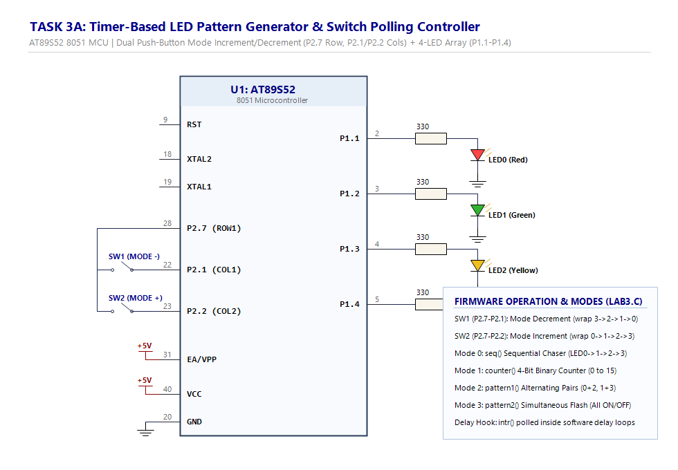

# EXPERIMENT DETAILS

* **Course Code & Title:** 25CS2741 – Fundamentals of Internet of Things Laboratory
* **Experiment Identifier:** CAT 3 (Continuous Assessment 3)
* **Date of Evaluation:** 27/07/2026
* **Student Name:** Venkataprabu V
* **Registration Number:** 25011102114
* **Hardware Platform:** 8051 Microcontroller (AT89S52) + Keil µVision IDE

---

## TASK 3A: Timer-Based LED Pattern Generator and Switch Polling Controller

### 1. Experiment Name and Aim
* **Experiment Title:** Timer-Based LED Pattern Generator and Button Interrupt Controller
* **Aim:** To construct and program an interactive LED display system using an AT89S52 microcontroller where dual matrix tactile switches (configured on row `P2.7` and columns `P2.1`, `P2.2`) are monitored via non-blocking polled interrupt hooks inside execution delay loops to seamlessly switch between four distinctive lighting patterns across four LEDs on `P1.1`–`P1.4`.

### 2. Components / Tools Required
| Component / Tool | Specification | Quantity | Role in Circuit |
|---|---|---|---|
| Microcontroller | AT89S52 (40-pin DIP) | 1 | Main algorithmic execution unit |
| Visual Indicators | 5 mm Diffused LEDs (Red, Green, Yellow, Blue) | 4 | 4-channel pattern display |
| Current Limiting Resistors | 330 Ω metal film (1/4 W) | 4 | LED branch forward current limiter |
| Matrix Switches | Momentary Push-Buttons (SW1, SW2) | 2 | Mode increment/decrement inputs |
| Crystal Oscillator | 11.0592 MHz Quartz | 1 | Clock generation |
| Tank Capacitors | 33 pF ceramic disc | 2 | Oscillator load balancing |
| Power-On Reset | 10 µF electrolytic + 10 kΩ resistor | 1 each | Clean power-on reset pulse generation |
| DC Power Source | +5.0 V regulated DC supply | 1 | Microcontroller operating power rail |
| Compiler / IDE | Keil µVision (C51 Compiler v9.60) | 1 | Code development, assembly, hex creation |

### 3. Hardware Setup
* **Processor Configuration:** AT89S52 clocked at 11.0592 MHz ($1.0851\ \mu\text{s}$ per machine cycle). $\overline{EA}/V_{PP}$ (Pin 31) is pulled to $V_{CC}$ to enable internal Flash execution.
* **Matrix Switch Input Subsystem:**
  * Rather than dedicating independent pins with fixed grounds, the input uses a row-column matrix structure:
    * `P2.7` (Pin 28) functions as the active-LOW driving row line (`row1`).
    * `P2.1` (Pin 22) functions as the sensing column line (`col1`) for **SW1 (Mode Decrement)**.
    * `P2.2` (Pin 23) functions as the sensing column line (`col2`) for **SW2 (Mode Increment)**.
  * Internal/external pull-ups maintain `P2.1` and `P2.2` at logic HIGH when switches remain open. When `P2.7` is held LOW, pressing SW1 shorts `P2.1` to LOW; pressing SW2 shorts `P2.2` to LOW.
* **LED Output Array:**
  * `P1.1` (Pin 2) $\rightarrow$ 330 Ω $\rightarrow$ LED0 (Red Anode) $\rightarrow$ Cathode to GND
  * `P1.2` (Pin 3) $\rightarrow$ 330 Ω $\rightarrow$ LED1 (Green Anode) $\rightarrow$ Cathode to GND
  * `P1.3` (Pin 4) $\rightarrow$ 330 Ω $\rightarrow$ LED2 (Yellow Anode) $\rightarrow$ Cathode to GND
  * `P1.4` (Pin 5) $\rightarrow$ 330 Ω $\rightarrow$ LED3 (Blue Anode) $\rightarrow$ Cathode to GND

### 4. Circuit Diagram
The circuit schematic below illustrates the AT89S52 microcontroller interfaced with the dual matrix push-buttons on Port 2 and the four-channel LED display on Port 1:

### 5. Pseudocode and Code Logic

#### Step-by-Step Program Walkthrough
1. **Pin Aliasing and Variable Initialization:**
   * Output bits: `sbit led0 = P1^1;` through `sbit led3 = P1^4;`.
   * Input matrix lines: `sbit row1 = P2^7;`, `sbit col1 = P2^1;`, `sbit col2 = P2^2;`.
   * Global state variables: `int mode = 0;`, `int num = 0;`, `int stat = 0;`.
2. **Key Scanning with Software Debounce (`keypress`):**
   * Assert `row1 = 0;`.
   * Check if either column is driven LOW: `if (col2 == 0 || col1 == 0)`.
   * Call short debounce delay `delay2()`.
   * If `col2 == 0` persists: wait until key release (`while(col2 == 0);`), set `stat = 1` (forward direction), return 1.
   * Else if `col1 == 0` persists: wait until key release (`while(col1 == 0);`), set `stat = 2` (backward direction), return 1.
   * If neither pressed, return 0.
3. **Interrupt Hook Emulation (`intr`):**
   * Calls `keypress()`.
   * If `stat == 1`: `mode = (mode + 1) % 4; num = 0; return 1;` (advances mode).
   * If `stat == 2`: `mode = mode - 1; if (mode < 0) mode = 3; num = 0; return 1;` (decrements mode).
   * Returns 0 if no button event occurred.
4. **Responsive Interleaved Delay (`delay`):**
   * Implements nested software loops ($300 \times 400$).
   * Crucially, after each inner loop iteration, the function tests `if (intr()) return 1;`.
   * If a user switch press is detected mid-delay, the delay aborts immediately, propagating `1` back up the call stack to break out of the currently running pattern and switch display modes instantly without lag.
5. **Pattern Execution Functions:**
   * **`seq()` (Mode 0 - Running Chaser):** Shifts a single illuminated bit across LED0 $\rightarrow$ LED1 $\rightarrow$ LED2 $\rightarrow$ LED3.
   * **`counter()` (Mode 1 - 4-Bit Binary Counter):** Deconstructs the integer `num` into binary bits (`a % 2`) and maps them to `led0`..`led3`, incrementing `num` from 0 to 15.
   * **`pattern1()` (Mode 2 - Alternating Pairs):** Alternates between pair `(led0, led2)` and pair `(led1, led3)`.
   * **`pattern2()` (Mode 3 - Simultaneous Blink):** Turns all four LEDs ON together, delays, then turns all four LEDs OFF together.
6. **Main Super-Loop:**
   * Continuously checks `intr()`, then executes the routine corresponding to the current `mode` variable in a `switch(mode)` block.

### 6. Procedure
1. Launch Keil µVision IDE and open `TaskSource.uvproj` under `8051/CAT3/TASK3A`.
2. Verify project properties: target device `AT89S52`, clock frequency `11.0592 MHz`, and HEX file generation enabled (`lab-4.hex`).
3. Compile and link the application using **Project $\rightarrow$ Rebuild all target files** (`F7`).
4. Ensure clean compilation output: `0 Error(s), 0 Warning(s)`.
5. Flash `lab-4.hex` to the physical AT89S52 board or simulate using the Keil µVision Logic Analyzer and Peripherals I/O monitor.

### 7. Expected Output and Inference
* **Default Power-Up (Mode 0):** The LEDs display a rhythmic running chaser sequence.
* **SW2 Press (Increment):** Instantly terminates the running pattern and shifts into Mode 1 (4-bit binary counting), then Mode 2 (alternating pairs), and Mode 3 (synchronous flash).
* **SW1 Press (Decrement):** Reverses the active mode index with clean boundary wrap-around ($0 \rightarrow 3$) [CONFIRM ON BOARD/SIMULATION].
* **Inference:**
  * By polling the switch inside the software delay loop, the program achieves pseudo-interrupt responsiveness without relying on hardware external interrupt lines (INT0/INT1).
  * Matrix row/column addressing reduces pin count requirements when scaling to larger keypad arrays.

### 8. Conclusion
The switch polling controller and multi-pattern generator were successfully implemented. The interleaved polling architecture provides instant user responsiveness during delay intervals, validating efficient input-handling techniques in resource-constrained embedded systems.
