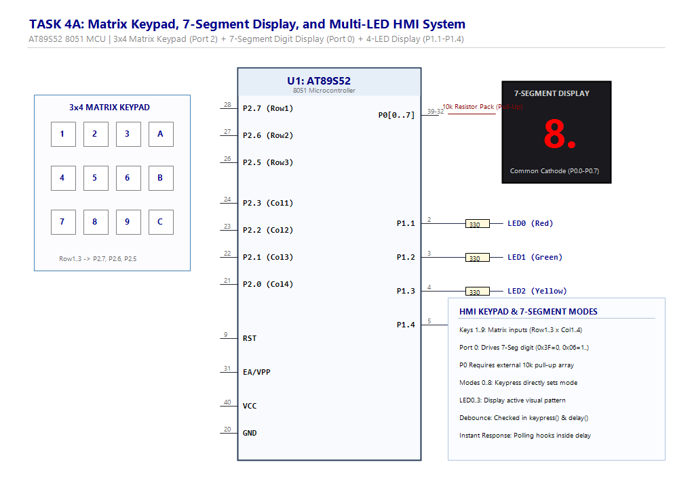

# EXPERIMENT DETAILS

* **Course Code & Title:** 25CS2741 – Fundamentals of Internet of Things Laboratory
* **Experiment Identifier:** CAT 4 (Continuous Assessment 4)
* **Date of Evaluation:** 03/08/2026
* **Student Name:** Venkataprabu V
* **Registration Number:** 25011102114
* **Hardware Platform:** 8051 Microcontroller (AT89S52) + Keil µVision IDE

---

## TASK 4A: Matrix Keypad, 7-Segment Display, and Multi-LED HMI System

### 1. Experiment Name and Aim
* **Experiment Title:** Human-Machine Interface using Matrix Keypad, LEDs, and Seven-Segment Display
* **Aim:** To design and implement a comprehensive Human-Machine Interface (HMI) on the AT89S52 microcontroller combining a $3 \times 4$ matrix keypad (Port 2), a single-digit common-cathode seven-segment display (Port 0), and a four-channel LED pattern array (Port 1). Key presses 1 through 9 are captured through active row scanning, decoded into active operational modes, dynamically rendered on the 7-segment display, and visually verified via associated LED animation patterns.

### 2. Components / Tools Required
| Component / Tool | Specification | Quantity | Purpose |
|---|---|---|---|
| Microcontroller | AT89S52 (40-pin DIP) | 1 | Master embedded controller |
| Matrix Keypad | $3 \times 4$ Tactile Switch Matrix | 1 | Numeric key entry (Keys 1–9, A–C) |
| 7-Segment Display | Single Digit, Common Cathode (0.56") | 1 | Numeric mode indicator |
| Pull-Up Resistor Network | 10 kΩ $\times 8$ Resistor Pack (SIP-9) | 1 | Port 0 bus pull-up (Open-Drain output) |
| Light Emitting Diodes | 5 mm Diffused LEDs (Red, Green, Yellow, Blue) | 4 | Pattern display indicators |
| Current Limiting Resistors | 330 Ω (1/4 W) | 4 | LED forward current limiting |
| Crystal Oscillator | 11.0592 MHz | 1 | Primary clock source |
| Load Capacitors | 33 pF ceramic | 2 | Crystal oscillator stability |
| Reset Circuit | 10 µF electrolytic + 10 kΩ resistor | 1 each | Power-on reset circuit |
| DC Power Supply | +5V DC regulated supply | 1 | Board operational supply |
| Compiler / IDE | Keil µVision v9.60 (C51 Compiler) | 1 | Build and link environment |

### 3. Hardware Setup
* **Processor Core:** AT89S52 clocked at 11.0592 MHz ($1.0851\ \mu\text{s}$ machine cycle).
* **Port 0 (7-Segment Bus):**
  * Port 0 Pins `P0.0` through `P0.7` drive segments `a` through `g` and decimal point `dp`.
  * **Critical Architecture Note:** Port 0 is an open-drain bidirectional bus; an external 10 kΩ pull-up resistor network tied to $+5\text{V}$ is mandatory to provide logic HIGH output levels when driving common-cathode displays.
  * Common cathode pin is connected to System GND ($0\text{V}$).
* **Port 2 (Matrix Keypad):**
  * Row outputs (active LOW): `row1 = P2^7`, `row2 = P2^6`, `row3 = P2^5`.
  * Column inputs (with internal pull-ups): `col1 = P2^3`, `col2 = P2^2`, `col3 = P2^1`, `col4 = P2^0`.
* **Port 1 (LED Array):**
  * `P1.1` (Red), `P1.2` (Green), `P1.3` (Yellow), `P1.4` (Blue) via individual 330 Ω series resistors to ground.

### 4. Circuit Diagram
The schematic diagram below illustrates the full HMI system wiring, including matrix keypad scanning, Port 0 pull-ups with 7-segment display, and Port 1 LED drivers:

### 5. Pseudocode and Code Logic

#### Step-by-Step Program Walkthrough
1. **7-Segment Display Driver (`display_seg`):**
   * Decodes numeric digit $n \in [0, 9]$ to standard 7-segment active-HIGH segment bytes:
     * `0`: `0x3F` (segments a,b,c,d,e,f)
     * `1`: `0x06` (segments b,c)
     * `2`: `0x5B` (segments a,b,d,e,g)
     * `3`: `0x4F` (segments a,b,c,d,g)
     * `4`: `0x66` (segments b,c,f,g)
     * `5`: `0x6D` (segments a,c,d,f,g)
     * `6`: `0x7D` (segments a,c,d,e,f,g)
     * `7`: `0x07` (segments a,b,c)
     * `8`: `0x7F` (segments a,b,c,d,e,f,g)
     * `9`: `0x6F` (segments a,b,c,d,f,g)
   * Writes the decoded byte directly to `P0`.
2. **Matrix Row Scanning Algorithm (`keypress`):**
   * **Stage 1 (Row 1):** Assert `row1 = 0; row2 = 1; row3 = 1;`. Test columns `col1..col4`. If a key is grounded, wait for debounce (`delay2()`), verify key release (`while(col == 0);`), and record `stat = 1..4` (corresponding to Keys 1, 2, 3, A).
   * **Stage 2 (Row 2):** Assert `row1 = 1; row2 = 0; row3 = 1;`. Repeat scan for `stat = 5..8` (Keys 4, 5, 6, B).
   * **Stage 3 (Row 3):** Assert `row1 = 1; row2 = 1; row3 = 0;`. Scan column 1 for `stat = 9` (Key 7).
3. **Interrupt Hook & Mode Dispatcher (`intr`):**
   * Maps `stat` index ($1 \text{ to } 9$) directly to operational `mode` ($0 \text{ to } 8$), resets the animation index `num = 0`, updates the 7-segment display with the newly selected mode digit, and returns `1` to abort running delays.
4. **Responsive Delay Function (`delay`):**
   * Nested $300 \times 400$ loops. Checks `if (intr()) return 1;` every inner cycle, guaranteeing instantaneous mode switches upon key actuation.
5. **Main Program Loop:**
   * Continuously executes `switch(mode)`, driving animated sequences across LEDs (chaser, binary counters, even/odd pairs, strobe) while reflecting the active mode number on the 7-segment display.

### 6. Procedure
1. Launch Keil µVision IDE and open `lab-4.uvproj`.
2. Review `lab4.c` source code and verify `STARTUP.A51` presence in the project workspace.
3. Confirm target device is set to `AT89S52` at `11.0592 MHz` and output binary is set to generate `Objects/lab-4.hex`.
4. Compile the project via **Project $\rightarrow$ Rebuild all target files** (`F7`) and verify zero errors.
5. Program the target microcontroller hardware or simulate the keypad inputs and 7-segment port outputs in Keil Logic Analyzer.

### 7. Expected Output and Inference
* **Initial State:** 7-segment display illuminates digit `0` (`P0 = 0x3F`), while the 4 LEDs execute the sequential running chaser (Mode 0).
* **Key Press 1–9:** Pressing any numeric key immediately halts the current LED sequence, updates the 7-segment display to reflect the pressed digit, and starts the corresponding pattern on `P1.1`–`P1.4` [CONFIRM ON BOARD/SIMULATION].
* **Inference:**
  * Row-by-row scanning allows reading 12 tactile switches using only 7 microcontroller pins ($3 \text{ rows} + 4 \text{ columns}$).
  * Port 0 requires external pull-ups to source current into LEDs or 7-segment displays due to its open-drain transistor configuration.

### 8. Conclusion
The multi-peripheral HMI system successfully harmonizes keypad matrix input decoding with dual visual output transducers (7-segment display and LED array), demonstrating robust embedded user-interface engineering on the 8051 platform.
