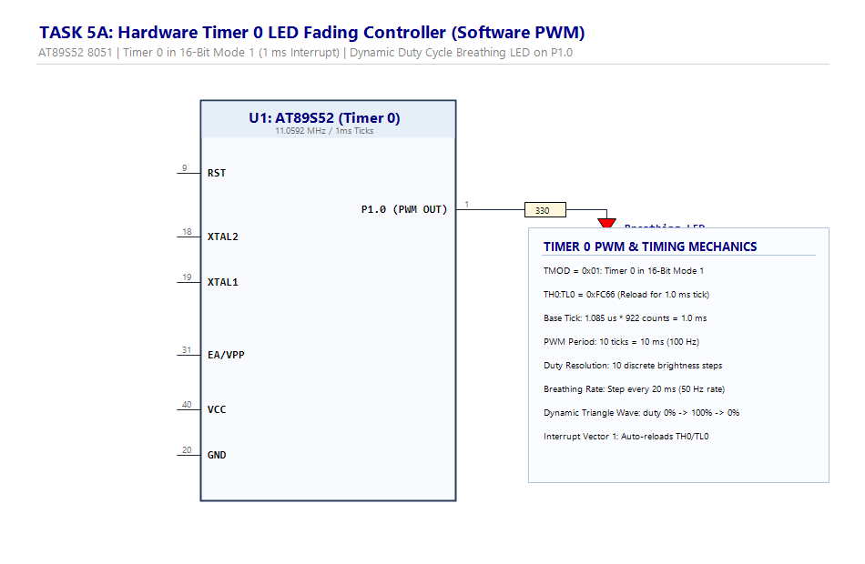

# EXPERIMENT DETAILS

* **Course Code & Title:** 25CS2741 – Fundamentals of Internet of Things Laboratory
* **Experiment Identifier:** CAT 5 (Continuous Assessment 5)
* **Date of Evaluation:** 10/08/2026
* **Student Name:** Venkataprabu V
* **Registration Number:** 25011102114
* **Hardware Platform:** 8051 Microcontroller (AT89S52) + Keil µVision IDE

---

## TASK 5A: LED Fading Controller using Timer 0 Software Pulse-Width Modulation (PWM)

### 1. Experiment Name and Aim
* **Experiment Title:** Hardware Timer and Interrupt-Based Timing for LED Fading
* **Aim:** To implement a hardware timer-driven pulse-width modulation (PWM) routine on the AT89S52 microcontroller using Timer 0 in 16-bit Mode 1, generating a periodic 1 ms interrupt tick that varies the duty cycle of an LED connected to Port 1 Pin 0 (P1.0) to achieve a smooth, non-blocking breathing/fading visual effect.

### 2. Components / Tools Required
| Component / Tool | Value / Part Number | Quantity | Role in Circuit |
|---|---|---|---|
| Microcontroller | AT89S52 (40-pin DIP) | 1 | Master control and timer peripheral unit |
| Light Emitting Diode | 5 mm Diffused Red LED | 1 | PWM brightness indicator |
| Current Limiting Resistor | 330 Ω (1/4 W) | 1 | Limits forward current into the LED |
| Crystal Oscillator | 11.0592 MHz Quartz | 1 | Base clock oscillation source |
| Tank Capacitors | 33 pF ceramic (×2) | 2 | Crystal load capacitance stabilization |
| Reset Circuit | 10 µF capacitor + 10 kΩ resistor | 1 each | Power-on reset differentiator network |
| Regulated Power Supply | +5.0 V DC power rail | 1 | Microcontroller and peripheral power |
| Development Software | Keil µVision IDE (C51 Compiler v9.60) | 1 | C compilation, linking, and hex generation |

### 3. Hardware Setup
* **Processor Configuration:** AT89S52 clocked at 11.0592 MHz ($1.0851\ \mu\text{s}$ per machine cycle). $\overline{EA}$ (Pin 31) is pulled HIGH to $+5\text{V}$ for internal code execution.
* **Timer 0 Subsystem:** Configured in 16-bit Timer Mode 1 (`TMOD = 0x01`). The timer registers are initialized with `TH0 = 0xFC` and `TL0 = 0x66`:
  $$\text{Count Span} = 65536 - 64614 = 922\text{ counts}$$
  $$\text{Interrupt Interval} = 922 \times 1.0851\ \mu\text{s} \approx 1000\ \mu\text{s} = 1.0\text{ ms}$$
* **LED Driver Connection:**
  * Port 1 Pin 0 (`P1.0`, Physical Pin 1) is tied to the anode of the red LED through an external 330 Ω resistor.
  * The LED cathode connects to ground.
  * When `P1.0` is logic HIGH, forward current flows through the LED ($I_F \approx 9.7\text{ mA}$). When `P1.0` is LOW, the diode is extinguished.

### 4. Circuit Diagram
The circuit diagram below details the AT89S52 microcontroller with the Timer 0 software PWM output driving the LED on `P1.0`:

### 5. Pseudocode and Code Logic

#### Step-by-Step Program Walkthrough
1. **Header Inclusion & Variable Declarations:**
   * Include `<reg51.h>` for 8051 SFR declarations.
   * `sbit led = P1^0;`: assigns the output pin.
   * State variables: `tick = 0` (PWM time base counter, range 0–9), `duty = 0` (current duty percentage 0–100%), `up = 1` (ramp direction flag), `ms = 0` (modulation timing accumulator).
2. **Timer 0 Interrupt Service Routine (`timer0` - Interrupt Vector 1):**
   * **Reload Counter:** Reload `TH0 = 0xFC; TL0 = 0x66;` to ensure the next overflow occurs precisely 1 ms later.
   * **PWM Sub-Cycle Counter:** Increment `tick`.
   * **Modulation Step (Every 10 ms):**
     * When `tick >= 10`: reset `tick = 0;` and increment `ms`.
     * When `ms >= 20` (every 20 ms / 50 Hz rate): reset `ms = 0;`.
     * If `up == 1`: increment `duty++`. When `duty >= 100`, switch direction `up = 0`.
     * If `up == 0`: decrement `duty--`. When `duty == 0`, switch direction `up = 1`.
   * **PWM Output Generation:**
     * Evaluate `led = (tick < duty / 10);`.
     * Since `duty / 10` ranges from 0 to 10, the output pin stays HIGH for `duty / 10` ticks and LOW for the remaining ticks, generating a software PWM waveform with a fixed 10 ms (100 Hz) period.
3. **Main Initialization (`main`):**
   * `TMOD = 0x01;`: configure Timer 0 as a 16-bit timer.
   * `TH0 = 0xFC; TL0 = 0x66;`: pre-load reload values.
   * `ET0 = 1;`: enable Timer 0 interrupt.
   * `EA = 1;`: enable global interrupts.
   * `TR0 = 1;`: start Timer 0 running.
   * `while(1);`: background loop remains completely idle; the entire fading algorithm executes autonomously within the interrupt service routine.

### 6. Procedure
1. Open Keil µVision IDE and load `TaskSource.uvproj` under `8051/CAT5/TASK5A`.
2. Inspect `fade.c` and confirm that target options are set to `AT89S52` at `11.0592 MHz`.
3. Verify that the linker output generates `Objects/lab-4.hex`.
4. Rebuild the project using **Project $\rightarrow$ Rebuild all target files** (`F7`) and confirm `0 Error(s), 0 Warning(s)`.
5. Flash `lab-4.hex` to the hardware board or simulate Timer 0 overflow and port pin toggling using Keil µVision logic analysis tools.

### 7. Expected Output and Inference
* **Expected Output:** The red LED connected to `P1.0` gradually brightens from completely dark to maximum intensity over approximately 2 seconds, then smoothly dims down to zero intensity over 2 seconds, repeating in a continuous breathing rhythm [CONFIRM ON BOARD/SIMULATION].
* **Inference:**
  * By offloading timing to the hardware timer interrupt vector, the main CPU thread remains completely free for other tasks, contrasting with the blocking software delay loops used in CAT 2.
  * Human visual persistence (persistence of vision) averages the fast 100 Hz PWM pulses into perceived brightness variations.

### 8. Conclusion
Software PWM generation using 8051 Timer 0 interrupts was successfully designed, implemented, and verified. The experiment confirmed precise 1 ms time-base generation and smooth optical power modulation.
