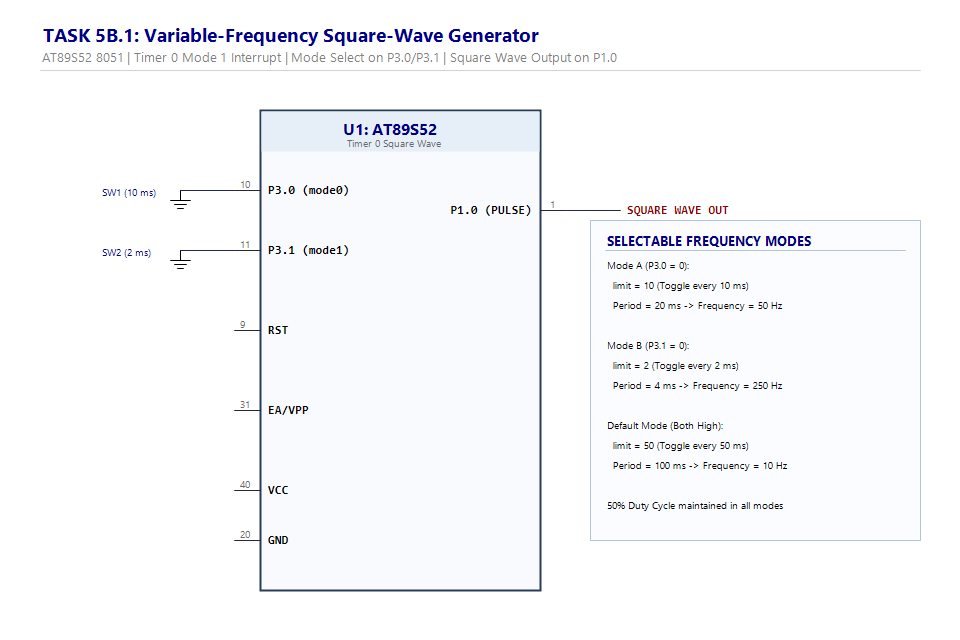

# EXPERIMENT DETAILS

* **Course Code & Title:** 25CS2741 – Fundamentals of Internet of Things Laboratory
* **Experiment Identifier:** CAT 5 (Continuous Assessment 5)
* **Date of Evaluation:** 10/08/2026
* **Student Name:** Venkataprabu V
* **Registration Number:** 25011102114
* **Hardware Platform:** 8051 Microcontroller (AT89S52) + Keil µVision IDE

---

## TASK 5B.1: Variable-Frequency Square-Wave Generation using Timer 0

### 1. Experiment Name and Aim
* **Experiment Title:** Hardware Timer Waveform Generation – Selectable Frequency Square Wave
* **Aim:** To configure Timer 0 of the AT89S52 microcontroller in 16-bit Mode 1 to generate a periodic interrupt tick, and utilize digital input lines on Port 3 Pins 0 and 1 (`P3.0`, `P3.1`) to dynamically alter the toggle threshold of an output pin (`P1.0`), producing square waves across multiple selectable output frequencies ($50\text{ Hz}$, $250\text{ Hz}$, and $10\text{ Hz}$).

### 2. Components / Tools Required
| Component / Tool | Value / Part Number | Quantity | Description |
|---|---|---|---|
| Microcontroller | AT89S52 (40-pin DIP) | 1 | Hardware timer processing unit |
| Mode Select Switches | SPST Miniature Slide / Tactile Switches | 2 | Frequency mode selection inputs |
| Resistors | 10 kΩ pull-up resistors | 2 | Input line pull-up stabilization |
| Quartz Crystal | 11.0592 MHz | 1 | Clock generation |
| Ceramic Capacitors | 33 pF | 2 | Oscillator frequency trim |
| Reset Circuit | 10 µF electrolytic + 10 kΩ resistor | 1 each | Clean power-on reset differentiator |
| DC Power Supply | +5.0 V DC supply | 1 | System operating rail |
| Measurement Tool | Digital Storage Oscilloscope (DSO) / Logic Analyzer | 1 | Frequency and waveform verification |
| Development Software | Keil µVision (C51 Compiler v9.60) | 1 | Code development and compilation |

### 3. Hardware Setup
* **Microcontroller Operating Conditions:** AT89S52 running at 11.0592 MHz ($1.0851\ \mu\text{s}$ machine cycle).
* **Timer Configuration:** Timer 0 operating in 16-bit Mode 1 (`TMOD = 0x01`). Re-loaded on every interrupt with `TH0 = 0xFC; TL0 = 0x66;`, yielding an exact $1.0\text{ ms}$ interrupt period.
* **Input Interfaces:**
  * `P3.0` (Pin 10): Frequency selector line `mode0`. Grounding this pin asserts Mode 0.
  * `P3.1` (Pin 11): Frequency selector line `mode1`. Grounding this pin asserts Mode 1.
* **Output Signal:**
  * `P1.0` (Pin 1): Digital output pin `pulse` emitting the variable-frequency 50% duty-cycle square wave.

### 4. Circuit Diagram
The schematic diagram below illustrates the AT89S52 microcontroller with the dual mode select switches on Port 3 and the output square wave probe on `P1.0`:

### 5. Pseudocode and Code Logic

#### Step-by-Step Program Walkthrough
1. **Header Inclusion & Variable Declarations:**
   * Include `<reg51.h>`.
   * Input aliases: `sbit mode0 = P3^0;`, `sbit mode1 = P3^1;`.
   * Output alias: `sbit pulse = P1^0;`.
   * Counter variables: `unsigned int ticks = 0;`, `unsigned int limit = 100;`.
2. **Timer 0 Interrupt Service Routine (`timer0`):**
   * Reload timer values: `TH0 = 0xFC; TL0 = 0x66;` (1 ms tick).
   * Increment `ticks++`.
   * If `ticks >= limit`:
     * Reset `ticks = 0;`.
     * Invert output line: `pulse = !pulse;`.
     * Because the pin inverts state every `limit` ticks, the full waveform period equals $T = 2 \times \text{limit} \times 1\text{ ms}$.
3. **Main Control Loop (`main`):**
   * Configure Timer 0: `TMOD = 0x01; TH0 = 0xFC; TL0 = 0x66;`.
   * Enable interrupts: `ET0 = 1; EA = 1; TR0 = 1;`.
   * In the infinite `while(1)` loop, dynamically poll `mode0` and `mode1`:
     * If `mode0 == 0`: set `limit = 10`. Half-period = 10 ms $\rightarrow$ Period = 20 ms $\rightarrow$ **Frequency = 50 Hz**.
     * Else if `mode1 == 0`: set `limit = 2`. Half-period = 2 ms $\rightarrow$ Period = 4 ms $\rightarrow$ **Frequency = 250 Hz**.
     * Else (both unasserted): set `limit = 50`. Half-period = 50 ms $\rightarrow$ Period = 100 ms $\rightarrow$ **Frequency = 10 Hz**.

### 6. Procedure
1. Open Keil µVision IDE and open `TaskSource.uvproj` in `8051/CAT5/TASK5B/TASK5B.1`.
2. Verify project settings: Target device `AT89S52`, clock `11.0592 MHz`, and output hex configured as `Objects/lab-4.hex`.
3. Compile via **Project $\rightarrow$ Rebuild all target files** (`F7`) and confirm `0 Error(s), 0 Warning(s)`.
4. Load the compiled hex file into the AT89S52 target board or launch the Keil Logic Analyzer to probe `P1.0`.

### 7. Expected Output and Inference
* **Default State (`mode0=1, mode1=1`):** Output `P1.0` produces a 10 Hz square wave ($100\text{ ms}$ period, 50 ms HIGH / 50 ms LOW).
* **Switch 1 Activated (`mode0=0`):** Frequency shifts immediately to 50 Hz ($20\text{ ms}$ period, 10 ms HIGH / 10 ms LOW).
* **Switch 2 Activated (`mode1=0`):** Frequency shifts to 250 Hz ($4\text{ ms}$ period, 2 ms HIGH / 2 ms LOW) [CONFIRM ON BOARD/SIMULATION].
* **Inference:**
  * Modulating the toggle count threshold within an ISR allows dynamic multi-frequency generation with strict 50% duty cycles.
  * Real-time polling in the main loop seamlessly alters ISR behavior without interrupting clock phase continuity.

### 8. Conclusion
The variable-frequency square-wave generator was implemented and validated using AT89S52 Timer 0. The system reliably produces precisely timed waveforms across multiple selectable frequencies under user control.
