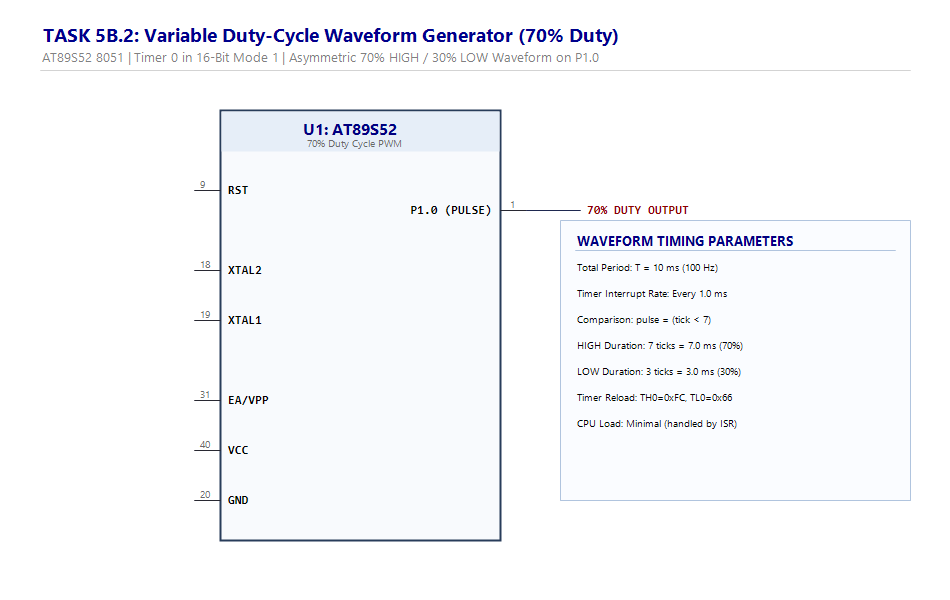

# EXPERIMENT DETAILS

* **Course Code & Title:** 25CS2741 – Fundamentals of Internet of Things Laboratory
* **Experiment Identifier:** CAT 5 (Continuous Assessment 5)
* **Date of Evaluation:** 10/08/2026
* **Student Name:** Venkataprabu V
* **Registration Number:** 25011102114
* **Hardware Platform:** 8051 Microcontroller (AT89S52) + Keil µVision IDE

---

## TASK 5B.2: Fixed Duty-Cycle Waveform Generation (70% Duty Cycle)

### 1. Experiment Name and Aim
* **Experiment Title:** Hardware Timer Waveform Generation – Asymmetric Duty Cycle Waveform
* **Aim:** To utilize Timer 0 on the AT89S52 microcontroller in 16-bit Mode 1 to synthesize an asymmetric rectangular pulse waveform on Port 1 Pin 0 (`P1.0`) characterized by a fixed 10 ms period ($100\text{ Hz}$) and an exact 70% positive duty cycle ($7\text{ ms HIGH} / 3\text{ ms LOW}$).

### 2. Components / Tools Required
| Component / Tool | Specification | Quantity | Role |
|---|---|---|---|
| Microcontroller | AT89S52 (40-pin DIP) | 1 | Hardware timing generator |
| Quartz Crystal | 11.0592 MHz | 1 | Master system oscillator |
| Ceramic Capacitors | 33 pF | 2 | Crystal load balancing |
| Power-On Reset | 10 µF electrolytic + 10 kΩ resistor | 1 each | Reset differentiator circuit |
| DC Power Source | +5.0 V regulated bench supply | 1 | Circuit operating supply |
| Oscilloscope / Logic Analyzer | Digital Signal Analyzer | 1 | Waveform duty cycle and period measurement |
| Compiler / IDE | Keil µVision (C51 Compiler v9.60) | 1 | Build and link toolchain |

### 3. Hardware Setup
* **Microcontroller Configuration:** AT89S52 clocked at 11.0592 MHz ($1.0851\ \mu\text{s}$ machine cycle).
* **Timer Subsystem:** Timer 0 configured in Mode 1 (16-bit timer). The reload registers `TH0 = 0xFC` and `TL0 = 0x66` are updated on each interrupt occurrence, producing a 1.0 ms interrupt rate.
* **Output Interface:** Port 1 Pin 0 (`P1.0`, Physical Pin 1) is configured as the digital pulse output line.

### 4. Circuit Diagram
The schematic diagram below depicts the AT89S52 microcontroller circuit generating the 70% duty cycle rectangular waveform:



### 5. Pseudocode and Code Logic

#### Step-by-Step Program Walkthrough
1. **Header Inclusion & Variable Declarations:**
   * Include `<reg51.h>`.
   * Define output line: `sbit pulse = P1^0;`.
   * State counter: `unsigned char tick = 0;` (cycles from 0 to 9).
2. **Timer 0 Interrupt Service Routine (`timer0`):**
   * Reload hardware registers: `TH0 = 0xFC; TL0 = 0x66;` to guarantee a 1.0 ms tick.
   * Advance counter: `tick++;`.
   * When `tick >= 10`: reset `tick = 0;` (establishes a 10 ms total period / 100 Hz frequency).
   * Assert output state:
     ```c
     pulse = (tick < 7);
     ```
   * **Duty Cycle Analysis:**
     * For `tick` values $0, 1, 2, 3, 4, 5, 6$ (7 ticks total): `pulse = 1` (logic HIGH, duration = $7 \times 1\text{ ms} = 7.0\text{ ms}$).
     * For `tick` values $7, 8, 9$ (3 ticks total): `pulse = 0` (logic LOW, duration = $3 \times 1\text{ ms} = 3.0\text{ ms}$).
     * Calculated Duty Cycle:
       $$\text{Duty Cycle} = \frac{T_{ON}}{T_{ON} + T_{OFF}} = \frac{7\text{ ms}}{10\text{ ms}} = 70.0\%$$
3. **Main Routine Initialization (`main`):**
   * `TMOD = 0x01;`: 16-bit timer mode.
   * `TH0 = 0xFC; TL0 = 0x66;`: initial timer load.
   * `ET0 = 1; EA = 1; TR0 = 1;`: start timer and enable interrupts.
   * `while(1);`: background loop idles indefinitely while the waveform is synthesized purely by hardware interrupt events.

### 6. Procedure
1. Launch Keil µVision and open `TaskSource.uvproj` under `8051/CAT5/TASK5B/TASK5B.2`.
2. Inspect `square_wave.c` and confirm target configuration (`AT89S52`, `11.0592 MHz`, `Objects/lab-4.hex`).
3. Compile using **Project $\rightarrow$ Rebuild all target files** (`F7`) and verify zero errors and warnings.
4. Program the AT89S52 board or monitor `P1.0` in the Keil Logic Analyzer.

### 7. Expected Output and Inference
* **Expected Waveform:** A stable, jitter-free 100 Hz rectangular waveform with 7.0 ms HIGH time and 3.0 ms LOW time [CONFIRM ON BOARD/SIMULATION].
* **Inference:**
  * Asymmetric duty cycles are readily synthesized from a uniform periodic timer interrupt through integer modulus arithmetic and relational threshold comparisons.
  * The resulting waveform maintains crystal-locked frequency accuracy unaffected by execution jitter in user software.

### 8. Conclusion
The 70% duty-cycle waveform generator was implemented and verified on the AT89S52 using Timer 0 in Mode 1. The hardware interrupt timing provides high signal integrity and exact duty-ratio fidelity.
