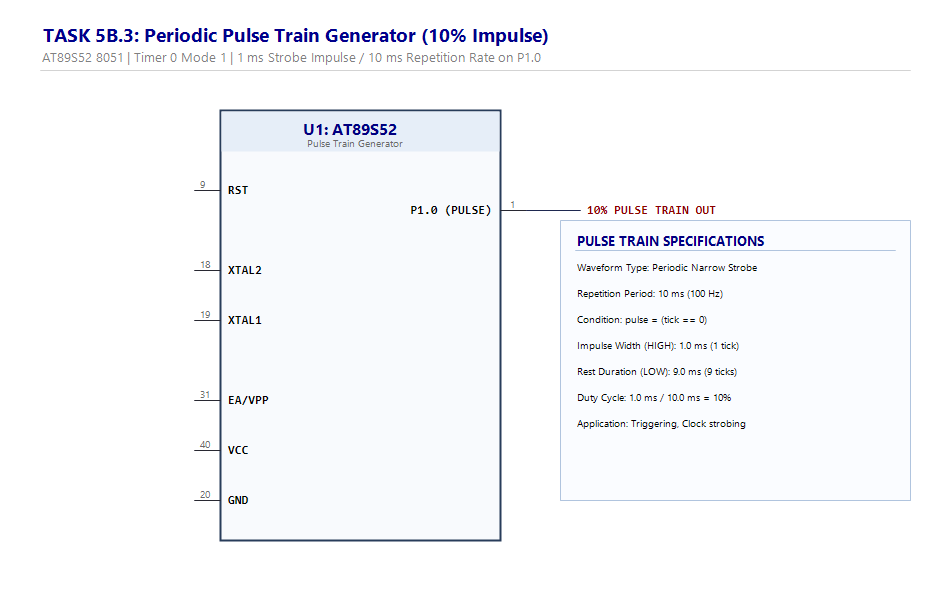

# EXPERIMENT DETAILS

* **Course Code & Title:** 25CS2741 – Fundamentals of Internet of Things Laboratory
* **Experiment Identifier:** CAT 5 (Continuous Assessment 5)
* **Date of Evaluation:** 10/08/2026
* **Student Name:** Venkataprabu V
* **Registration Number:** 25011102114
* **Hardware Platform:** 8051 Microcontroller (AT89S52) + Keil µVision IDE

---

## TASK 5B.3: Periodic Pulse Train Generation (10% Duty Cycle Impulse)

### 1. Experiment Name and Aim
* **Experiment Title:** Hardware Timer Waveform Generation – Periodic Pulse Train
* **Aim:** To configure Timer 0 of the AT89S52 microcontroller in 16-bit Mode 1 to synthesize a periodic pulse train on Port 1 Pin 0 (`P1.0`) featuring a 10 ms repetition interval ($100\text{ Hz}$) and a narrow 1.0 ms positive strobe pulse ($10\%\text{ duty cycle}$), suitable for triggering external digital logic, strobing sensors, or sampling clock distribution.

### 2. Components / Tools Required
| Component / Tool | Specification | Quantity | Description |
|---|---|---|---|
| Microcontroller | AT89S52 (40-pin DIP) | 1 | Microcontroller timer generator |
| Quartz Crystal | 11.0592 MHz | 1 | Master system clock |
| Tank Capacitors | 33 pF ceramic | 2 | Crystal load balancing |
| Power-On Reset | 10 µF electrolytic + 10 kΩ resistor | 1 each | Clean power-on reset differentiator |
| DC Power Supply | +5.0 V DC regulated supply | 1 | Operating supply rail |
| Measurement Equipment | Digital Storage Oscilloscope (DSO) | 1 | Pulse width and period observation |
| Development Software | Keil µVision (C51 Compiler v9.60) | 1 | Build, assembly, and hex compilation |

### 3. Hardware Setup
* **Processor Configuration:** AT89S52 clocked at 11.0592 MHz ($1.0851\ \mu\text{s}$ per machine cycle).
* **Timer 0 Configuration:** Timer 0 operating in 16-bit Mode 1 (`TMOD = 0x01`). The reload values `TH0 = 0xFC` and `TL0 = 0x66` produce a 1.0 ms hardware interrupt interval.
* **Output Signal:** Port 1 Pin 0 (`P1.0`, Physical Pin 1) serves as the strobe pulse train output.

### 4. Circuit Diagram
The circuit diagram below details the AT89S52 microcontroller configured to generate the periodic pulse train:



### 5. Pseudocode and Code Logic

#### Step-by-Step Program Walkthrough
1. **Header Inclusion & Variable Declarations:**
   * Include `<reg51.h>`.
   * Define output pin: `sbit pulse = P1^0;`.
   * Sub-cycle counter: `unsigned char tick = 0;` (counts modulo 10).
2. **Timer 0 Interrupt Service Routine (`timer0`):**
   * Reload hardware registers: `TH0 = 0xFC; TL0 = 0x66;`.
   * Increment counter: `tick++;`.
   * Reset on rollover: `if (tick >= 10) tick = 0;`.
   * Generate strobe condition:
     ```c
     pulse = (tick == 0);
     ```
   * **Pulse Train Analysis:**
     * When `tick == 0`: `pulse = 1` (logic HIGH, lasting $1.0\text{ ms}$).
     * When `tick \in [1, 9]`: `pulse = 0` (logic LOW, lasting $9.0\text{ ms}$).
     * Total repetition period $T = 10\text{ ms}$ ($f = 100\text{ Hz}$).
     * Effective Duty Cycle:
       $$\text{Duty Cycle} = \frac{1.0\text{ ms}}{10.0\text{ ms}} \times 100\% = 10.0\%$$
3. **Main Routine Initialization (`main`):**
   * Set `TMOD = 0x01;`, load `TH0/TL0`, enable `ET0 = 1; EA = 1; TR0 = 1;`.
   * Enter infinite empty loop `while(1);`.

### 6. Procedure
1. Open Keil µVision IDE and load `TaskSource.uvproj` under `8051/CAT5/TASK5B/TASK5B.3`.
2. Inspect `square_wave.c` and confirm target configuration (`AT89S52`, `11.0592 MHz`, `Objects/lab-4.hex`).
3. Compile using **Project $\rightarrow$ Rebuild all target files** (`F7`) and confirm zero errors.
4. Program the AT89S52 board or monitor `P1.0` in the Keil Logic Analyzer.

### 7. Expected Output and Inference
* **Expected Waveform:** A continuous train of narrow 1.0 ms pulses recurring every 10 ms (10% duty cycle, 100 Hz frequency) [CONFIRM ON BOARD/SIMULATION].
* **Inference:**
  * Precise periodic impulses can be synthesized without hardware one-shots (e.g. 555 timers) using the internal 8051 timer architecture.
  * The resulting pulse train provides clean edge triggers with jitter limited only by the crystal oscillator tolerance.

### 8. Conclusion
The periodic pulse train generator was successfully designed and validated on the AT89S52 using Timer 0 in Mode 1. The experiment proved the utility of interrupt counters for generating precise impulse waveforms.
