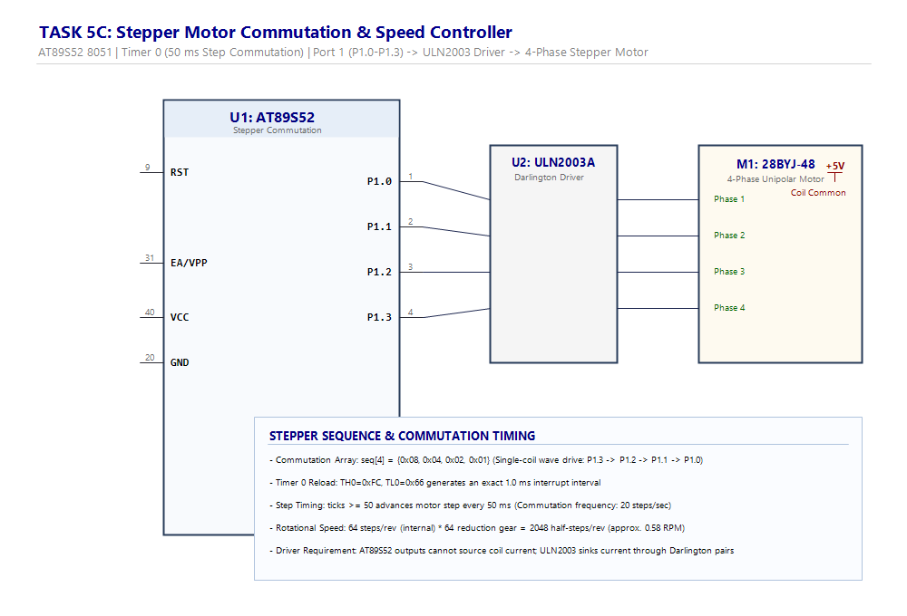

# EXPERIMENT DETAILS

* **Course Code & Title:** 25CS2741 – Fundamentals of Internet of Things Laboratory
* **Experiment Identifier:** CAT 5 (Continuous Assessment 5)
* **Date of Evaluation:** 10/08/2026
* **Student Name:** Venkataprabu V
* **Registration Number:** 25011102114
* **Hardware Platform:** 8051 Microcontroller (AT89S52) + Keil µVision IDE

---

## TASK 5C: Stepper Motor Speed and Commutation Controller using Hardware Timer 0

### 1. Experiment Name and Aim
* **Experiment Title:** Hardware Timer and Interrupt-Based Timing for Stepper Motor Control
* **Aim:** To implement a non-blocking 4-phase unipolar stepper motor commutation controller on the AT89S52 microcontroller using Timer 0 in 16-bit Mode 1, generating an accurate 50 ms step commutation interval to drive a ULN2003 Darlington transistor array connected to Port 1 Pins 0 through 3 (`P1.0`–`P1.3`).

### 2. Components / Tools Required
| Component / Tool | Specification | Quantity | Role in Circuit |
|---|---|---|---|
| Microcontroller | AT89S52 (40-pin DIP) | 1 | Master control and timer unit |
| Stepper Motor Driver | ULN2003A Darlington Transistor Array | 1 | Inductive high-current sinking driver |
| Stepper Motor | 28BYJ-48 4-Phase 5-Wire Unipolar Stepper Motor | 1 | Mechanical rotational actuator |
| Power Supply | +5.0 V DC (1A minimum for motor coils) | 1 | Motor and microcontroller power source |
| Quartz Crystal | 11.0592 MHz | 1 | Microcontroller clock source |
| Tank Capacitors | 33 pF ceramic | 2 | Crystal oscillator load balancing |
| Reset Circuit | 10 µF capacitor + 10 kΩ resistor | 1 each | Power-on reset differentiator |
| Development Software | Keil µVision (C51 Compiler v9.60) | 1 | Embedded C build and compilation toolchain |

### 3. Hardware Setup
* **Microcontroller Configuration:** AT89S52 clocked at 11.0592 MHz ($1.0851\ \mu\text{s}$ machine cycle).
* **Timer Subsystem:** Timer 0 operating in 16-bit Mode 1 (`TMOD = 0x01`). Re-loaded with `TH0 = 0xFC; TL0 = 0x66;` to generate a 1.0 ms interrupt rate.
* **Driver & Motor Interconnections:**
  * **Motor Power:** Connect the red wire (common center tap of 28BYJ-48) to $+5\text{V}$ DC power supply.
  * **Driver Inputs (ULN2003):** Connect `P1.0`, `P1.1`, `P1.2`, and `P1.3` to inputs `1B`, `2B`, `3B`, and `4B` of the ULN2003A driver IC.
  * **Driver Outputs (ULN2003):** Connect outputs `1C`, `2C`, `3C`, and `4C` to the four stator phase coils of the stepper motor (Blue, Pink, Yellow, Orange wires).
  * **Common Ground:** Connect ULN2003 Pin 8 (GND) to the microcontroller system ground. Connect ULN2003 Pin 9 (COM) to $+5\text{V}$ to engage internal inductive flyback suppression diodes.

### 4. Circuit Diagram
The circuit diagram below illustrates the AT89S52 microcontroller interfacing with the ULN2003A Darlington array and the 4-phase unipolar stepper motor:



### 5. Pseudocode and Code Logic

#### Step-by-Step Program Walkthrough
1. **Header Inclusion & Array Initialization:**
   * Include `<reg51.h>`.
   * State variables: `unsigned char step = 0;`, `unsigned int ticks = 0;`.
   * Commutation array defining single-coil wave-drive sequence:
     ```c
     unsigned char seq[4] = {0x08, 0x04, 0x02, 0x01};
     ```
     * `0x08` (binary `00001000b`): Energizes Phase 4 (`P1.3`).
     * `0x04` (binary `00000100b`): Energizes Phase 3 (`P1.2`).
     * `0x02` (binary `00000010b`): Energizes Phase 2 (`P1.1`).
     * `0x01` (binary `00000001b`): Energizes Phase 1 (`P1.0`).
2. **Timer 0 Interrupt Service Routine (`timer0`):**
   * Reload hardware registers: `TH0 = 0xFC; TL0 = 0x66;` (1 ms tick).
   * Accumulate timing ticks: `ticks++;`.
   * **Commutation Interval:**
     * When `ticks >= 50` (precisely 50 ms / 20 steps per second):
       * Reset accumulator: `ticks = 0;`.
       * Output active step byte: `P1 = seq[step];`.
       * Advance sequence pointer: `step = (step + 1) & 3;` (modulo 4 wrap-around).
3. **Main Routine Initialization (`main`):**
   * Configure Timer 0 in 16-bit Mode 1: `TMOD = 0x01;`.
   * Load initial reload values: `TH0 = 0xFC; TL0 = 0x66;`.
   * Enable interrupts: `ET0 = 1; EA = 1; TR0 = 1;`.
   * Enter background super-loop: `while(1);`. The CPU remains idle while motor stepping executes strictly from the timer ISR.

### 6. Procedure
1. Open Keil µVision IDE and open `TaskSource.uvproj` under `8051/CAT5/TASK5C`.
2. Inspect `stepper.c` and confirm target configuration (`AT89S52`, `11.0592 MHz`, `Objects/lab-4.hex`).
3. Compile using **Project $\rightarrow$ Rebuild all target files** (`F7`) and confirm zero errors.
4. Program the AT89S52 board and connect the ULN2003 driver module to Port 1 and the 5V power supply.

### 7. Expected Output and Inference
* **Expected Mechanical Movement:** The 28BYJ-48 stepper motor shaft rotates smoothly in a fixed direction at a constant velocity without stalling or excessive vibration [CONFIRM ON BOARD/SIMULATION].
* **Speed Calculation:**
  $$\text{Step Frequency} = \frac{1}{50\text{ ms}} = 20\text{ steps/sec}$$
  For a 28BYJ-48 unipolar motor with a 1:64 reduction gearbox ($64 \times 64 = 4096$ full steps per output revolution in wave drive), the output shaft rotational speed evaluates to:
  $$\text{RPM} = \frac{20\text{ steps/sec} \times 60\text{ sec/min}}{4096\text{ steps/rev}} \approx 0.29\text{ RPM}$$
* **Inference:**
  * Direct port-byte writes (`P1 = seq[step]`) ensure synchronous coil switching, preventing intermediate multi-coil states that cause magnetic locking.
  * Using a dedicated Darlington sink driver (ULN2003) is essential because 8051 port pins cannot sink the $100\text{ mA} - 200\text{ mA}$ inductive currents required by motor stator windings.

### 8. Conclusion
The Timer 0-driven stepper motor commutation system was successfully implemented. The experiment demonstrated precise interrupt-based motor speed control and proper inductive load driving on the AT89S52 microcontroller.
