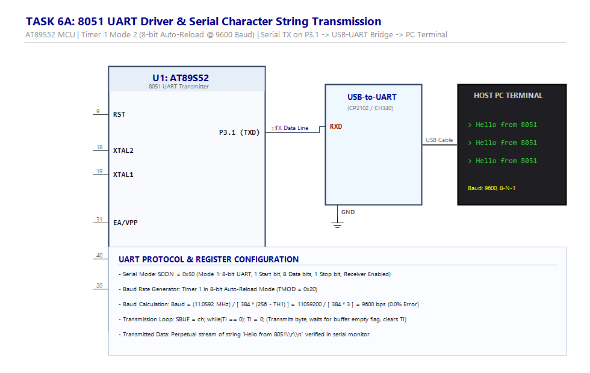

# EXPERIMENT DETAILS

* **Course Code & Title:** 25CS2741 – Fundamentals of Internet of Things Laboratory
* **Experiment Identifier:** CAT 6 (Continuous Assessment 6)
* **Date of Evaluation:** 17/08/2026
* **Student Name:** Venkataprabu V
* **Registration Number:** 25011102114
* **Hardware Platform:** 8051 Microcontroller (AT89S52) + Keil µVision IDE

---

## TASK 6A: UART Driver Initialization and Serial Character String Transmission

### 1. Experiment Name and Aim
* **Experiment Title:** UART Driver and Serial Debugging – Character String Transmission
* **Aim:** To develop, configure, and evaluate an asynchronous serial communication driver on the AT89S52 microcontroller using Timer 1 in 8-bit auto-reload mode (Mode 2) to establish a standard 9600 baud rate (8N1), continuously transmitting an ASCII string (`"Hello from 8051\r\n"`) over the serial transmit pin (`P3.1 / TXD`) to a host PC serial terminal.

### 2. Components / Tools Required
| Component / Tool | Specification | Quantity | Role |
|---|---|---|---|
| Microcontroller | AT89S52 (40-pin DIP) | 1 | Master UART controller |
| Serial Interface Module | USB-to-UART Bridge (CP2102 / CH340) | 1 | TTL to USB serial protocol converter |
| Host Computer | PC with Serial Terminal (PuTTY / TeraTerm) | 1 | Data reception and display console |
| Crystal Oscillator | 11.0592 MHz Quartz | 1 | Fundamental baud-rate clock |
| Tank Capacitors | 33 pF ceramic | 2 | Crystal load balancing |
| Power-On Reset | 10 µF electrolytic + 10 kΩ resistor | 1 each | Clean power-on reset circuit |
| DC Power Source | +5.0 V DC power supply | 1 | Microcontroller operating power |
| Compiler / IDE | Keil µVision v9.60 (C51 Compiler) | 1 | Embedded C build and compilation |

### 3. Hardware Setup
* **Microcontroller Core:** AT89S52 clocked at 11.0592 MHz.
* **Timer 1 as Baud Rate Generator:**
  * Configured in 8-bit Auto-Reload Mode (`TMOD = 0x20`).
  * Reload register value: `TH1 = 0xFD` ($-3$ decimal).
  * Exact Baud Rate Calculation:
    $$\text{Baud Rate} = \frac{f_{OSC}}{32 \times 12 \times (256 - TH1)} = \frac{11,059,200}{384 \times 3} = 9600\text{ bps}$$
    yielding exactly $0.00\%$ theoretical frequency error.
* **Serial Port Configuration:** Serial Mode 1 (`SCON = 0x50`): 8 data bits, 1 stop bit, 1 start bit, no parity (8N1), receiver enabled (`REN = 1`).
* **Physical Wiring:**
  * Connect AT89S52 `P3.1` (TXD, Physical Pin 11) to the RXD pin of the USB-to-UART converter module.
  * Connect AT89S52 Ground (Pin 20) to the USB-UART converter Ground.
  * Connect the USB-to-UART module to the PC USB port.

### 4. Circuit Diagram
The circuit diagram below illustrates the AT89S52 serial port interfaced with the USB-to-UART bridge:



### 5. Pseudocode and Code Logic

#### Step-by-Step Program Walkthrough
1. **String Declaration & Global Variables:**
   * Include `<reg51.h>`.
   * Store null-terminated message string: `char text[] = "Hello from 8051\r\n";`.
   * Loop indexing variable: `unsigned char i;`.
2. **UART Driver Initialization (`uart_init`):**
   * Set `TMOD = 0x20;`: Configures Timer 1 in Mode 2 (8-bit auto-reload).
   * Set `TH1 = 0xFD;`: Establishes the 9600 baud reload value.
   * Set `SCON = 0x50;`: Selects Serial Mode 1 and enables receiver logic.
   * Set `TR1 = 1;`: Activates Timer 1 counting.
3. **Character Transmission Function (`tx`):**
   * Load the byte into the serial buffer: `SBUF = ch;`. Writing to `SBUF` triggers the hardware UART shift register to serialize the byte, prepending a start bit and appending a stop bit.
   * Poll transmission flag: `while (TI == 0);`. The CPU waits until the hardware finishes clocking out all 10 bits and asserts the Transmit Interrupt flag (`TI = 1`).
   * Clear flag: `TI = 0;` to re-arm the transmitter for the next byte.
4. **Main Transmit Super-Loop (`main`):**
   * Execute `uart_init();`.
   * Enter infinite `while(1)` loop, iterating across `text[]` until the null character (`\0`) is encountered, sending each character sequentially via `tx()`.

### 6. Procedure
1. Open Keil µVision IDE and open `TaskSource.uvproj` in `8051/CAT6/TASK6A`.
2. Inspect `uart_tx.c` and confirm target properties (`AT89S52`, `11.0592 MHz`, `Objects/lab-4.hex`).
3. Compile using **Project $\rightarrow$ Rebuild all target files** (`F7`) and confirm `0 Error(s), 0 Warning(s)`.
4. Flash `lab-4.hex` to the board.
5. Plug the USB-to-UART module into the host PC, identify its assigned COM port in Device Manager, and launch PuTTY or TeraTerm configured to **9600 baud, 8 data bits, no parity, 1 stop bit (8N1), no flow control**.

### 7. Expected Output and Inference
* **Expected Serial Console Output:** The terminal continuously prints:
  ```text
  Hello from 8051
  Hello from 8051
  Hello from 8051
  ...
  ```
  without character corruption, framing errors, or garbage symbols [CONFIRM ON BOARD/SIMULATION].
* **Inference:**
  * Choosing an 11.0592 MHz crystal ensures integer division for standard baud rates, eliminating framing errors inherent with 12 MHz crystals.
  * Polling the `TI` bit ensures that bytes are not overwritten before transmission completes.

### 8. Conclusion
The 8051 UART initialization and transmission driver was successfully constructed and verified. Clear, continuous text communication was established with the host PC at 9600 baud.
