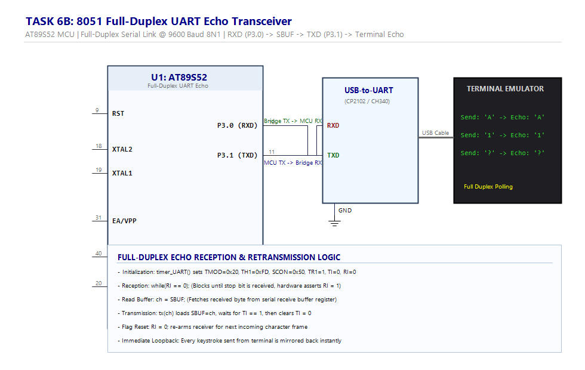

# EXPERIMENT DETAILS

* **Course Code & Title:** 25CS2741 – Fundamentals of Internet of Things Laboratory
* **Experiment Identifier:** CAT 6 (Continuous Assessment 6)
* **Date of Evaluation:** 17/08/2026
* **Student Name:** Venkataprabu V
* **Registration Number:** 25011102114
* **Hardware Platform:** 8051 Microcontroller (AT89S52) + Keil µVision IDE

---

## TASK 6B: Full-Duplex UART Character Reception and Echo Loopback

### 1. Experiment Name and Aim
* **Experiment Title:** UART Driver and Serial Debugging – Full-Duplex Echo Transceiver
* **Aim:** To implement a full-duplex UART echo transceiver on the AT89S52 microcontroller that monitors the Serial Receive Interrupt flag (`RI`), buffers incoming ASCII characters from the receive register (`SBUF`) via Pin `P3.0` (`RXD`), and immediately retransmits each received character back across Pin `P3.1` (`TXD`) to the host computer at 9600 baud (8N1).

### 2. Components / Tools Required
| Component / Tool | Specification | Quantity | Purpose |
|---|---|---|---|
| Microcontroller | AT89S52 (40-pin DIP) | 1 | Master UART controller |
| Serial Converter | USB-to-UART Module (CP2102 / CH340) | 1 | Full-duplex TTL/USB bridge |
| Host Machine | PC with Terminal Emulator (PuTTY / TeraTerm) | 1 | Interactive serial console |
| Quartz Crystal | 11.0592 MHz | 1 | Exact baud rate crystal |
| Load Capacitors | 33 pF ceramic | 2 | Crystal oscillator load balancing |
| Power-On Reset | 10 µF electrolytic + 10 kΩ resistor | 1 each | Clean reset circuit |
| DC Power Supply | +5.0 V regulated supply | 1 | System power rail |
| Compiler / IDE | Keil µVision (C51 Compiler v9.60) | 1 | Embedded C build environment |

### 3. Hardware Setup
* **Processor Configuration:** AT89S52 operating on an 11.0592 MHz fundamental quartz crystal.
* **Baud Rate Generation:** Timer 1 in Mode 2 (8-bit auto-reload, `TMOD = 0x20`), loaded with `TH1 = 0xFD` for an exact 9600 baud clock.
* **Serial Protocol:** 8-bit UART Mode 1 (`SCON = 0x50`): 1 Start bit, 8 Data bits, 1 Stop bit, No parity (8N1), Receiver Enabled (`REN = 1`).
* **Physical Connections:**
  * Connect AT89S52 `P3.1` (TXD, Pin 11) $\rightarrow$ USB-to-UART module **RXD** pin.
  * Connect AT89S52 `P3.0` (RXD, Pin 10) $\rightarrow$ USB-to-UART module **TXD** pin.
  * Connect AT89S52 GND (Pin 20) $\rightarrow$ USB-to-UART module **GND** pin.

### 4. Circuit Diagram
The circuit diagram below details the bidirectional full-duplex communication interconnects between the AT89S52 microcontroller and the serial converter:

### 5. Pseudocode and Code Logic

#### Step-by-Step Program Walkthrough
1. **Header Inclusion & Variable Definitions:**
   * Include `<reg51.h>`.
   * Declare character buffer: `char ch;`.
2. **UART Subsystem Initialization (`timer_UART`):**
   * `TMOD = 0x20;`: Configures Timer 1 as an 8-bit auto-reload timer.
   * `TH1 = 0xFD;`: Sets reload value for 9600 baud.
   * `SCON = 0x50;`: Selects Serial Mode 1 and enables receiver circuitry (`REN = 1`).
   * `TR1 = 1;`: Starts Timer 1.
   * Explicitly clear interrupt flags: `TI = 0; RI = 0;`.
3. **Character Transmitter Function (`tx`):**
   * Load data byte: `SBUF = ch;`.
   * Wait until transmission finishes: `while (TI == 0);`.
   * Reset flag: `TI = 0;`.
4. **Main Reception & Echo Super-Loop (`main`):**
   * Invoke `timer_UART();`.
   * Enter infinite `while(1)` loop:
     * **Wait for Incoming Byte:** Poll `while (RI == 0);`. The CPU remains waiting until the hardware receiver detects the stop bit and sets `RI = 1`.
     * **Read Received Byte:** Retrieve the byte: `ch = SBUF;`.
     * **Echo Back:** Call `tx(ch);` to transmit the identical byte back over the TX line.
     * **Clear Flag:** Reset `RI = 0;` so the hardware receiver can capture subsequent incoming characters.

### 6. Procedure
1. Open Keil µVision IDE and open `lab-6.uvproj` under `8051/CAT6/TASK6B`.
2. Inspect `lab6.c` and confirm target configuration (`AT89S52`, `11.0592 MHz`, `Objects/lab-6.hex`).
3. Compile using **Project $\rightarrow$ Rebuild all target files** (`F7`) and confirm zero errors.
4. Program `lab-6.hex` into the target microcontroller.
5. Launch a terminal emulator (PuTTY / TeraTerm) connected to the bridge COM port at 9600 baud (8N1).
6. Ensure local echo is disabled in terminal settings to verify that displayed text originates purely from the microcontroller loopback.

### 7. Expected Output and Inference
* **Interactive Terminal Observation:**
  * Typing any character (e.g. `'A'`, `'1'`, `'!'`) on the host keyboard immediately displays that character on the terminal screen.
  * If the serial cable is disconnected, typing produces no screen output, confirming genuine loopback [CONFIRM ON BOARD/SIMULATION].
* **Inference:**
  * The double-buffered receive register (`SBUF`) allows incoming characters to be received while the CPU reads the prior byte, preventing overrun if processed promptly.
  * Clearing `RI` in software is mandatory; failing to clear `RI` prevents detection of any subsequent serial frames.

### 8. Conclusion
The full-duplex UART echo program was successfully developed and evaluated. Real-time bidirectional communication between the AT89S52 microcontroller and a host computer was confirmed at 9600 baud.
