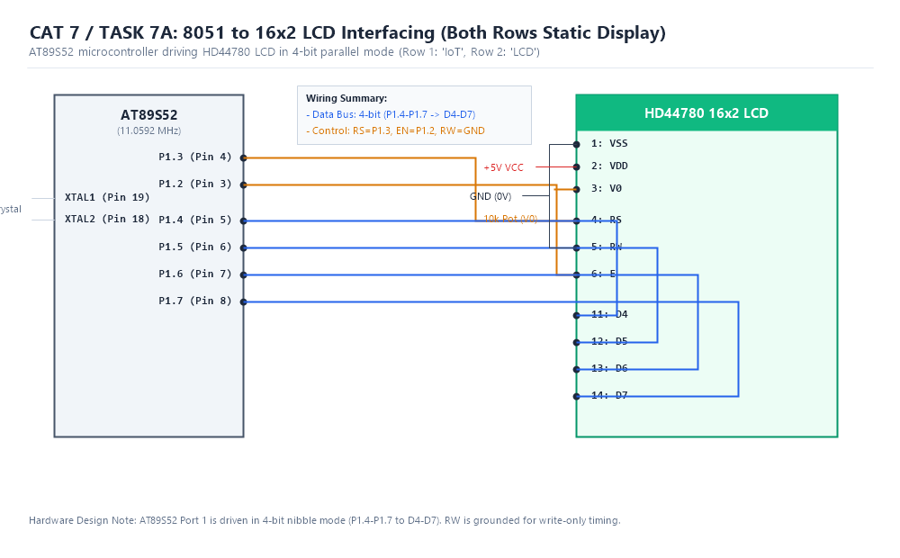

# Experiment 7A: 8051 to 16x2 LCD Interfacing (Dual-Row Character Display)

**Course:** Foundations of IoT (FIoT) Lab  
**Student Name:** Venkataprabu V  
**Registration Number:** 25011102114  
**Date:** 25/08/2026  

---

## 1. Experiment Name and Aim
- **Experiment Name:** 8051 Microcontroller 16x2 Alphanumeric LCD Interfacing in 4-Bit Mode
- **Aim:** To interface an industry-standard HD44780-compatible 16x2 character LCD with the AT89S52 microcontroller using a 4-bit parallel data bus, initialize the display controller, and simultaneously present static alphanumeric strings across both display rows ("IoT" on Line 1, "LCD" on Line 2).

---

## 2. Components / Tools Required
### Hardware Components
- AT89S52 Microcontroller Development Board (DIP-40)
- 16x2 Alphanumeric Character LCD Module (HD44780 / ST7066U driver)
- 11.0592 MHz Quartz Crystal Oscillator
- 2x 33 pF Ceramic Capacitors (Crystal load capacitors)
- 10 kΩ Potentiometer (Contrast adjustment for LCD pin V0)
- Breadboard and DuPont jumper wires
- Regulated +5V DC Power Supply

### Software / Tools
- Keil µVision IDE (C51 Compiler toolchain)
- USB ISP / SPI Programmer & GUI flashing utility (progisp / avrdude)
- Proteus VSM (Simulation environment)

---

## 3. Hardware Setup
### Pin Allocations
| AT89S52 Pin | Port Pin | Direction | LCD Pin | LCD Function |
|---|---|---|---|---|
| Pin 3 | P1.2 | Output | Pin 6 (E) | Enable Strobe (Active High pulse) |
| Pin 4 | P1.3 | Output | Pin 4 (RS) | Register Select (0 = Command, 1 = Data) |
| Pin 5 | P1.4 | Output | Pin 11 (D4) | LCD Data Bus Bit 4 |
| Pin 6 | P1.5 | Output | Pin 12 (D5) | LCD Data Bus Bit 5 |
| Pin 7 | P1.6 | Output | Pin 13 (D6) | LCD Data Bus Bit 6 |
| Pin 8 | P1.7 | Output | Pin 14 (D7) | LCD Data Bus Bit 7 |
| - | - | Reference | Pin 5 (RW) | Read/Write Select (Tied to GND for write) |
| - | - | Bias | Pin 3 (V0) | Contrast Voltage (Connected to 10k wiper) |
| - | - | Power | Pin 1 (VSS) | Ground reference (0V) |
| - | - | Power | Pin 2 (VDD) | Logic supply voltage (+5V) |

### Wiring Instructions
1. Connect LCD Pin 1 (VSS) to system ground (GND) and Pin 2 (VDD) to regulated +5V.
2. Wire the terminals of the 10 kΩ potentiometer between +5V and GND, connecting the central wiper contact to LCD Pin 3 (V0).
3. Connect LCD Pin 5 (RW) permanently to GND to enforce write-only bus timing.
4. Wire control lines: AT89S52 Pin 3 (P1.2) to LCD Pin 6 (EN), and AT89S52 Pin 4 (P1.3) to LCD Pin 4 (RS).
5. Wire data nibble lines: Connect P1.4 to D4, P1.5 to D5, P1.6 to D6, and P1.7 to D7. Unused lower data pins (D0-D3) on the LCD can be left floating or grounded.
6. Connect the 11.0592 MHz crystal across XTAL1 (Pin 19) and XTAL2 (Pin 18) with 33 pF capacitors to GND. Connect EA/VPP (Pin 31) to VCC.

---

## 4. Circuit Diagram


---

## 5. Pseudocode and Code Logic
### Operation Sequence
1. Define Special Function Register `ldata` at address `0x90` corresponding to 8051 Port 1.
2. Define bit registers `rs = P1^3` and `en = P1^2`.
3. Provide software delay loops to satisfy HD44780 command execution and enable pulse duration constraints.
4. Implement `write_byte(unsigned char v, bit dat)`:
   - Set `rs = dat` (0 for command register, 1 for data register).
   - Extract the upper nibble `(v & 0xF0)` and merge with Port 1 lower bits `(ldata & 0x0F)`.
   - Assert `en = 1`, wait, de-assert `en = 0` to latch upper 4 bits.
   - Shift the lower nibble left by 4 `((v << 4) & 0xF0)` and merge with `ldata`.
   - Assert `en = 1`, wait, de-assert `en = 0` to latch lower 4 bits.
5. In `main()`:
   - Issue 4-bit mode activation command: `0x20`.
   - Issue Function Set command: `0x28` (4-bit data length, 2 display lines, 5x8 dot matrix font).
   - Issue Display Control command: `0x0C` (Display ON, Cursor OFF, Cursor Blink OFF).
   - Issue Clear Display command: `0x01` (Clears DDRAM and resets cursor to address 0x00).
   - Set cursor to Line 1 starting DDRAM address: `0x80`.
   - Send characters `'I'`, `'o'`, `'T'` to the data register.
   - Set cursor to Line 2 starting DDRAM address: `0xC0`.
   - Send characters `'L'`, `'C'`, `'D'` to the data register.
   - Enter `while(1)` static hold loop.

### Pseudocode
```text
FUNCTION write_byte(val, is_data):
    rs <- is_data
    ldata <- (ldata AND 0x0F) OR (val AND 0xF0)
    en <- 1; DELAY(); en <- 0
    ldata <- (ldata AND 0x0F) OR ((val SHL 4) AND 0xF0)
    en <- 1; DELAY(); en <- 0
    DELAY()
END FUNCTION

MAIN:
    write_byte(0x20, 0)   // Enter 4-bit mode
    write_byte(0x28, 0)   // 2 lines, 5x8 matrix
    write_byte(0x0C, 0)   // Display ON, cursor OFF
    write_byte(0x01, 0)   // Clear display

    write_byte(0x80, 0)   // DDRAM address 0x00 (Line 1)
    write_byte('I', 1)
    write_byte('o', 1)
    write_byte('T', 1)

    write_byte(0xC0, 0)   // DDRAM address 0x40 (Line 2)
    write_byte('L', 1)
    write_byte('C', 1)
    write_byte('D', 1)

    WHILE TRUE DO
        IDLE
    END WHILE
```

---

## 6. Procedure
1. Launch Keil µVision and open project `TaskSource.uvproj` under directory `8051/CAT7/TASK7A/`.
2. Inspect target configuration under *Options for Target -> Target*: confirm Crystal frequency is set to 11.0592 MHz and Memory Model is Small.
3. Under *Options for Target -> Output*, ensure **Create HEX File** is checked.
4. Compile and link via **Project -> Rebuild all target files** (F7). Confirm 0 Errors, 0 Warnings.
5. In Proteus VSM or hardware testbench, load `Objects/lab-4.hex` into the AT89S52 microcontroller.
6. Power on the system and adjust the 10 kΩ potentiometer to achieve optimal contrast.

---

## 7. Expected Output / Inference
- Upon system reset, the LCD clears its internal buffer and initializes into 4-bit operational mode.
- Line 1 displays the string `"IoT"` beginning at column 1 (DDRAM address `0x80`).
- Line 2 displays the string `"LCD"` beginning at column 1 (DDRAM address `0xC0`).
- Contrast can be smoothly tuned using the potentiometer wiper. Characters remain static and crisp with no visible ghosting or flickering [CONFIRM ON BOARD/SIMULATION].

---

## 8. Conclusion
The experiment successfully verified interfacing a 16x2 alphanumeric LCD with the AT89S52 in 4-bit parallel mode. By dividing 8-bit command and character bytes into two sequential nibbles latching on the Enable line, pin usage on Port 1 was reduced to 6 lines while ensuring full compatibility with HD44780 timing standards.
