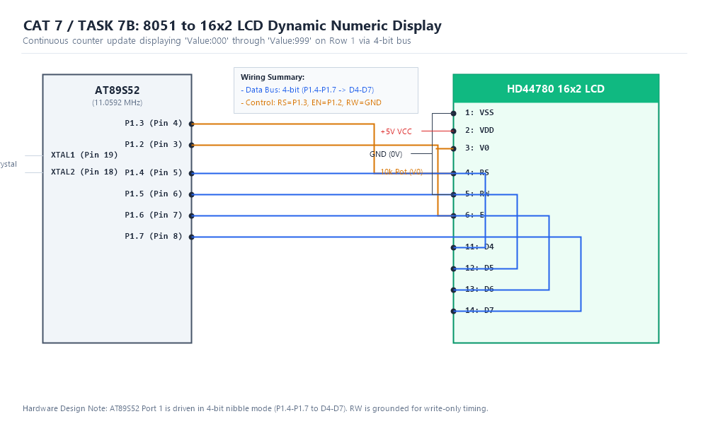

# Experiment 7B: 8051 to 16x2 LCD Dynamic Numeric Counter Display

**Course:** Foundations of IoT (FIoT) Lab  
**Student Name:** Venkataprabu V  
**Registration Number:** 25011102114  
**Date:** 25/08/2026  

---

## 1. Experiment Name and Aim
- **Experiment Name:** 8051 Dynamic Numerical Data Formatting and Refresh on 16x2 LCD
- **Aim:** To interface an AT89S52 microcontroller with a 16x2 LCD in 4-bit bus mode and continuously format, display, and increment a 3-digit decimal counter from `000` to `999` with automatic roll-over on display Line 1 ("Value:000").

---

## 2. Components / Tools Required
### Hardware Components
- AT89S52 Microcontroller Development Board
- 16x2 Character LCD Module (HD44780 controller)
- 11.0592 MHz Quartz Crystal with 2x 33 pF ceramic capacitors
- 10 kΩ Potentiometer (Contrast control)
- DuPont ribbon cables and breadboard
- +5V DC Regulated Power Source

### Software / Tools
- Keil µVision IDE (C51 Compiler)
- Universal Flash Programmer utility
- Proteus VSM Circuit Simulation Software

---

## 3. Hardware Setup
### Pin Allocations
| AT89S52 Pin | Port Pin | Direction | LCD Pin | Signal Description |
|---|---|---|---|---|
| Pin 3 | P1.2 | Output | Pin 6 (E) | Enable Strobe (High-to-Low transition latch) |
| Pin 4 | P1.3 | Output | Pin 4 (RS) | Register Select (0 = Command, 1 = Data) |
| Pin 5 | P1.4 | Output | Pin 11 (D4) | Data Bus Line D4 |
| Pin 6 | P1.5 | Output | Pin 12 (D5) | Data Bus Line D5 |
| Pin 7 | P1.6 | Output | Pin 13 (D6) | Data Bus Line D6 |
| Pin 8 | P1.7 | Output | Pin 14 (D7) | Data Bus Line D7 |
| - | - | Reference | Pin 5 (RW) | Hardwired to Ground (Write operation) |
| - | - | Bias | Pin 3 (V0) | Potentiometer wiper for liquid crystal contrast |
| - | - | Power | Pin 1 (VSS) | System 0V reference |
| - | - | Power | Pin 2 (VDD) | +5V DC Supply |

### Wiring Details
1. Power rails: Wire LCD Pin 1 (VSS) to GND and Pin 2 (VDD) to +5V.
2. Wire the 10 kΩ potentiometer across +5V and GND, and route its wiper to Pin 3 (V0).
3. Connect Pin 5 (RW) directly to GND.
4. Connect AT89S52 Port 1 control lines: P1.2 to LCD Pin 6 (E), and P1.3 to LCD Pin 4 (RS).
5. Connect AT89S52 Port 1 high nibble to LCD data bus: P1.4 -> D4, P1.5 -> D5, P1.6 -> D6, P1.7 -> D7.
6. Install 11.0592 MHz crystal between pins 18 and 19 with 33 pF capacitors to ground.

---

## 4. Circuit Diagram


---

## 5. Pseudocode and Code Logic
### Operation Sequence
1. Map SFR `ldata` to Port 1 (`0x90`), and bit signals `rs` (`P1^3`) and `en` (`P1^2`).
2. Implement utility functions:
   - `send(v, dat)`: Sets RS flag, masks upper nibble onto `ldata`, toggles Enable, masks lower nibble shifted left by 4, and toggles Enable.
   - `cmd(v)`: Calls `send(v, 0)` for instruction register writes.
   - `put(v)`: Calls `send(v, 1)` for DDRAM character writes.
3. LCD Initialization:
   - Execute `cmd(0x28)` to select 4-bit bus, 2-line display, and 5x8 matrix.
   - Execute `cmd(0x0C)` to activate display without cursor.
   - Execute `cmd(0x01)` to clear display memory.
4. Refresh Loop:
   - Reset cursor position to Line 1 starting address `0x80`.
   - Output string prefix `"Value:"`.
   - Extract hundreds digit via `(n / 100) % 10`, add ASCII offset `'0'` (`0x30`), and send.
   - Extract tens digit via `(n / 10) % 10`, add ASCII offset `'0'`, and send.
   - Extract units digit via `n % 10`, add ASCII offset `'0'`, and send.
   - Increment `n`. If `n > 999`, reset `n = 0`.
   - Call software delay before the next refresh cycle.

### Pseudocode
```text
FUNCTION send(byte_val, is_data):
    rs <- is_data
    ldata <- (ldata AND 0x0F) OR (byte_val AND 0xF0)
    en <- 1; DELAY(); en <- 0
    ldata <- (ldata AND 0x0F) OR ((byte_val SHL 4) AND 0xF0)
    en <- 1; DELAY(); en <- 0
    DELAY()
END FUNCTION

MAIN:
    n <- 0
    cmd(0x28); cmd(0x0C); cmd(0x01)

    WHILE TRUE DO
        cmd(0x80)
        put('V'); put('a'); put('l'); put('u'); put('e'); put(':')
        put('0' + (n / 100) MOD 10)
        put('0' + (n / 10) MOD 10)
        put('0' + n MOD 10)
        n <- n + 1
        IF n > 999 THEN n <- 0 END IF
        DELAY()
    END WHILE
```

---

## 6. Procedure
1. Open Keil µVision and load `8051/CAT7/TASK7B/TaskSource.uvproj`.
2. Verify target parameters: 11.0592 MHz clock frequency, Small data memory model.
3. Build the target project by pressing F7. Confirm compilation finishes with zero errors.
4. Launch Proteus simulation or load `Objects/lab-4.hex` to physical AT89S52 hardware.
5. Observe the LCD Line 1 display updating continuously.

---

## 7. Expected Output / Inference
- On boot, the display initializes and shows `"Value:000"`.
- The numeric value increments dynamically: `Value:001`, `Value:002`, ..., `Value:999`.
- When reaching `999`, the counter smoothly wraps around to `000` without display artifacts.
- Because `cmd(0x80)` overwrites DDRAM in-place without issuing a full clear (`cmd(0x01)`), screen flicker is prevented [CONFIRM ON BOARD/SIMULATION].

---

## 8. Conclusion
The experiment demonstrated numerical extraction, dynamic ASCII string conversion, and rapid in-place refresh on an HD44780 LCD driven by an AT89S52 microcontroller in 4-bit mode.
