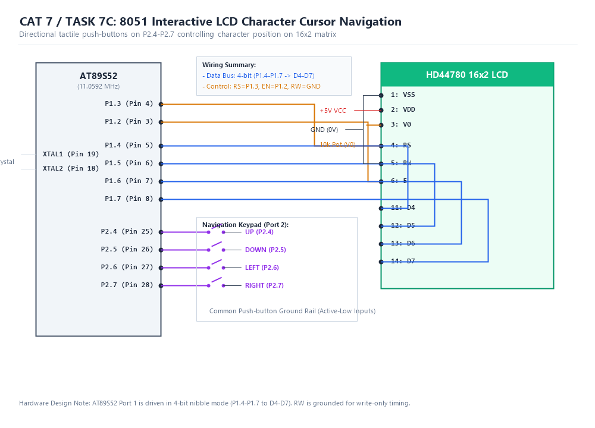

# Experiment 7C: 8051 Interactive LCD Character Navigation via Directional Push-Buttons

**Course:** Foundations of IoT (FIoT) Lab  
**Student Name:** Venkataprabu V  
**Registration Number:** 25011102114  
**Date:** 25/08/2026  

---

## 1. Experiment Name and Aim
- **Experiment Name:** 8051 Interactive 16x2 LCD Character Matrix Navigation
- **Aim:** To interface an AT89S52 microcontroller with a 16x2 alphanumeric LCD and four directional tactile push-buttons, dynamically translating user key presses (Up, Down, Left, Right) into 2D display coordinates and relocating a cursor character (`'A'`) across the 2x16 character grid.

---

## 2. Components / Tools Required
### Hardware Components
- AT89S52 Microcontroller Development Board
- 16x2 HD44780 Alphanumeric LCD Module
- 4x Tactile Momentary Push-Buttons (Up, Down, Left, Right)
- 11.0592 MHz Quartz Crystal with 2x 33 pF ceramic capacitors
- 10 kΩ Potentiometer (Contrast adjust)
- Breadboard and DuPont jumper wires
- Regulated +5V DC Power Source

### Software / Tools
- Keil µVision IDE (C51 Compiler)
- Proteus VSM Circuit Simulation Tool
- Hardware Flash Programmer (progisp)

---

## 3. Hardware Setup
### Pin Allocations
| Pin Name | AT89S52 Pin | Port Pin | Direction | Connected Device | Description |
|---|---|---|---|---|---|
| E | Pin 3 | P1.2 | Output | LCD Pin 6 | LCD Enable latch strobe |
| RS | Pin 4 | P1.3 | Output | LCD Pin 4 | Register Select (0=Cmd, 1=Data) |
| D4 | Pin 5 | P1.4 | Output | LCD Pin 11 | LCD Data Bit 4 |
| D5 | Pin 6 | P1.5 | Output | LCD Pin 12 | LCD Data Bit 5 |
| D6 | Pin 7 | P1.6 | Output | LCD Pin 13 | LCD Data Bit 6 |
| D7 | Pin 8 | P1.7 | Output | LCD Pin 14 | LCD Data Bit 7 |
| KEY_UP | Pin 25 | P2.4 | Input (pull-up) | Push-Button 1 | Decrement row (Up) |
| KEY_DOWN | Pin 26 | P2.5 | Input (pull-up) | Push-Button 2 | Increment row (Down) |
| KEY_LEFT | Pin 27 | P2.6 | Input (pull-up) | Push-Button 3 | Decrement column (Left) |
| KEY_RIGHT | Pin 28 | P2.7 | Input (pull-up) | Push-Button 4 | Increment column (Right) |

### Wiring Details
1. Connect LCD power: Pin 1 (VSS) to GND, Pin 2 (VDD) to +5V, Pin 5 (RW) to GND. Connect contrast potentiometer wiper to Pin 3 (V0).
2. Wire LCD control and data bus to Port 1: P1.2 to E, P1.3 to RS, P1.4-P1.7 to D4-D7.
3. Wire four normally-open tactile push-buttons:
   - One side of all 4 buttons is connected to common Ground (GND).
   - The other sides are connected to Port 2 pins: P2.4 (Up), P2.5 (Down), P2.6 (Left), P2.7 (Right).
   - Port 2 internal pull-up resistors maintain logic HIGH (+5V) when unpressed, pulling LOW (0V) on key press.
4. Connect the 11.0592 MHz crystal circuit across XTAL1 and XTAL2.

---

## 4. Circuit Diagram


---

## 5. Pseudocode and Code Logic
### Operation Sequence
1. Declare Port 1 SFR address `0x90`, control bit lines `rs = P1^3`, `en = P1^2`, and button lines `key_up = P2^4`, `key_down = P2^5`, `key_left = P2^6`, `key_right = P2^7`.
2. Configure Port 2 inputs: `P2 = 0xF0;` sets the high nibble pins (`P2.4`..`P2.7`) to 1, enabling internal pull-ups for active-low switch detection.
3. Initialize LCD in 4-bit mode: `0x28` (4-bit, 2 lines), `0x0C` (display on), `0x01` (clear).
4. Initialize position tracking variables: `row = 0` (range 0..1), `col = 0` (range 0..15).
5. In the main polling loop:
   - If `key_up == 0` and `row > 0`, decrement `row`.
   - If `key_down == 0` and `row < 1`, increment `row`.
   - If `key_left == 0` and `col > 0`, decrement `col`.
   - If `key_right == 0` and `col < 15`, increment `col`.
   - Calculate DDRAM target address: Base address `0x80` + (`0x40` if `row == 1` else `0x00`) + `col`.
   - Send command `lcd(0x80 + (row ? 0x40 : 0) + col, 0)` to position cursor.
   - Print marker character `'A'` at the target location.
   - Insert debounce and repetition pacing delay.

### Pseudocode
```text
MAIN:
    row <- 0
    col <- 0
    P2 <- 0xF0                // Configure P2.4-P2.7 as inputs with pull-ups
    lcd(0x28, 0)              // 4-bit, 2 lines, 5x8 font
    lcd(0x0C, 0)              // Display ON, cursor OFF
    lcd(0x01, 0)              // Clear screen

    WHILE TRUE DO
        IF key_up == 0 THEN
            IF row > 0 THEN row <- row - 1 END IF
        END IF
        IF key_down == 0 THEN
            IF row < 1 THEN row <- row + 1 END IF
        END IF
        IF key_left == 0 THEN
            IF col > 0 THEN col <- col - 1 END IF
        END IF
        IF key_right == 0 THEN
            IF col < 15 THEN col <- col + 1 END IF
        END IF

        target_address <- 0x80 + (row * 0x40) + col
        lcd(target_address, 0)
        lcd('A', 1)
        DELAY()
    END WHILE
```

---

## 6. Procedure
1. Open Keil µVision project `8051/CAT7/TASK7C/TaskSource.uvproj`.
2. Confirm target device is set to AT89S52 with 11.0592 MHz crystal.
3. Build the target (F7) to generate `Objects/lab-4.hex`.
4. Launch Proteus or program the AT89S52 development board.
5. Press the respective push-buttons (Up, Down, Left, Right) and observe character repositioning on the LCD.

---

## 7. Expected Output / Inference
- On startup, character `'A'` appears at Row 0, Column 0 (top-left position).
- Pressing `key_right` causes `'A'` to advance across columns up to Column 15.
- Pressing `key_down` shifts `'A'` down to Row 1.
- Pressing `key_up` shifts `'A'` back up to Row 0.
- Boundary conditions prevent the cursor coordinates from exceeding valid matrix bounds (`row` clamped to 0..1, `col` clamped to 0..15) [CONFIRM ON BOARD/SIMULATION].

---

## 8. Conclusion
The experiment verified bidirectional 2D navigation on a character LCD matrix using active-low switch polling on Port 2. Dynamic DDRAM addressing was successfully implemented to map Cartesian coordinates into HD44780 memory addresses.
