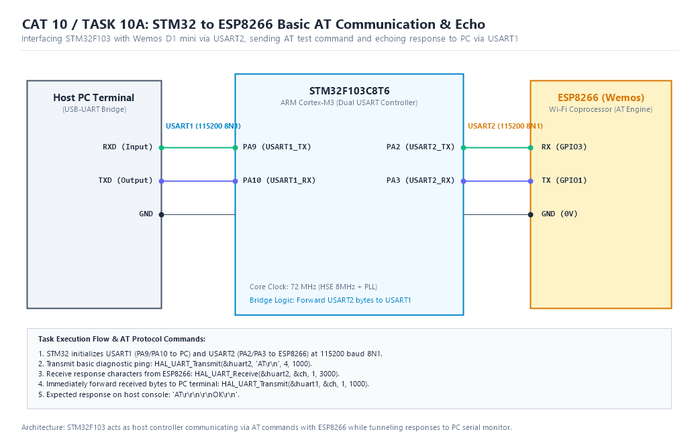

# Experiment 10A: STM32 to ESP8266 Basic AT Communication and Response Streaming

**Course:** Foundations of IoT (FIoT) Lab  
**Student Name:** Venkataprabu V  
**Registration Number:** 25011102114  
**Date:** 05/10/2026  

---

## 1. Experiment Name and Aim
- **Experiment Name:** STM32 Cortex-M3 to ESP8266 Dual-UART Bridge and AT Test Protocol
- **Aim:** To establish a dual-USART communication bridge on the STM32F103C8T6 microcontroller, transmitting a basic AT test command to a Wemos D1 mini ESP8266 Wi-Fi module over USART2 at 115200 baud, capturing the response characters, and tunneling them to a host PC terminal over USART1.

---

## 2. Components / Tools Required
### Hardware Components
- STM32F103C8T6 "Blue Pill" ARM Cortex-M3 Development Board
- ESP8266 Wi-Fi Development Board (Wemos D1 mini or ESP-01)
- USB-to-UART Bridge Module (CP2102 / CH340)
- ST-Link V2 In-Circuit Programmer/Debugger
- Breadboard and DuPont interconnect cables
- Regulated +3.3V / +5V DC Power Source

### Software / Tools
- Keil MDK-ARM v5 / µVision IDE
- STM32CubeMX
- Serial Terminal Application (PuTTY, Tera Term, minicom)

---

## 3. Hardware Setup
### Pin Allocations & Dual-UART Interconnect
| Interface | STM32 Pin | Peripheral Function | Connected Module | Function Description |
|---|---|---|---|---|
| **Console Link** | PA9 | USART1_TX | USB-UART RXD | Output stream to PC serial monitor |
| **Console Link** | PA10 | USART1_RX | USB-UART TXD | Input keystrokes from PC |
| **Modem Link** | PA2 | USART2_TX | ESP8266 RX (GPIO3) | Transmit AT command to Wi-Fi module |
| **Modem Link** | PA3 | USART2_RX | ESP8266 TX (GPIO1) | Receive AT response from Wi-Fi module |
| **Common Ground** | GND | 0V Reference | ESP8266 GND & USB-UART GND | Equipotential system reference |
| **Power Supply** | +3.3V | VDD Supply | ESP8266 3V3 | Regulated 3.3V supply rail (min 300 mA) |

### System & Peripheral Clock Configurations
- **System Clock (SYSCLK):** 72.0 MHz generated via 8.0 MHz HSE quartz crystal and PLL x9.
- **USART1 Clock:** Driven by APB2 bus at 72.0 MHz.
- **USART2 Clock:** Driven by APB1 bus at 36.0 MHz.
- **Baud Rates:** Both USART1 and USART2 configured to 115200 bps, 8 Data Bits, 1 Stop Bit, No Parity (8N1).

---

## 4. Circuit Diagram


---

## 5. Pseudocode and Code Logic
### Dual-UART Tunneling Mechanics
1. On startup, `MX_GPIO_Init()`, `MX_USART1_UART_Init()`, and `MX_USART2_UART_Init()` initialize clocks and I/O pins.
2. The microcontroller issues the standard AT attention test probe `"AT\r\n"` to the ESP8266 via `HAL_UART_Transmit(&huart2, (uint8_t *)"AT\r\n", 4, 1000)`.
3. The program enters a receive loop:
   - Polling `HAL_UART_Receive(&huart2, &ch, 1, 3000)` with a generous 3-second timeout to accommodate modem response latency.
   - For every character received from the ESP8266, it immediately invokes `HAL_UART_Transmit(&huart1, &ch, 1, 1000)` to mirror the character onto the host PC serial terminal.
4. When reception times out (the ESP8266 has concluded transmission), the loop terminates and enters `while (1) { }` idle state.

### Pseudocode
```text
INITIALIZE HAL, 72 MHz Clock, GPIO
INITIALIZE USART1 (115200 Baud -> PC Console)
INITIALIZE USART2 (115200 Baud -> ESP8266 Modem)

// Transmit Attention Probe
HAL_UART_Transmit(USART2, "AT\r\n", 4, 1000)

// Stream Response to PC
WHILE HAL_UART_Receive(USART2, ch, 1, 3000) == HAL_OK DO
    HAL_UART_Transmit(USART1, ch, 1, 1000)
END WHILE

LOOP FOREVER:
    IDLE
END LOOP
```

---

## 6. Procedure
1. Open Keil µVision and load `STM32/CAT10/TASK10A/MDK-ARM/plswork2.uvprojx`.
2. Inspect `Core/Src/main.c` and confirm peripheral instances `huart1` and `huart2` are generated.
3. Build the target project (**F7**). Verify compilation finishes with 0 Errors, 0 Warnings.
4. Connect ST-Link V2 to the Blue Pill and download the firmware (**F8**).
5. Ensure the ESP8266 is powered with a stable 3.3V source sharing a common ground with the STM32.
6. Open PuTTY on the USB-UART COM port at 115200 baud.
7. Press the Blue Pill hardware reset button to trigger the AT command sequence.

---

## 7. Expected Output / Inference
- Upon microcontroller reset, the console receives the transmitted query and response stream:
  ```text
  AT

  OK
  ```
- The presence of `"OK"` validates that the ESP8266 firmware is operational, serial baud rates on both UART interfaces are perfectly synchronized at 115200 bps, and full-duplex transmission and reception through the STM32 router is functioning reliably [CONFIRM ON BOARD/SIMULATION].

---

## 8. Conclusion
The experiment verified multi-peripheral UART coordination on the STM32F103C8T6. Transmitting AT diagnostic frames to an external wireless coprocessor while concurrently relaying responses to a development console demonstrated the fundamental building blocks of embedded IoT gateway architectures.
