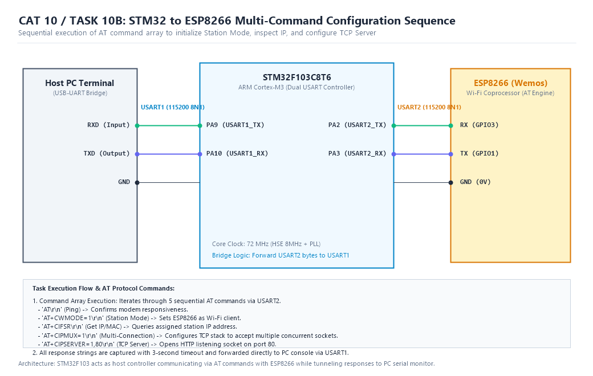

# Experiment 10B: STM32 to ESP8266 Multi-Command Configuration Sequence

**Course:** Foundations of IoT (FIoT) Lab  
**Student Name:** Venkataprabu V  
**Registration Number:** 25011102114  
**Date:** 05/10/2026  

---

## 1. Experiment Name and Aim
- **Experiment Name:** STM32 Sequential AT Command Scripting for ESP8266 Wi-Fi Setup
- **Aim:** To execute an automated, sequential initialization sequence of five AT commands from the STM32F103C8T6 microcontroller to an ESP8266 Wi-Fi module over USART2, establishing Station Mode, querying network parameters, enabling multiple TCP connections, activating an HTTP server daemon on port 80, and relaying diagnostic logs to the PC terminal via USART1.

---

## 2. Components / Tools Required
### Hardware Components
- STM32F103C8T6 ARM Cortex-M3 Development Board
- ESP8266 Wi-Fi Module (Wemos D1 mini)
- USB-to-UART Adapter Module (CP2102 / CH340)
- ST-Link V2 In-Circuit Programmer
- Breadboard and DuPont jumper wires
- Dedicated +3.3V DC Power Supply (capable of handling 300 mA RF current spikes)

### Software / Tools
- Keil MDK-ARM v5 / µVision IDE
- STM32CubeMX
- Serial Terminal Console (PuTTY / Tera Term)

---

## 3. Hardware Setup
### Wiring & Pin Mapping
| Interface | STM32 Pin | Direction | Destination | Functional Purpose |
|---|---|---|---|---|
| Console TX | PA9 | Output | USB-UART RXD | Transmit diagnostic telemetry to PC |
| Console RX | PA10 | Input | USB-UART TXD | Optional console input from PC |
| Coprocessor TX | PA2 | Output | ESP8266 RX | Dispatches AT configuration frames |
| Coprocessor RX | PA3 | Input | ESP8266 TX | Receives AT replies and status messages |
| Common Ground | GND | Reference | System GND | Common ground reference plane |

### Serial Protocol Parameters
- **USART1 (PC Interface):** 115200 bps, 8N1.
- **USART2 (ESP8266 Interface):** 115200 bps, 8N1.

---

## 4. Circuit Diagram


---

## 5. Pseudocode and Code Logic
### Sequential Command Execution Table
| Index | AT Command String | Length | Functional Action on ESP8266 | Expected Response |
|---|---|---|---|---|
| 0 | `"AT\r\n"` | 4 | Tests serial synchronization and readiness | `OK` |
| 1 | `"AT+CWMODE=1\r\n"` | 13 | Sets Wi-Fi mode to Station (client) | `OK` |
| 2 | `"AT+CIFSR\r\n"` | 10 | Queries local IP address and station MAC | IP string / `OK` |
| 3 | `"AT+CIPMUX=1\r\n"` | 13 | Enables multi-socket TCP multiplexing | `OK` |
| 4 | `"AT+CIPSERVER=1,80\r\n"` | 19 | Starts TCP server daemon on HTTP port 80 | `OK` |

### Scripting Engine Mechanics
1. An array of string pointers `cmds[]` and corresponding byte count array `sizes[]` encapsulate the configuration sequence.
2. A `for` loop executes 5 iterations (`i = 0` to `4`):
   - Dispatches command string `cmds[i]` across `huart2` to the ESP8266.
   - Enters a character-by-character response loop: reads from `huart2` with a 3000 ms character timeout.
   - For every incoming byte received, it is forwarded immediately over `huart1` to the host PC console.
   - When the modem finishes transmitting its response banner (`OK` or `ERROR`) and the line goes idle for 3 seconds, `HAL_UART_Receive()` times out, permitting the loop to advance to the next command.
3. Upon exhausting all 5 commands, the system transitions into an idle hold loop (`while (1) { }`).

### Pseudocode
```text
COMMANDS <- ["AT\r\n", "AT+CWMODE=1\r\n", "AT+CIFSR\r\n", "AT+CIPMUX=1\r\n", "AT+CIPSERVER=1,80\r\n"]
SIZES    <- [4, 13, 10, 13, 19]

FOR i <- 0 TO 4 DO
    HAL_UART_Transmit(USART2, COMMANDS[i], SIZES[i], 1000)
    
    WHILE HAL_UART_Receive(USART2, ch, 1, 3000) == HAL_OK DO
        HAL_UART_Transmit(USART1, ch, 1, 1000)
    END WHILE
END FOR

LOOP FOREVER:
    IDLE
END LOOP
```

---

## 6. Procedure
1. Launch Keil µVision and open `STM32/CAT10/TASK10B/MDK-ARM/plswork2.uvprojx`.
2. Inspect `main.c` and confirm the `cmds` table and sequential loop structure.
3. Build the project (**F7**). Verify compilation finishes with 0 Errors, 0 Warnings.
4. Flash the STM32F103C8 development board using ST-Link V2 (**F8**).
5. Open PuTTY on the host PC connected to the USB-UART COM port at 115200 baud.
6. Press the hardware RESET button on the Blue Pill and monitor the automated configuration log.

---

## 7. Expected Output / Inference
- The terminal displays the structured execution transcript:
  ```text
  AT
  OK
  AT+CWMODE=1
  OK
  AT+CIFSR
  +CIFSR:STAIP,"0.0.0.0"
  +CIFSR:STAMAC,"xx:xx:xx:xx:xx:xx"
  OK
  AT+CIPMUX=1
  OK
  AT+CIPSERVER=1,80
  OK
  ```
- Because Station Mode is activated without associating to an Access Point prior to `AT+CIFSR`, the IP defaults to `0.0.0.0`, while the factory MAC is valid.
- `AT+CIPMUX=1` and `AT+CIPSERVER=1,80` complete with `OK`, establishing the underlying socket listener required for embedded Web server operations [CONFIRM ON BOARD/SIMULATION].

---

## 8. Conclusion
The experiment verified multi-stage AT command orchestration from an ARM Cortex-M3 microcontroller. Array-driven command dispatching combined with dynamic response draining enabled reliable configuration of the ESP8266 networking stack.
