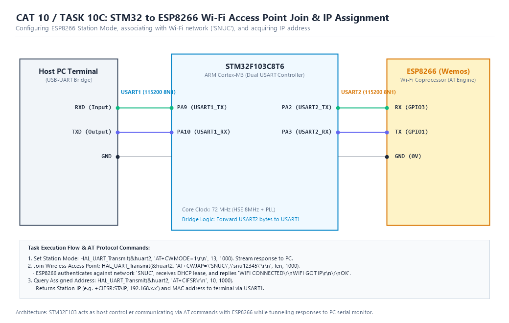

# Experiment 10C: STM32 to ESP8266 Wi-Fi Access Point Join and IP Allocation

**Course:** Foundations of IoT (FIoT) Lab  
**Student Name:** Venkataprabu V  
**Registration Number:** 25011102114  
**Date:** 05/10/2026  

---

## 1. Experiment Name and Aim
- **Experiment Name:** STM32 Automated Wi-Fi Association and IP Discovery via ESP8266
- **Aim:** To configure the ESP8266 Wi-Fi coprocessor into Station Mode using the STM32F103C8T6 microcontroller, authenticate and associate with an IEEE 802.11 wireless network ("SNUC") using WPA2-PSK credentials, acquire a dynamic DHCP IP address, and report the network parameters back to the PC serial monitor.

---

## 2. Components / Tools Required
### Hardware Components
- STM32F103C8T6 "Blue Pill" ARM Cortex-M3 Development Board
- ESP8266 Wi-Fi Module (Wemos D1 mini or NodeMCU)
- USB-to-UART Adapter Module (CP2102 / CH340)
- ST-Link V2 In-Circuit Programmer
- Breadboard, DuPont cables, and +3.3V / +5V Power Supply
- Wi-Fi Access Point broadcasting SSID `"SNUC"` with password `"snu12345"`

### Software / Tools
- Keil MDK-ARM v5 / µVision IDE
- STM32CubeMX
- Serial Terminal Console (PuTTY / Tera Term)

---

## 3. Hardware Setup
### Interconnect Architecture
| Interface Line | STM32 Pin | Connected Node | Electrical Signal |
|---|---|---|---|
| PC Debug TX | PA9 (USART1_TX) | USB-UART RXD | 115200 Baud Diagnostic Telemetry |
| PC Debug RX | PA10 (USART1_RX) | USB-UART TXD | 115200 Baud Console Rx |
| Wi-Fi Command TX | PA2 (USART2_TX) | ESP8266 RX (GPIO3) | 115200 Baud AT Command Stream |
| Wi-Fi Response RX | PA3 (USART2_RX) | ESP8266 TX (GPIO1) | 115200 Baud Modem Replies |
| Ground Plane | GND | ESP8266 GND & USB-UART GND | Equipotential 0V Ground |
| Power Rail | +3.3V / +5V | ESP8266 VCC | High-current regulated DC supply |

---

## 4. Circuit Diagram


---

## 5. Pseudocode and Code Logic
### Wireless Authentication Workflow
1. **Station Mode Setup:**
   - Transmit `"AT+CWMODE=1\r\n"` via `huart2`.
   - The ESP8266 configures its internal Wi-Fi MAC to operate as an 802.11 client (Station) rather than an Access Point.
   - Response drained and mirrored to `huart1`.
2. **Access Point Association (`AT+CWJAP`):**
   - Transmit `cmd[] = "AT+CWJAP=\"SNUC\",\"snu12345\"\r\n"`.
   - The ESP8266 initiates 802.11 probe requests, performs 4-way WPA2 handshake authentication, associates with the BSSID, and triggers DHCP discovery.
   - The module emits intermediate status messages:
     ```text
     WIFI CONNECTED
     WIFI GOT IP
     OK
     ```
   - Because 802.11 association and DHCP handshakes typically require between 1.5 and 4.0 seconds, the 3000 ms per-character receive timeout ensures uninterrupted packet streaming to `huart1`.
3. **Address Inspection (`AT+CIFSR`):**
   - Transmit `"AT+CIFSR\r\n"`.
   - Queries the TCP/IP stack for the leased station IP and MAC address.
   - Result string streamed to PC console, confirming complete Internet Protocol connectivity.
4. Transitions into idle loop (`while (1) { }`).

### Pseudocode
```text
INITIALIZE Peripherals (USART1, USART2 at 115200 Baud)

// Step 1: Set Station Mode
HAL_UART_Transmit(USART2, "AT+CWMODE=1\r\n", 13, 1000)
WHILE HAL_UART_Receive(USART2, ch, 1, 3000) == HAL_OK DO
    HAL_UART_Transmit(USART1, ch, 1, 1000)
END WHILE

// Step 2: Join Access Point
cmd <- "AT+CWJAP=\"SNUC\",\"snu12345\"\r\n"
HAL_UART_Transmit(USART2, cmd, LENGTH(cmd), 1000)
WHILE HAL_UART_Receive(USART2, ch, 1, 3000) == HAL_OK DO
    HAL_UART_Transmit(USART1, ch, 1, 1000)
END WHILE

// Step 3: Query Assigned Network IP
HAL_UART_Transmit(USART2, "AT+CIFSR\r\n", 10, 1000)
WHILE HAL_UART_Receive(USART2, ch, 1, 3000) == HAL_OK DO
    HAL_UART_Transmit(USART1, ch, 1, 1000)
END WHILE

LOOP FOREVER:
    IDLE
END LOOP
```

---

## 6. Procedure
1. Open Keil µVision and load `STM32/CAT10/TASK10C/MDK-ARM/plswork2.uvprojx`.
2. Check `main.c` and confirm the Wi-Fi credentials (`"SNUC"`, `"snu12345"`).
3. Build the target project (**F7**). Verify compilation succeeds with 0 Errors, 0 Warnings.
4. Program the STM32F103C8 development board using ST-Link V2 (**F8**).
5. Open PuTTY on the USB-to-UART COM port at 115200 baud.
6. Ensure the target Wi-Fi Access Point is broadcasting within radio range.
7. Reset the Blue Pill and observe the association log on the serial terminal.

---

## 7. Expected Output / Inference
- The host terminal outputs the real-time association telemetry:
  ```text
  AT+CWMODE=1
  OK
  WIFI CONNECTED
  WIFI GOT IP

  OK
  AT+CIFSR
  +CIFSR:STAIP,"192.168.1.105"
  +CIFSR:STAMAC,"xx:xx:xx:xx:xx:xx"

  OK
  ```
- The transition from `WIFI CONNECTED` to `WIFI GOT IP` confirms that the IEEE 802.11 physical association and layer-3 DHCP IP leasing succeeded.
- The returned IP (e.g., `192.168.1.105`) validates that the embedded system is officially on the local intranet and ready for TCP/HTTP socket communication [CONFIRM ON BOARD/SIMULATION].

---

## 8. Conclusion
The experiment verified full wireless LAN association and IP provisioning on an STM32-based embedded IoT node using an external ESP8266 coprocessor. Coordinated multi-stage AT commands over USART successfully bridged local embedded hardware to a standard Wi-Fi network infrastructure.
