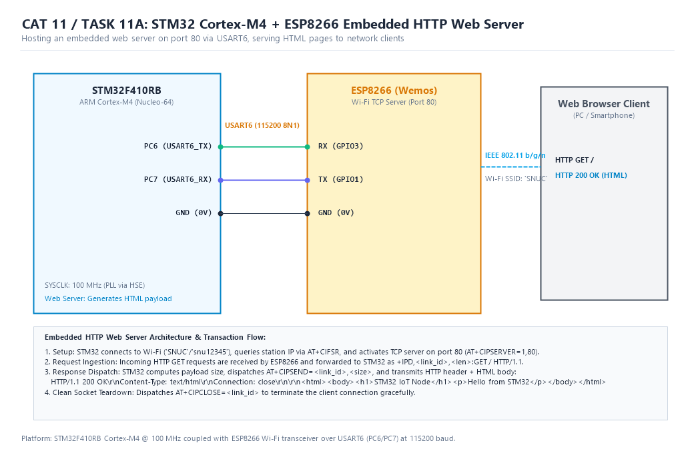

# Experiment 11A: STM32 Cortex-M4 + ESP8266 Embedded HTTP Web Server

**Course:** Foundations of IoT (FIoT) Lab  
**Student Name:** Venkataprabu V  
**Registration Number:** 25011102114  
**Date:** 12/10/2026  

---

## 1. Experiment Name and Aim
- **Experiment Name:** STM32 + ESP8266 Embedded HTTP Web Server Implementation
- **Aim:** To interface an STM32F410RB (ARM Cortex-M4) microcontroller with an ESP8266 Wi-Fi module over USART6 at 115200 baud, establish connection to a local wireless network, initialize a multi-client TCP server daemon on HTTP port 80, ingest inbound browser HTTP GET requests (`+IPD`), and respond with dynamically constructed HTML web pages.

---

## 2. Components / Tools Required
### Hardware Components
- NUCLEO-F410RB (or STM32F410RBT6 Development Board)
- ESP8266 Wi-Fi Module (Wemos D1 mini or NodeMCU)
- USB-to-UART Adapter (for debugging console telemetry)
- On-board ST-LINK/V2-1 Debugger via Mini-B USB cable
- DuPont jumper wires and breadboard
- Wi-Fi Router / Hotspot (SSID: `"SNUC"`, Password: `"snu12345"`)
- Client Device with Web Browser (PC, Tablet, or Smartphone)

### Software / Tools
- Keil MDK-ARM v5 / µVision IDE
- STM32CubeMX
- Web Browser (Chrome, Firefox, Safari)

---

## 3. Hardware Setup
### Pin Allocations & Peripheral Map
| STM32F410RB Pin | Alternate Function | Connected Device Pin | Function Description |
|---|---|---|---|
| PC6 | USART6_TX | ESP8266 RX (GPIO3) | Transmits AT commands & HTTP responses |
| PC7 | USART6_RX | ESP8266 TX (GPIO1) | Receives AT replies & incoming HTTP requests |
| PA9 | USART1_TX | Host Console RXD | Optional debug logging stream |
| PA10 | USART1_RX | Host Console TXD | Optional debug input |
| GND | System Ground | ESP8266 GND | Common 0V ground reference |
| +3.3V / +5V | Power Supply Rail | ESP8266 VCC | Dedicated high-current logic power |

### System Clock & Serial Parameters
- **Core Processor:** ARM Cortex-M4 @ 100.0 MHz SYSCLK (PLL sourced from HSE/HSI).
- **USART6 Baud Rate:** 115200 bps, 8 Data Bits, 1 Stop Bit, No Parity (8N1).
- **Network Port:** TCP Port 80 (Standard Hypertext Transfer Protocol).

---

## 4. Circuit Diagram


---

## 5. Pseudocode and Code Logic
### Transaction & State Machine Sequence
1. **Network Provisioning:**
   - On boot, `main()` initializes clocks and USART6 (`MX_USART6_UART_Init()`).
   - Issues attention probe `"AT\r\n"`.
   - Sets Station mode: `"AT+CWMODE=1\r\n"`.
   - Associates with network: `snprintf(join, sizeof(join), "AT+CWJAP=\"%s\",\"%s\"\r\n", WIFI_SSID, WIFI_PASS)`.
   - Pauses 10 seconds (`HAL_Delay(10000)`) to allow DHCP lease acquisition.
   - Queries IP address: `"AT+CIFSR\r\n"`.
   - Enables multi-channel connection multiplexing: `"AT+CIPMUX=1\r\n"`.
   - Binds TCP server listener to port 80: `"AT+CIPSERVER=1,80\r\n"`.
2. **HTTP Request Ingestion:**
   - In the infinite superloop (`while (1)`), invokes `ESP_HandleBrowserRequest()`.
   - Clears receiver overrun flags: `__HAL_UART_CLEAR_OREFLAG(&huart6)`.
   - Samples incoming serial stream into buffer `rx[600]` via `HAL_UART_Receive()`.
   - Scans for the incoming IPD pattern: `strstr(rx, "+IPD,")`.
   - Extracts the client connection handle (`link_id = ipd[5] - '0'`).
3. **HTTP Response Generation:**
   - Defines HTML payload:
     ```html
     <html><body><h1>STM32 IoT Node</h1><p>Hello from STM32</p></body></html>
     ```
   - Constructs standard HTTP/1.1 response header:
     ```text
     HTTP/1.1 200 OK\r\nContent-Type: text/html\r\nConnection: close\r\n\r\n
     ```
   - Calculates total payload length and issues data transmission directive:
     ```text
     AT+CIPSEND=<link_id>,<total_length>\r\n
     ```
   - Delivers HTTP response stream across USART6.
   - Gracefully closes client connection socket via `AT+CIPCLOSE=<link_id>\r\n`.

### Pseudocode
```text
INITIALIZE HAL, 100 MHz Clock, USART6 at 115200 Baud

// Wi-Fi & Web Server Initialization
ESP_Send("AT\r\n")
ESP_Send("AT+CWMODE=1\r\n")
ESP_Send("AT+CWJAP=\"SNUC\",\"snu12345\"\r\n")
WAIT 10 seconds for DHCP
ESP_Send("AT+CIFSR\r\n")
ESP_Send("AT+CIPMUX=1\r\n")
ESP_Send("AT+CIPSERVER=1,80\r\n")

// Request Handler Superloop
LOOP FOREVER:
    CLEAR UART Overrun Flags
    RECEIVE buffer from USART6 (timeout 200 ms)
    
    ipd <- FIND "+IPD," IN buffer
    IF ipd != NULL THEN
        link_id <- ipd[5] - '0'
        
        body <- "<html><body><h1>STM32 IoT Node</h1><p>Hello from STM32</p></body></html>"
        header <- "HTTP/1.1 200 OK\r\nContent-Type: text/html\r\nConnection: close\r\n\r\n"
        payload <- header + body
        
        ESP_Send("AT+CIPSEND=" + link_id + "," + LENGTH(payload) + "\r\n")
        WAIT 50 ms
        ESP_Send(payload)
        WAIT 50 ms
        ESP_Send("AT+CIPCLOSE=" + link_id + "\r\n")
    END IF
END LOOP
```

---

## 6. Procedure
1. Open Keil µVision and load `STM32/CAT11/TASK11A/MDK-ARM/http_f410rb.uvprojx`.
2. Inspect `Core/Src/main.c`. Verify that `WIFI_SSID` and `WIFI_PASS` match your local network.
3. Build the project (**F7**). Verify compilation completes with 0 Errors, 0 Warnings.
4. Connect the NUCLEO-F410RB board to the PC via USB and flash the firmware using the on-board ST-LINK (**F8**).
5. Open a serial monitor to observe the assigned IP address returned by `AT+CIFSR` (or inspect your router DHCP client table).
6. Open any web browser on a device connected to the same Wi-Fi network and navigate to `http://<ASSIGNED_IP>/`.

---

## 7. Expected Output / Inference
- Navigating to the board's IP address prompts the ESP8266 to deliver the inbound HTTP GET frame to the STM32F410RB.
- The web browser renders the HTML response:
  - Header: **STM32 IoT Node**
  - Body paragraph: *Hello from STM32*
- The HTTP header specifies `Connection: close`, causing the socket to terminate cleanly upon transmission without hanging browser network resources [CONFIRM ON BOARD/SIMULATION].

---

## 8. Conclusion
The experiment verified full-stack embedded web server operation on an STM32 Cortex-M4 microcontroller. Integrating layer-4 TCP socket handling and layer-7 HTTP protocol synthesis over AT commands demonstrated how low-power edge nodes can natively host web interfaces for IoT management.
