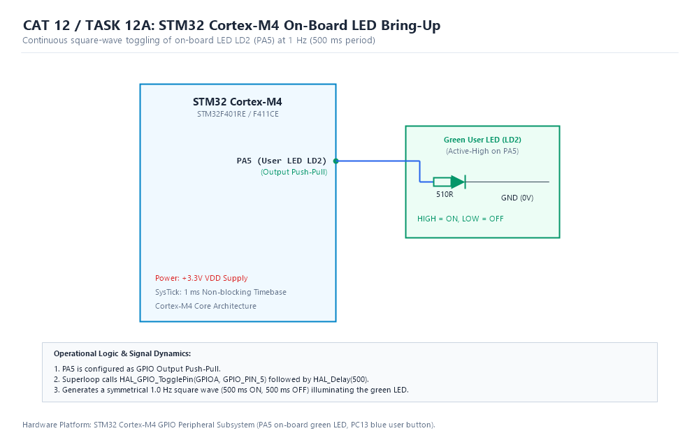

# Experiment 12A: STM32 Cortex-M4 On-Board LED Bring-Up

**Course:** Foundations of IoT (FIoT) Lab  
**Student Name:** Venkataprabu V  
**Registration Number:** 25011102114  
**Date:** 19/10/2026  

---

## 1. Experiment Name and Aim
- **Experiment Name:** STM32 Cortex-M4 GPIO Output Programming and LED Bring-Up
- **Aim:** To configure General Purpose Output pin PA5 on the STM32 Cortex-M4 microcontroller (STM32F401RE / STM32F411CE) using the STM32Cube HAL driver, generating a periodic 1.0 Hz square wave (500 ms HIGH, 500 ms LOW) to flash the on-board user LED (LD2).

---

## 2. Components / Tools Required
### Hardware Components
- STM32 Cortex-M4 Target Board (NUCLEO-F401RE / WeAct Black Pill STM32F411CE)
- ST-LINK V2 / V2-1 In-Circuit Debugger/Programmer
- Mini/Micro-USB Interface Cable (+3.3V DC power feed)
- Breadboard (optional)

### Software / Tools
- Keil MDK-ARM v5 / µVision IDE
- STM32CubeMX
- ST-Link Utility / STM32CubeProgrammer

---

## 3. Hardware Setup
### Pin Configuration & Board Topography
| STM32 Pin | GPIO Mode | Output Speed | Connected Hardware | Electrical Polarity |
|---|---|---|---|---|
| PA5 | Output Push-Pull | Low Frequency | On-Board Green LED (LD2) | Active-High (3.3V = LED ON, 0V = LED OFF) |
| PC13 | Digital Input | Pull-Up | Blue User Push-Button (B1) | Active-Low (0V when pressed) |
| VDD / GND | Power Rails | - | Microcontroller Core Supply | +3.3V DC / 0V Ground |

### Clock Configuration
- **Processor Family:** ARM Cortex-M4 with Single-Precision Floating Point Unit (FPU).
- **Core Clock (SYSCLK):** 16.0 MHz (HSI internal RC oscillator default) or PLL-boosted up to 84/100 MHz.
- **SysTick Timer:** 1.0 ms periodic tick generating system delays via `HAL_Delay()`.

---

## 4. Circuit Diagram


---

## 5. Pseudocode and Code Logic
### Functional Operation
1. The microcontroller initializes HAL core services (`HAL_Init()`), configuring Flash prefetch and Systick.
2. `SystemClock_Config()` initializes internal oscillator trees.
3. `MX_GPIO_Init()` enables clock gating for GPIO Port A (`__HAL_RCC_GPIOA_CLK_ENABLE()`) and configures PA5 as an output push-pull pin with no pull-up/pull-down resistors.
4. In the superloop (`while (1)`):
   - Invokes `HAL_GPIO_TogglePin(GPIOA, GPIO_PIN_5)` to invert the electrical logic state of PA5.
   - Suspends CPU execution for 500 milliseconds via blocking delay `HAL_Delay(500)`.
   - Results in a continuous 50% duty cycle 1 Hz blinking square wave.

### Pseudocode
```text
INITIALIZE HAL, System Clock, GPIO

LOOP FOREVER:
    HAL_GPIO_TogglePin(Port A, Pin 5)
    HAL_Delay(500)
END LOOP
```

---

## 6. Procedure
1. Open Keil µVision and load `STM32/CAT12/TASK12A/MDK-ARM/TEST1.uvprojx`.
2. Inspect `Core/Src/main.c` under the main execution loop.
3. Build the target project (**F7**) and verify 0 Errors, 0 Warnings.
4. Connect the board via USB and download firmware (**F8**).
5. Observe the green LED on the development board flashing at 1-second intervals.

---

## 7. Expected Output / Inference
- On board bring-up, the green user LED on pin PA5 begins blinking continuously.
- The LED remains illuminated for 500 ms, turns off for 500 ms, and repeats indefinitely.
- Timing verified with oscilloscope or stopwatch matches a 1.0 Hz periodic square wave with 50% duty cycle [CONFIRM ON BOARD/SIMULATION].

---

## 8. Conclusion
The experiment verified fundamental GPIO output control on the ARM Cortex-M4 platform. The STM32Cube HAL driver reliably handled pin direction, clock gating, and state toggling.
