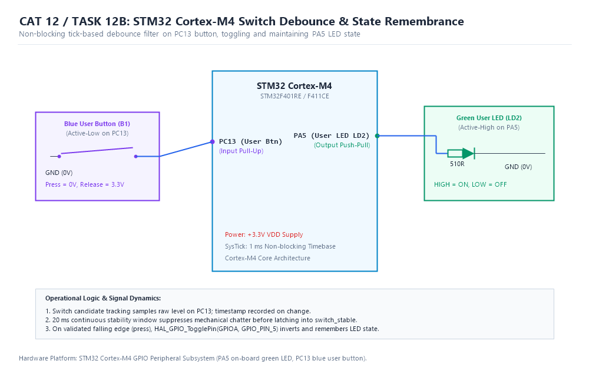

# Experiment 12B: STM32 Cortex-M4 Switch Debounce and State Remembrance

**Course:** Foundations of IoT (FIoT) Lab  
**Student Name:** Venkataprabu V  
**Registration Number:** 25011102114  
**Date:** 19/10/2026  

---

## 1. Experiment Name and Aim
- **Experiment Name:** STM32 Cortex-M4 Digital Switch Debouncing and Latching Output Toggle
- **Aim:** To implement a non-blocking digital switch debouncing filter (30 ms stability threshold) on the STM32 Cortex-M4 microcontroller using the SysTick timebase, monitoring the user push-button on pin PC13, and toggling and latching the state of the user LED on pin PA5 upon each valid actuation.

---

## 2. Components / Tools Required
### Hardware Components
- STM32 Cortex-M4 Development Board (NUCLEO-F401RE / WeAct STM32F411CE)
- On-Board User Push-Button (PC13)
- On-Board User Green LED (PA5)
- ST-Link V2 / V2-1 In-Circuit Programmer
- USB Cable (+3.3V DC power source)

### Software / Tools
- Keil MDK-ARM v5 / µVision IDE
- STM32CubeMX Configuration Tool
- STM32CubeProgrammer

---

## 3. Hardware Setup
### Pin Map & Functional Role
| MCU Pin | Peripheral Function | Hardware Device | Active Level |
|---|---|---|---|
| PC13 | GPIO Input | User Push-Button (B1) | Input signal transition |
| PA5 | GPIO Output | Green User LED (LD2) | High = LED ON, Low = LED OFF |
| SysTick | System Core Timer | 1 ms Tick Reference | Timebase for contact stability checks |

---

## 4. Circuit Diagram


---

## 5. Pseudocode and Code Logic
### Debouncing & State Remembrance
1. Variables initialized:
   - `switch_candidate`: Latest transient level on PC13.
   - `switch_stable`: Confirmed steady-state level.
   - `switch_tick`: Timestamp when level change was detected.
2. In `switch_task()`:
   - Read current raw input: `raw = HAL_GPIO_ReadPin(GPIOC, GPIO_PIN_13)`.
   - Check current time: `now = HAL_GetTick()`.
   - If `raw != switch_candidate`, record transition start: `switch_candidate = raw; switch_tick = now;`.
   - If candidate remains unchanged for at least 30 ms (`(now - switch_tick) >= 30`) and differs from last stable state (`switch_stable != switch_candidate`):
     - Update confirmed state: `switch_stable = switch_candidate`.
     - On active transition to `GPIO_PIN_SET`, execute output latch toggle: `HAL_GPIO_TogglePin(GPIOA, GPIO_PIN_5)`.
3. In `main()`, `switch_task()` executes repeatedly inside `while (1)` without blocking delays.

### Pseudocode
```text
VARIABLES:
    candidate <- RESET
    stable <- RESET
    tick <- 0

FUNCTION switch_task():
    raw <- HAL_GPIO_ReadPin(Port C, Pin 13)
    now <- HAL_GetTick()

    IF raw != candidate THEN
        candidate <- raw
        tick <- now
    END IF

    IF (now - tick >= 30) AND (stable != candidate) THEN
        stable <- candidate
        IF stable == SET THEN
            HAL_GPIO_TogglePin(Port A, Pin 5)
        END IF
    END IF
END FUNCTION

LOOP FOREVER:
    switch_task()
END LOOP
```

---

## 6. Procedure
1. Open Keil µVision and load `STM32/CAT12/TASK12B/MDK-ARM/TEST1.uvprojx`.
2. Inspect `Core/Src/main.c` to examine the non-blocking state machine in `switch_task()`.
3. Build project (**F7**) and verify 0 Errors, 0 Warnings.
4. Download the firmware to the target board using ST-Link (**F8**).
5. Press the user push-button on PC13 repeatedly and observe the PA5 LED state.

---

## 7. Expected Output / Inference
- On boot, PA5 LED begins in the default OFF state.
- Pressing the user push-button toggles the LED ON. Releasing the button keeps the LED ON (state remembrance).
- Pressing the button a second time toggles the LED OFF.
- Switch contact bounce occurring during the first 30 ms is filtered out, ensuring exactly one toggle action per button press [CONFIRM ON BOARD/SIMULATION].

---

## 8. Conclusion
The experiment verified non-blocking switch debouncing and state latching on the ARM Cortex-M4 platform. Time-stamped hysteresis filtering eliminated mechanical contact noise while preserving real-time responsiveness.
