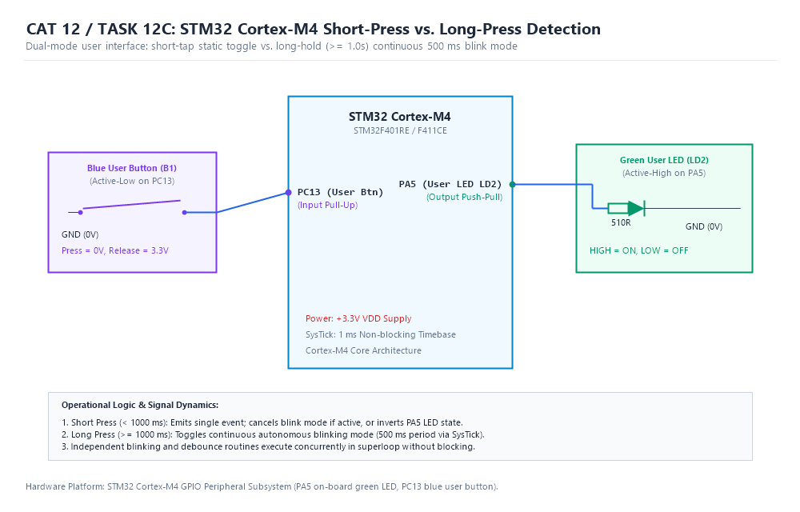

# Experiment 12C: STM32 Cortex-M4 Short-Press and Long-Press Detection

**Course:** Foundations of IoT (FIoT) Lab  
**Student Name:** Venkataprabu V  
**Registration Number:** 25011102114  
**Date:** 19/10/2026  

---

## 1. Experiment Name and Aim
- **Experiment Name:** STM32 Cortex-M4 Dual-Gesture Button Detection and Autonomous Blink Engine
- **Aim:** To implement an advanced multi-gesture button state machine on the STM32 Cortex-M4 microcontroller, differentiating between short-tap (< 1.0 s) gestures to toggle the PA5 LED statically and long-hold (>= 1.0 s) gestures to toggle an autonomous 500 ms periodic blink mode.

---

## 2. Components / Tools Required
### Hardware Components
- STM32 Cortex-M4 Target Development Board (NUCLEO-F401RE / STM32F411CE)
- On-Board User Push-Button (PC13)
- On-Board User Green LED (PA5)
- ST-Link V2 / V2-1 Debugger via USB
- Micro/Mini-USB cable

### Software / Tools
- Keil MDK-ARM v5 / µVision IDE
- STM32CubeMX
- STM32CubeProgrammer

---

## 3. Hardware Setup
### Peripheral Wiring
| Peripheral Pin | Direction | Description | Logic Behavior |
|---|---|---|---|
| PC13 | Digital Input | User Push-Button (B1) | Input signal transition |
| PA5 | Digital Output | Green User LED (LD2) | High = LED ON, Low = LED OFF |
| SysTick | Timer | System Tick Reference | 1 ms resolution for gesture timing & blinking |

---

## 4. Circuit Diagram


---

## 5. Pseudocode and Code Logic
### Gesture Classification & Blink Logic
1. **Debounce Stage (30 ms):** `raw` input level on PC13 is tracked. If candidate remains unchanged for >= 30 ms, `switch_stable` is updated.
2. **Press Tracking:** When `switch_stable == GPIO_PIN_SET` (button pressed):
   - Set `pressed = 1`.
   - Clear `long_handled = 0`.
   - Record press start timestamp: `press_tick = now`.
3. **Long Press Check (>= 1000 ms):**
   - If `pressed == 1 && !long_handled && (now - press_tick) >= 1000`:
     - Toggle blink mode: `blink = !blink`.
     - Synchronize blink timer: `blink_tick = now`.
     - Latch `long_handled = 1` so the long press triggers only once per continuous hold.
4. **Short Press Release (< 1000 ms):**
   - When button is released (`switch_stable != SET` and `pressed == 1`):
     - If the hold did not cross the long-press threshold (`!long_handled`) and `blink == 0`:
       - Toggle PA5 LED: `HAL_GPIO_TogglePin(GPIOA, GPIO_PIN_5)`.
     - Reset `pressed = 0`.
5. **Autonomous Blinker Engine:**
   - If `blink == 1 && (now - blink_tick) >= 500`:
     - Invert PA5: `HAL_GPIO_TogglePin(GPIOA, GPIO_PIN_5)`.
     - Reset `blink_tick = now`.

### Pseudocode
```text
FUNCTION switch_task():
    raw <- READ(Port C, Pin 13)
    now <- HAL_GetTick()

    // 30 ms Debounce
    IF raw != candidate THEN candidate <- raw; tick <- now END IF
    IF (now - tick >= 30) AND (stable != candidate) THEN
        stable <- candidate
        IF stable == SET THEN
            pressed <- 1
            long_handled <- 0
            press_tick <- now
        ELSE IF pressed THEN
            IF NOT long_handled AND NOT blink THEN
                HAL_GPIO_TogglePin(Port A, Pin 5)
            END IF
            pressed <- 0
        END IF
    END IF

    // Long Press Detection (>= 1000 ms)
    IF pressed AND NOT long_handled AND (now - press_tick >= 1000) THEN
        blink <- NOT blink
        blink_tick <- now
        long_handled <- 1
    END IF

    // Autonomous Blinking Engine (500 ms)
    IF blink AND (now - blink_tick >= 500) THEN
        HAL_GPIO_TogglePin(Port A, Pin 5)
        blink_tick <- now
    END IF
END FUNCTION

LOOP FOREVER:
    switch_task()
END LOOP
```

---

## 6. Procedure
1. Open Keil µVision project `STM32/CAT12/TASK12C/MDK-ARM/TEST1.uvprojx`.
2. Review the cooperative non-blocking implementation in `switch_task()`.
3. Build the target project (**F7**) (0 Errors, 0 Warnings).
4. Flash the board using ST-Link (**F8**).
5. Perform user testing:
   - Tap PC13 briefly (< 1 s) and verify static LED toggle.
   - Hold PC13 down for >= 1 s, observing entry into 500 ms blinking mode.
   - Hold PC13 down again for >= 1 s to stop blinking mode.

---

## 7. Expected Output / Inference
- Short Tap (< 1 s): Toggles PA5 LED immediately upon release.
- Long Hold (>= 1 s): When the 1.0-second threshold is crossed, the system enters autonomous 500 ms square-wave blinking mode.
- Holding the switch longer does not produce multiple toggles because `long_handled` remains latched until release.
- Re-holding for >= 1 s deactivates blinking mode cleanly [CONFIRM ON BOARD/SIMULATION].

---

## 8. Conclusion
The experiment verified multi-gesture HMI decoding and concurrent task execution on an ARM Cortex-M4 microcontroller without using an RTOS or blocking delay primitives.
