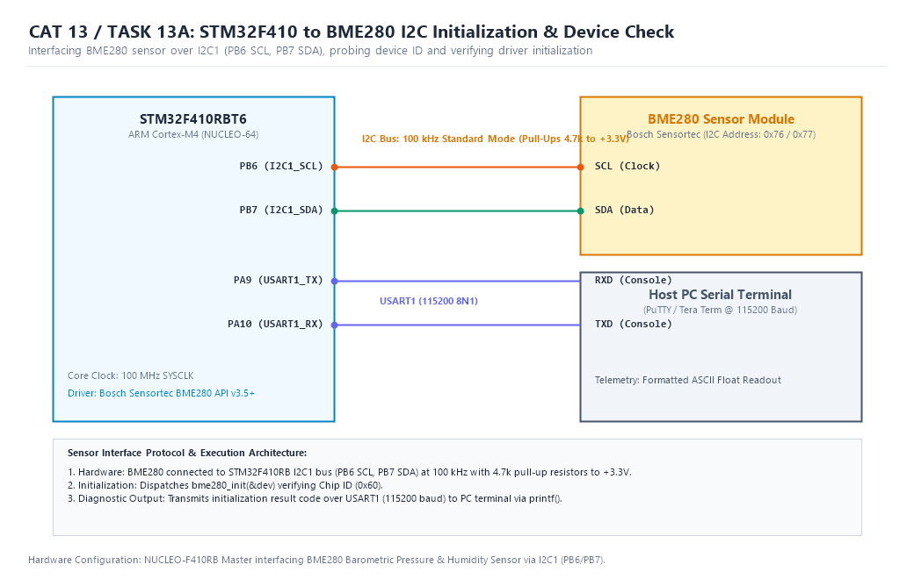

# Experiment 13A: STM32 to BME280 I2C Initialization and Device Bring-Up

**Course:** Foundations of IoT (FIoT) Lab  
**Student Name:** Venkataprabu V  
**Registration Number:** 25011102114  
**Date:** 23/10/2026  

---

## 1. Experiment Name and Aim
- **Experiment Name:** STM32 I2C Interfacing with Bosch BME280 Environmental Sensor
- **Aim:** To configure the I2C1 peripheral on the STM32F410RB microcontroller in Master Standard Mode (100 kHz), bind the low-level I2C read/write primitives to the official Bosch Sensortec BME280 driver, probe device connectivity at primary 7-bit address `0x76`, verify calibration coefficient registers, and report initialization status over USART1.

---

## 2. Components / Tools Required
### Hardware Components
- NUCLEO-F410RB (STM32F410RBT6 ARM Cortex-M4) Development Board
- Bosch BME280 Combined Temperature, Pressure, and Humidity Sensor Module
- USB-to-UART Adapter Module (CP2102 / FT232R)
- 2x 4.7 kΩ Pull-Up Resistors (if not integrated on sensor breakout)
- Breadboard and DuPont jumper wires
- ST-LINK/V2-1 via USB Cable

### Software / Tools
- Keil MDK-ARM v5 / µVision IDE
- STM32CubeMX
- Serial Terminal Application (PuTTY, 115200 8N1)
- Bosch Sensortec BME280 Sensor Driver API (v3.5+)

---

## 3. Hardware Setup
### Pin Allocations & I2C Bus Topology
| STM32F410 Pin | Peripheral Function | BME280 Pin | Bus Function | Electrical Detail |
|---|---|---|---|---|
| PB6 | I2C1_SCL | SCL | Serial Clock | Open-Drain with 4.7 kΩ pull-up to 3.3V |
| PB7 | I2C1_SDA | SDA | Serial Data | Open-Drain with 4.7 kΩ pull-up to 3.3V |
| PA9 | USART1_TX | Console RXD | Telemetry TX | 115200 Baud Diagnostic Output |
| PA10 | USART1_RX | Console TXD | Console RX | Optional serial input |
| +3.3V | VDD Supply | VCC / VIN | Logic Supply | Regulated 3.3V sensor supply rail |
| GND | System Ground | GND | 0V Reference | Common Ground Reference |
| - | Hardware Strap | SDO / ADDR | Address Select | Tied to GND (Addr = 0x76) or VDD (0x77) |

### Clock Configuration
- **Core SYSCLK:** 100.0 MHz.
- **I2C1 Speed:** Standard Mode, 100 kHz clock frequency (`ClockSpeed = 100000`, `DutyCycle = I2C_DUTYCYCLE_2`).
- **UART Retargeting:** Standard library `printf()` redirected to USART1 via `__io_putchar()`.

---

## 4. Circuit Diagram


---

## 5. Pseudocode and Code Logic
### Driver Binding & Initialization
1. In `main()`, initialize HAL, system clocks, I2C1, and USART1.
2. Configure Bosch driver interface structure `struct bme280_dev dev`:
   - `dev.intf_ptr = &dev_addr;` (Primary address `0x76` or 7-bit shifted `0xEC`).
   - `dev.intf = BME280_I2C_INTF;`
   - `dev.read = user_i2c_read;` (Maps `HAL_I2C_Mem_Read()` into driver).
   - `dev.write = user_i2c_write;` (Maps `HAL_I2C_Mem_Write()` into driver).
   - `dev.delay_us = user_delay_us;` (Microsecond delay helper using SysTick).
3. Call `bme280_init(&dev)`:
   - Reads Chip ID register (`0xD0`), verifying expected constant `0x60`.
   - Reads factory calibration trimming parameters stored in non-volatile memory (temperature, pressure, and humidity compensation coefficients).
4. Print return code to console: `printf("BME280 init result: %d\r\n", rslt);` (Result code `0` corresponds to `BME280_OK`).

### Pseudocode
```text
INITIALIZE HAL, 100 MHz SYSCLK
INITIALIZE I2C1 (100 kHz Standard Mode, Open-Drain)
INITIALIZE USART1 (115200 Baud)

dev.addr <- 0x76
dev.read <- user_i2c_read
dev.write <- user_i2c_write
dev.delay <- user_delay_us

rslt <- bme280_init(&dev)
printf("BME280 init result: %d\r\n", rslt)

LOOP FOREVER:
    HAL_Delay(1000)
END LOOP
```

---

## 6. Procedure
1. Open Keil µVision and load `STM32/CAT13/TASK13A/MDK-ARM/i2c.uvprojx`.
2. Inspect `Core/Src/main.c`. Verify that `dev_addr` matches your module's hardware strapping (`BME280_I2C_ADDR_PRIM = 0x76`).
3. Build the target project (**F7**) (0 Errors, 0 Warnings).
4. Flash the NUCLEO-F410RB board using the on-board ST-LINK (**F8**).
5. Open PuTTY on the USB-UART COM port at 115200 baud.
6. Reset the board and observe initialization diagnostics.

---

## 7. Expected Output / Inference
- The serial monitor outputs:
  ```text
  BME280 init result: 0
  ```
- Result code `0` confirms:
  1. I2C hardware bus timing and pull-up resistor integrity are verified.
  2. The BME280 acknowledged its slave address on the bus.
  3. Chip ID `0x60` was read and matched successfully.
  4. Trimming parameters were transferred into memory [CONFIRM ON BOARD/SIMULATION].

---

## 8. Conclusion
The experiment verified low-level I2C hardware master configuration and driver integration between an ARM Cortex-M4 microcontroller and a Bosch BME280 environmental sensor.
