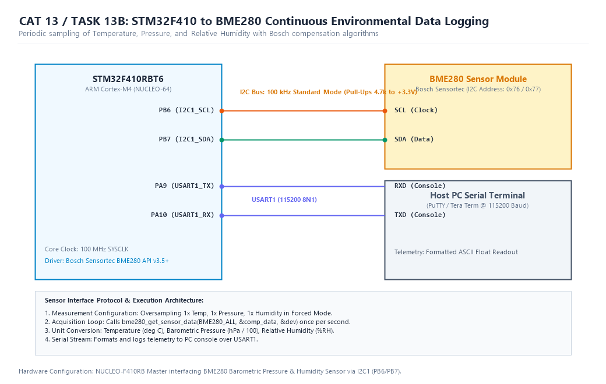

# Experiment 13B: STM32 to BME280 Continuous Environmental Data Logging

**Course:** Foundations of IoT (FIoT) Lab  
**Student Name:** Venkataprabu V  
**Registration Number:** 25011102114  
**Date:** 23/10/2026  

---

## 1. Experiment Name and Aim
- **Experiment Name:** STM32 Multi-Variable Atmospheric Telemetry Acquisition over I2C
- **Aim:** To configure continuous sampling of ambient temperature, atmospheric barometric pressure, and relative humidity from a Bosch BME280 sensor over I2C1 on the STM32F410RB microcontroller, execute Bosch polynomial compensation formulas, and stream real-time calibrated engineering units over USART1 at 1.0 Hz.

---

## 2. Components / Tools Required
### Hardware Components
- NUCLEO-F410RB Development Board (ARM Cortex-M4 @ 100 MHz)
- Bosch BME280 Sensor Breakout Module
- USB-to-UART Adapter Module (115200 Baud)
- Breadboard and DuPont jumper wires
- ST-LINK/V2-1 via USB Cable

### Software / Tools
- Keil MDK-ARM v5 / µVision IDE
- STM32CubeMX
- Serial Terminal Console (PuTTY / Tera Term)
- Bosch BME280 Driver API

---

## 3. Hardware Setup
### Interconnect Architecture
| STM32F410 Pin | Function | Sensor Pin | Description |
|---|---|---|---|
| PB6 | I2C1_SCL | SCL | I2C Master Serial Clock (100 kHz) |
| PB7 | I2C1_SDA | SDA | I2C Master Bidirectional Data |
| PA9 | USART1_TX | Console RXD | Transmit calibrated telemetry string |
| PA10 | USART1_RX | Console TXD | Console receive |
| +3.3V | VDD Supply | VCC | Sensor logic and analogue supply rail |
| GND | Ground | GND | System common ground plane |

---

## 4. Circuit Diagram


---

## 5. Pseudocode and Code Logic
### Acquisition & Compensation Sequence
1. **Sensor Initialization:** BME280 initialized via `bme280_init(&dev)`.
2. **Measurement Profile:**
   - Configure oversampling settings:
     - Temperature Oversampling: 1x (`BME280_OVERSAMPLING_1X`)
     - Pressure Oversampling: 1x (`BME280_OVERSAMPLING_1X`)
     - Humidity Oversampling: 1x (`BME280_OVERSAMPLING_1X`)
     - IIR Filter: Disabled (`BME280_FILTER_COEFF_OFF`)
   - Apply settings via `bme280_set_sensor_settings()`.
   - Set operational power mode to Normal or Forced mode (`bme280_set_sensor_mode()`).
3. **Superloop Acquisition (`while (1)`):**
   - Read raw uncompensated ADC registers (burst read of 8 data registers: `0xF7` to `0xFE`).
   - Bosch driver applies 64-bit integer / double precision polynomial calibration equations using factory trimming parameters (`dig_T1..T3`, `dig_P1..P9`, `dig_H1..H6`).
   - Extract calibrated variables:
     - `temperature`: Degrees Celsius (°C).
     - `pressure`: Measured in Pascals (Pa), divided by `100.0f` to yield standard hectopascals (hPa / millibars).
     - `humidity`: Percentage Relative Humidity (%RH).
   - Format and output reading over USART1 via `printf("Temperature: %.2f C Pressure: %.2f hPa Humidity: %.2f %%RH\r\n", temperature, pressure, humidity)`.
   - Delay 1000 ms via `HAL_Delay(1000)`.

### Pseudocode
```text
INITIALIZE I2C1, USART1
INIT BME280 driver

settings.osr_t <- 1x
settings.osr_p <- 1x
settings.osr_h <- 1x
bme280_set_settings(&settings)
bme280_set_mode(NORMAL)

LOOP FOREVER:
    rslt <- bme280_get_sensor_data(ALL, comp_data)
    IF rslt == OK THEN
        temp <- comp_data.temperature
        press <- comp_data.pressure / 100.0
        humid <- comp_data.humidity
        printf("Temperature: %.2f C Pressure: %.2f hPa Humidity: %.2f %%RH\r\n", temp, press, humid)
    END IF
    HAL_Delay(1000)
END LOOP
```

---

## 6. Procedure
1. Open Keil µVision and load `STM32/CAT13/TASK13B/MDK-ARM/i2c.uvprojx`.
2. Verify project floating point settings: *Options for Target -> Target -> Floating Point Hardware: Single Precision*.
3. Build the target project (**F7**) (0 Errors, 0 Warnings).
4. Connect the NUCLEO board and flash the firmware (**F8**).
5. Open PuTTY on the USB-UART COM port at 115200 baud.
6. Observe live telemetry updating once per second.

---

## 7. Expected Output / Inference
- The serial monitor outputs continuous real-time atmospheric measurements:
  ```text
  Temperature: 27.34 C Pressure: 1012.85 hPa Humidity: 54.21 %RH
  Temperature: 27.36 C Pressure: 1012.83 hPa Humidity: 54.19 %RH
  Temperature: 27.35 C Pressure: 1012.87 hPa Humidity: 54.25 %RH
  ```
- Exhaling gently onto the sensor causes rapid, visible elevation in Relative Humidity (e.g., from 54% up to 85%) and temperature, while atmospheric pressure remains stable near ~1013 hPa (sea level standard) [CONFIRM ON BOARD/SIMULATION].

---

## 8. Conclusion
The experiment verified multi-channel environmental sensing over I2C on the STM32 Cortex-M4 platform. Factory calibration polynomials were correctly applied to raw ADC registers, outputting high-precision meteorological telemetry.
