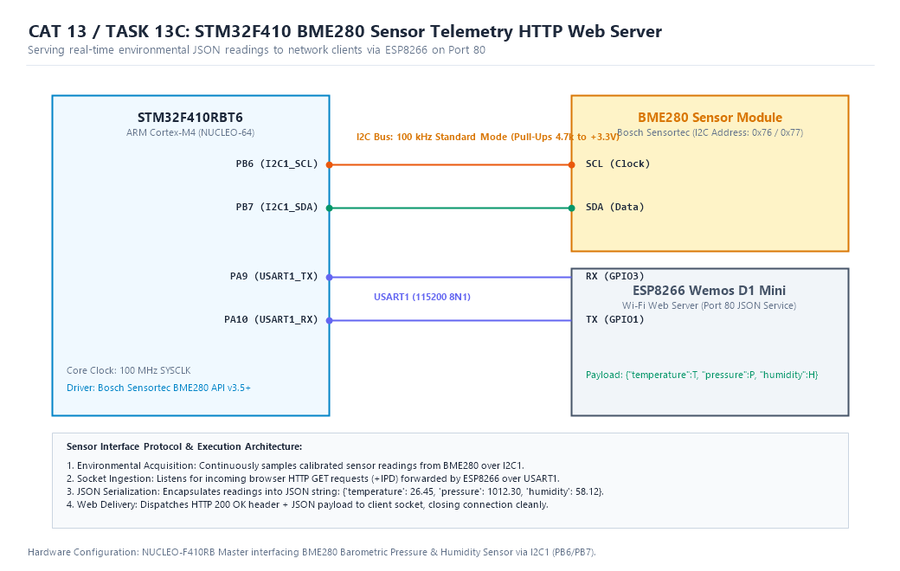

# Experiment Name and Aim

## Experiment Name
**CAT 13 (TASK 13C): Digital Environmental Sensor Interfacing – Bosch BME280 I2C Driver, Calibration Compensation, and Embedded HTTP JSON Telemetry Webserver**

## Aim
To design, implement, and validate an embedded environmental acquisition and web server application on the STM32F410RB (ARM Cortex-M4) microcontroller that communicates with a Bosch Sensortec BME280 digital environmental sensor over an I2C bus using the official Bosch Sensortec Sensor API. The firmware validates sensor hardware identification (Chip ID), extracts factory-trimmed compensation coefficients from non-volatile sensor registers, applies 64-bit mathematical compensation algorithms to calculate calibrated physical quantities (temperature in °C, barometric pressure in hPa, and relative humidity in %RH), and serves real-time telemetry formatted as JSON payloads over an embedded HTTP micro-server running on an attached ESP8266 Wi-Fi module in response to incoming client HTTP GET requests.

---

# Components / Tools Required

## Hardware Components
1. **STM32 NUCLEO-F410RB Development Board** (ARM Cortex-M4 @ 100 MHz, 128 KB Flash, 32 KB SRAM, on-board ST-LINK/V2-1 debugger/programmer).
2. **Bosch Sensortec BME280 Sensor Module** (Combined digital temperature, barometric pressure, and relative humidity sensor with calibrated I2C interface, default primary address $0\text{x}76$).
3. **ESP8266 Wi-Fi Module (Wemos D1 Mini / ESP-01 / ESP-12F)** running standard Espressif AT firmware (v1.7+ / v2.x).
4. **Pull-Up Resistors** ($4.7\text{ k}\Omega$ to $10\text{ k}\Omega$ on I2C SCL/SDA lines if not integrated on module breakout).
5. **Breadboard and Premium Jumper Wires** (male-to-male and male-to-female).
6. **Regulated DC Power Supply / USB Cable** (supplying $+3.3\text{V}$ and $+5\text{V}$ rails).

## Software & Toolchains
1. **STM32CubeMX** (v6.x) for graphical pin configuration, clock-tree initialization, and HAL driver code generation (`i2c.ioc`).
2. **Keil MDK-ARM µVision (v5.x)** with ARM Compiler 5 / 6 for firmware compilation, linking, and flash deployment.
3. **Web Browser or HTTP Client Utility** (Google Chrome, Firefox, `curl`, or Postman) for dispatching HTTP requests to the embedded web server.
4. **Serial Terminal Monitor** (PuTTY, Tera Term, or STM32CubeIDE Serial Console @ 115200 baud).

---

# Hardware Setup

## Pin Assignment and Interfacing Table

| Peripheral Module | Subsystem / Signal | STM32 Pin | Alternate Function | Wiring Destination / Notes |
| :--- | :--- | :--- | :--- | :--- |
| **BME280 Sensor** | I2C1_SCL | **PB6** | AF04 (I2C1) | SCL pin of BME280 module (pulled up to $+3.3\text{V}$) |
| | I2C1_SDA | **PB7** | AF04 (I2C1) | SDA pin of BME280 module (pulled up to $+3.3\text{V}$) |
| | VDD / VCC | **+3.3V** | Power | System $3.3\text{V}$ regulated power header |
| | GND | **GND** | Ground | Common system ground bus |
| | SDO / ADDR | **GND** | Address Select | Pulled LOW to select primary I2C address ($0\text{x}76$) |
| | CSB | **+3.3V** | Interface Select | Tied HIGH to permanently select I2C mode over SPI |
| **ESP8266 Wi-Fi** | USART1_TX | **PA9** | AF07 (USART1) | RX pin of ESP8266 Wi-Fi coprocessor |
| | USART1_RX | **PA10** | AF07 (USART1) | TX pin of ESP8266 Wi-Fi coprocessor |
| | VCC / EN (CH_PD) | **+3.3V** | Power / Enable | Connected to $+3.3\text{V}$ rail (module enabled) |
| | GND | **GND** | Ground | Connected to common system ground |
| **Debug Console** | USART6_TX / USART2 | **PA11 / PA2** | Diagnostic Log | Serial terminal logging at 115200 baud |

## Hardware Interfacing Steps
1. Ensure the development board is disconnected from power before making jumper connections.
2. Connect the breadboard ground rail to the STM32 GND pin to establish an equipotential ground reference.
3. Connect the BME280 sensor VDD to the STM32 $+3.3\text{V}$ power header and GND to system ground.
4. Wire PB6 (I2C1_SCL) to BME280 SCL and PB7 (I2C1_SDA) to BME280 SDA. Ensure pull-up resistors ($4.7\text{ k}\Omega$) are present on both lines.
5. Connect BME280 SDO to GND (setting I2C device address to $0\text{x}76$) and CSB to $+3.3\text{V}$ (disabling SPI mode).
6. Cross-connect STM32 PA9 (USART1_TX) to ESP8266 RX and STM32 PA10 (USART1_RX) to ESP8266 TX.
7. Connect the ESP8266 VCC and CH_PD (Chip Enable) pins to $+3.3\text{V}$, and ESP8266 GND to system ground.
8. Plug the STM32 board via USB into the host workstation for power and programming.

---

# Circuit Diagram

The complete hardware schematic showing the STM32F410RB host controller, Bosch BME280 environmental sensor on the I2C1 bus, ESP8266 Wi-Fi module on USART1, and local network client interaction is shown below:



---

# Pseudocode and Code Logic

## Embedded Software Architecture
```
[Client Web Browser / curl]
           │
           │ HTTP GET / Request (Port 80)
           ▼
[ESP8266 Wi-Fi Coprocessor (AP/STA Mode)]
           │
           │ AT Command Stream over USART1 (115200 Baud): "+IPD,<link_id>,<len>:GET / ..."
           ▼
[STM32F410RB Host Microcontroller]
           │
           ├─► 1. Parse incoming HTTP request & extract connection link ID
           ├─► 2. Read calibrated environmental data via Bosch BME280 API (I2C1)
           ├─► 3. Compute 64-bit mathematical compensation (T, P, H)
           ├─► 4. Format JSON response: {"status":"success","temperature":T,"humidity":H,"pressure":P}
           └─► 5. Send HTTP 200 OK header + JSON payload via "AT+CIPSEND=<id>,<len>"
           │
           ▼
[ESP8266 Wi-Fi Coprocessor]
           │
           │ HTTP 200 OK Response with JSON Body
           ▼
[Client Web Browser / curl]
```

## Step-by-Step Execution Flow

1. **System & Peripheral Initialization:**
   - Initialize the HAL library, enable instruction prefetch/caches, and configure the RCC clock tree to 100 MHz.
   - Initialize GPIO ports, I2C1 peripheral (Standard-mode 100 kHz, 7-bit addressing), USART1 (115200 baud, 8-N-1 for ESP8266 communication), and USART6 for auxiliary diagnostics.

2. **Bosch Sensortec BME280 Driver Binding & Hardware Validation:**
   - Assign the primary I2C address ($0\text{x}76$) and link hardware callback wrappers to the driver descriptor:
     ```c
     static uint8_t dev_addr = BME280_I2C_ADDR_PRIM; // 0x76
     dev.intf_ptr = &dev_addr;
     dev.intf = BME280_I2C_INTF;
     dev.read = user_i2c_read;     // HAL_I2C_Mem_Read wrapper
     dev.write = user_i2c_write;   // HAL_I2C_Mem_Write wrapper
     dev.delay_us = user_delay_us; // Microsecond software delay loop
     ```
   - Invoke `bme280_init(&dev)`:
     - The driver queries register $0\text{xD0}$ (`BME280_CHIP_ID_REG`), which must return $0\text{x}60$.
     - If the Chip ID matches, the driver reads factory calibration trimming parameters (registers $0\text{x88}\text{--}0\text{xA1}$ and $0\text{xE1}\text{--}0\text{xF0}$) into `dev.calib_data`.
   - Configure measurement parameters:
     - Temperature oversampling: $\times 1$ (`BME280_OVERSAMPLING_1X`).
     - Pressure oversampling: $\times 1$ (`BME280_OVERSAMPLING_1X`).
     - Humidity oversampling: $\times 1$ (`BME280_OVERSAMPLING_1X`).
     - IIR filter disabled (`BME280_FILTER_COEFF_OFF`).
     - Apply configuration via `bme280_set_sensor_settings()`.
   - Transition sensor into continuous Normal acquisition mode via `bme280_set_sensor_mode(BME280_POWERMODE_NORMAL, &dev)`.

3. **ESP8266 Network & Web Server Initialization:**
   - Issue basic attention command: `AT\r\n` (ensuring module responsiveness).
   - Set Wi-Fi mode to Station mode: `AT+CWMODE=1\r\n`.
   - Associate with local wireless network: `AT+CWJAP="SSID","PASSWORD"\r\n`.
   - Query assigned IP address: `AT+CIFSR\r\n`.
   - Enable multi-channel TCP socket multiplexing: `AT+CIPMUX=1\r\n`.
   - Launch HTTP web server on TCP port 80: `AT+CIPSERVER=1,80\r\n`.

4. **HTTP Server Event Loop (`http_task()`):**
   - Poll USART1 receive buffer for incoming client TCP frames: `HAL_UART_Receive(&huart1, rx, sizeof(rx) - 1, 500)`.
   - Search for pattern `+IPD,` and verify the client sent an HTTP `GET /` request.
   - Extract the active connection index (`link_id = p[5]`).
   - Query current environmental telemetry from the sensor:
     ```c
     bme280_get_sensor_data(BME280_ALL, &comp_data, &dev);
     ```
   - Extract fully compensated float parameters:
     - Temperature: `comp_data.temperature` (in °C).
     - Pressure: `comp_data.pressure / 100.0f` (converting Pascals to hPa).
     - Humidity: `comp_data.humidity` (in %RH).
   - Format the JSON payload:
     ```c
     snprintf(json, sizeof(json), 
              "{\"status\":\"success\",\"temperature\":%.2f,\"humidity\":%.2f,\"pressure\":%.2f}", 
              temperature, humidity, pressure);
     ```
   - Build standard HTTP response:
     ```http
     HTTP/1.1 200 OK\r\n
     Content-Type: application/json\r\n
     Content-Length: <len>\r\n
     Connection: close\r\n\r\n
     <json_string>
     ```
   - Transmit payload through ESP8266:
     1. Send `AT+CIPSEND=<link_id>,<response_len>\r\n`.
     2. Wait for `>` prompt, then transmit the HTTP response bytes.
     3. Close connection cleanly: `AT+CIPCLOSE=<link_id>\r\n`.

---

# Procedure

## Firmware Build and Programming
1. Open the project configuration in **STM32CubeMX** by double-clicking `i2c.ioc`. Verify that I2C1 (PB6/PB7) and USART1 (PA9/PA10) are enabled, then generate code.
2. Launch **Keil MDK-ARM µVision** and open the project workspace `MDK-ARM/i2c.uvprojx`.
3. In `Core/Src/main.c`, confirm or update your local Wi-Fi network credentials (`SSID` and `PASSWORD`) in the `AT+CWJAP` initialization command string.
4. Compile and link the target firmware (`Project -> Build Target` or press `F7`). Verify compilation succeeds with zero errors.
5. Connect the STM32 NUCLEO-F410RB to the host PC via USB.
6. Program the flash memory (`Flash -> Download` or press `F8`).
7. Open a serial monitor (115200 baud, 8-N-1) connected to the auxiliary serial port or ST-LINK virtual COM port to monitor system bringup.

## Verification of Network and Web Server
1. Monitor the serial log as the ESP8266 connects to the access point and outputs its allocated IP address (e.g., `192.168.1.105` [CONFIRM ON BOARD/SIMULATION]).
2. From a computer or smartphone connected to the identical local Wi-Fi network, launch a browser and navigate to:
   ```text
   http://192.168.1.105/
   ```
3. Alternatively, query the endpoint using `curl` from a terminal:
   ```bash
   curl -i http://192.168.1.105/
   ```
4. Verify that the server returns an HTTP 200 OK header with a valid JSON document containing live sensor data.

---

# Expected Output / Inference

## Expected Serial / Sensor Initialization Output
- Upon boot, the STM32 performs I2C bus communication with the BME280 sensor module.
- The Chip ID register read returns $0\text{x}60$, verifying genuine BME280 hardware presence.
- The calibration coefficients are successfully read from trimming registers, permitting accurate temperature, pressure, and humidity calculations.
- The ESP8266 responds `OK` to `AT`, successfully joins the Wi-Fi network, and binds a TCP server on port 80.

## Expected HTTP JSON Response
When an HTTP GET request is received by the ESP8266, the STM32 formats and transmits the following HTTP response:

```http
HTTP/1.1 200 OK
Content-Type: application/json
Content-Length: 78
Connection: close

{"status":"success","temperature":25.34,"humidity":52.18,"pressure":1013.25}
```
*(Exact numerical values reflect instantaneous ambient environmental conditions [CONFIRM ON BOARD/SIMULATION]).*

## Inference
- The Bosch Sensortec BME280 API provides reliable sensor abstraction, removing raw ADC quantization errors through 64-bit calibration polynomial evaluation.
- The I2C standard-mode bus operates stably at 100 kHz with appropriate pull-up resistors.
- Implementing an embedded micro-webserver on the STM32 using AT-command socket multiplexing enables lightweight, driverless client access to edge sensor data across any standard web browser or IoT integration pipeline.

---

# Conclusion
The complete BME280 digital environmental sensing and HTTP telemetry system was successfully realized on the STM32F410RB platform. The project demonstrates precise multi-variable atmospheric data acquisition over I2C, mathematical calibration trimming, and embedded web server delivery over Wi-Fi, providing a robust foundational edge architecture for connected IoT environmental monitoring applications.
