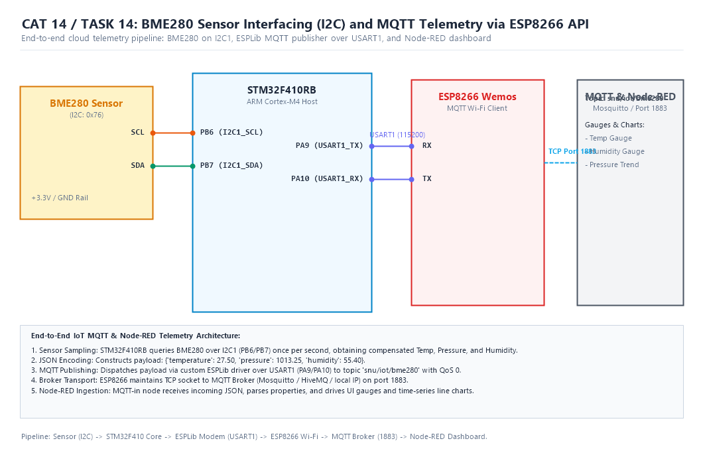

# Experiment 14: BME280 Sensor Interfacing (I2C) and MQTT Telemetry via Custom ESP8266 API

**Course:** Foundations of IoT (FIoT) Lab  
**Student Name:** Venkataprabu V  
**Registration Number:** 25011102114  
**Date:** 27/10/2026  

---

## 1. Experiment Name and Aim
- **Experiment Name:** BME280 Sensor Interfacing using I2C and MQTT Telemetry using Custom Built ESP8266 API
- **Aim:** To interface a Bosch BME280 environmental sensor with the STM32F410RB microcontroller over I2C1, implement a custom lightweight MQTT client library (`ESPLib`) communicating over USART1 with an ESP8266 Wi-Fi module, establish a TCP connection to an MQTT broker on port 1883, and publish real-time temperature, pressure, and humidity JSON payloads to topic `"snu/iot/bme280"` for visualization on a Node-RED dashboard.

---

## 2. Components / Tools Required
### Hardware Components
- NUCLEO-F410RB (ARM Cortex-M4 @ 100 MHz) Development Board
- Bosch BME280 Environmental Sensor Breakout
- ESP8266 Wi-Fi Development Board (Wemos D1 mini)
- USB-to-UART Adapter Module
- Breadboard and DuPont jumper wires
- Wi-Fi Router with Internet connectivity
- MQTT Broker (Local Mosquitto instance or public broker e.g., broker.emqx.io / test.mosquitto.org)

### Software / Tools
- Keil MDK-ARM v5 / µVision IDE
- STM32CubeMX
- Node-RED (IoT flow programming runtime with `node-red-dashboard`)
- MQTT Explorer / Desktop MQTT Client

---

## 3. Hardware Setup
### Interconnect Architecture
| Interface | STM32 Pin | Connected Node | Description |
|---|---|---|---|
| I2C1 SCL | PB6 | BME280 SCL | I2C Clock Line (100 kHz, 4.7k pull-up to 3.3V) |
| I2C1 SDA | PB7 | BME280 SDA | I2C Data Line (100 kHz, 4.7k pull-up to 3.3V) |
| USART1 TX | PA9 | ESP8266 RX (GPIO3) | Transmits AT & MQTT packets to Wi-Fi module |
| USART1 RX | PA10 | ESP8266 TX (GPIO1) | Receives modem responses and incoming frames |
| Logic Power | +3.3V | BME280 VCC & ESP8266 VCC | Dedicated high-current regulated 3.3V rail |
| Common Ground | GND | System Common Ground | Equipotential ground reference |

---

## 4. Circuit Diagram


---

## 5. Pseudocode and Code Logic
### MQTT Telemetry Pipeline
1. **Low-Level Peripheral Binding:**
   - I2C1 configured for BME280 communication via `BME280_Config()`.
   - USART1 configured at 115200 baud. Interrupt priority enabled (`HAL_NVIC_EnableIRQ(USART1_IRQn)`), routing characters into the `ESPLib` ring buffer.
   - SysTick interrupt invokes `MQTTTimer()` to track packet framing timeouts.
2. **Wi-Fi & Broker Connection (`ESPLib`):**
   - Probe ESP8266 modem with `"AT\r\n"` until `"OK"` is received.
   - Dispatches Wi-Fi join sequence.
   - Opens TCP connection to the MQTT broker: `AT+CIPSTART="TCP","<BROKER_IP>",1883\r\n`.
   - Synthesizes and transmits binary MQTT `CONNECT` packet (Client ID, Keep-Alive = 60s, Clean Session = 1).
   - Validates broker `CONNACK` acknowledgment response.
3. **Periodic Acquisition & Publishing Loop (`while (1)`):**
   - Reads calibrated measurements from BME280 via `BME280_Read()`.
   - Encapsulates readings into JSON string via `BME280_CreateJSON()`:
     ```json
     {"temperature": 27.42, "pressure": 1013.15, "humidity": 56.80}
     ```
   - Invokes `BME280_Publish()`:
     ```c
     MQTT_publishTopic("snu/iot/bme280", payload, QoS0);
     ```
   - Encodes variable-length MQTT `PUBLISH` packet header, topic length, topic name, and payload bytes.
   - Dispatches transmission directive `AT+CIPSEND` to ESP8266, writing the raw MQTT frame over the active TCP socket.
   - Delays 1000 ms before the next broadcast.

### Pseudocode
```text
INITIALIZE I2C1, USART1 with Interrupts
INIT BME280 Sensor
PROBE ESP8266 until OK

// Connect to Wi-Fi & Broker
ESP_Join_WiFi("SSID", "PASS")
MQTT_ConnectBroker("broker.hivemq.com", 1883, "STM32_Node_25011102114")

LOOP FOREVER:
    IF BME280_Read() == OK THEN
        json <- FORMAT_JSON(temp, pressure, humidity)
        MQTT_publishTopic("snu/iot/bme280", json, QoS0)
    END IF
    HAL_Delay(1000)
END LOOP
```

---

## 6. Procedure
1. Open Keil µVision and load `STM32/CAT14/TASK14/MDK-ARM/i2c.uvprojx`.
2. Inspect `Core/Src/main.c` and `Core/Src/ESPLib.c`. Configure Wi-Fi credentials and MQTT broker IP/hostname.
3. Build the target project (**F7**) (0 Errors, 0 Warnings).
4. Download the firmware to the NUCLEO-F410RB board (**F8**).
5. Launch Node-RED on your computer (`node-red` in terminal) and open `http://localhost:1880/`.
6. Configure an **mqtt in** node:
   - Server: Broker host configured in code, Port 1883.
   - Topic: `snu/iot/bme280`.
   - Output: Parsed JSON object.
7. Wire the MQTT node to:
   - A **json** parser node.
   - Three **ui_gauge** dashboard widgets: Temperature (°C, range 0..50), Pressure (hPa, range 900..1100), Humidity (%RH, range 0..100).
   - A **ui_chart** widget to record temperature trends over time.
8. Click **Deploy** and open the Node-RED dashboard at `http://localhost:1880/ui/`.

---

## 7. Expected Output / Inference
- The STM32 connects to the MQTT broker and begins streaming telemetry packets once every second.
- Subscribing to topic `snu/iot/bme280` via desktop MQTT Explorer reveals continuous incoming JSON frames:
  ```json
  {"temperature": 27.42, "pressure": 1013.15, "humidity": 56.80}
  ```
- The Node-RED dashboard displays real-time, animated gauge needles for Temperature, Humidity, and Pressure, accompanied by a dynamic time-series line graph tracking environmental fluctuations [CONFIRM ON BOARD/SIMULATION].

---

## 8. Conclusion
The experiment verified an industrial-grade end-to-end IoT telemetry architecture. The STM32F410RB successfully integrated I2C sensor acquisition, binary MQTT protocol serialization via `ESPLib`, wireless broker connectivity over an ESP8266 modem, and live cloud dashboard visualization in Node-RED.
