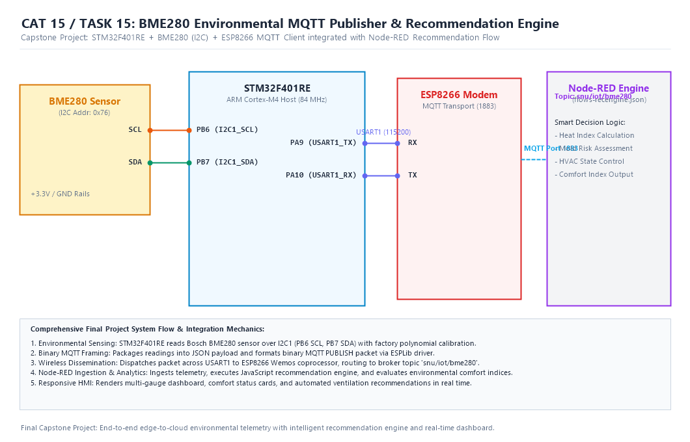

# Experiment Name and Aim

## Experiment Name
**CAT 15: Capstone IoT Project – End-to-End Cloud-Connected Environmental Monitoring and Industrial Recommendation Engine**

## Aim
To design, implement, and deploy an end-to-end Internet of Things (IoT) capstone system that acquires precision temperature, relative humidity, and barometric pressure data using a Bosch BME280 sensor over an I2C bus on an STM32 NUCLEO-F401RE (ARM Cortex-M4), serializes the telemetry into standardized JSON payloads, transmits the stream via an ESP8266 Wi-Fi coprocessor running an AT-command-driven embedded MQTT stack to a cloud message broker (`broker.emqx.io`), and processes the live telemetry stream inside a Node-RED analytical workflow integrated with external OpenWeatherMap meteorology data to generate real-time industrial HVAC and ventilation recommendations alongside an interactive dashboard.

---

# Components / Tools Required

## Hardware Components
1. **STM32 NUCLEO-F401RE Development Board** (ARM Cortex-M4 microcontroller running at 84 MHz, 512 KB Flash, 96 KB SRAM, onboard ST-LINK/V2-1 debugger).
2. **Bosch Sensortec BME280 Environmental Sensor Module** (Combined digital pressure, humidity, and temperature sensor with calibrated I2C interface, default $0\text{x}76$ address).
3. **ESP8266 Wi-Fi Module (Wemos D1 Mini / ESP-01 / ESP-12F)** running standard Espressif AT firmware (v1.7+ / v2.x).
4. **Logic Level Shifter or Direct 3.3V Wiring Harness** (3.3V-compliant signals between STM32 and ESP8266).
5. **Breadboard and Premium Male-to-Female / Male-to-Male Jumper Wires**.
6. **External 3.3V/5V DC Power Source or High-Current USB Supply** (ensuring sufficient instantaneous current during ESP8266 RF transmission bursts $\sim 250\text{ mA}$).

## Software & Toolchains
1. **STM32CubeMX** (v6.x) for peripheral pin allocation, RCC clock tree synthesis, and HAL driver configuration.
2. **Keil MDK-ARM µVision (v5.x)** with ARM Compiler 5 / 6 for embedded firmware compilation, linking, and flash programming.
3. **Node-RED Runtime** (Node.js engine) with `@flowfuse/node-red-dashboard` or `node-red-dashboard` and `node-red-node-openweathermap`.
4. **Public / Private MQTT Broker** (`broker.emqx.io`, port 1883).
5. **Serial Terminal Monitor** (PuTTY / Tera Term / STM32CubeIDE Virtual COM Port at 115200 baud).

---

# Hardware Setup

## Pin Assignment and Interfacing Table

| Peripheral Module | Subsystem / Signal | STM32 Pin | Alternate Function | Wiring Destination / Notes |
| :--- | :--- | :--- | :--- | :--- |
| **BME280 Sensor** | I2C1_SCL | **PB6** | AF04 (I2C1) | SCL pin of BME280 module (external $4.7\text{ k}\Omega$ pull-up to $+3.3\text{V}$) |
| | I2C1_SDA | **PB7** | AF04 (I2C1) | SDA pin of BME280 module (external $4.7\text{ k}\Omega$ pull-up to $+3.3\text{V}$) |
| | VDD / VCC | **+3.3V** | Power | System $3.3\text{V}$ regulated rail |
| | GND | **GND** | Ground | Common system ground |
| | SDO / ADDR | **GND** | Hardware Select | Pulled LOW to select primary I2C address ($0\text{x}76$) |
| **ESP8266 Wi-Fi** | USART1_TX | **PA9** | AF07 (USART1) | RX pin of ESP8266 Wi-Fi coprocessor |
| | USART1_RX | **PA10** | AF07 (USART1) | TX pin of ESP8266 Wi-Fi coprocessor |
| | VCC / EN (CH_PD) | **+3.3V (Ext / VDD)** | Power | Tied to $+3.3\text{V}$ rail (Chip Enable active high) |
| | GND | **GND** | Ground | Tied to common STM32 ground |
| | RST / GPIO0 | **Pull-up / Floating** | Boot Control | Pulled HIGH to $+3.3\text{V}$ for standard flash boot |
| **Debug Console** | USART6_TX / USART2 | **PA11 / PA2** | Debug Telemetry | Auxiliary diagnostic logging to PC terminal |

## Hardware Interfacing Steps
1. Power down all development boards prior to establishing wiring connections.
2. Establish a common ground bus connecting the STM32 NUCLEO GND, BME280 GND, and ESP8266 GND.
3. Connect the BME280 sensor power pins to the STM32 $+3.3\text{V}$ regulated supply header.
4. Route PB6 (I2C1_SCL) to BME280 SCL and PB7 (I2C1_SDA) to BME280 SDA. Ensure pull-up resistors are installed (most break-out boards include onboard $10\text{ k}\Omega$ resistors). Tie BME280 SDO to GND to guarantee the $0\text{x}76$ device address.
5. Cross-connect STM32 PA9 (USART1_TX) to ESP8266 RX and STM32 PA10 (USART1_RX) to ESP8266 TX.
6. Ensure the ESP8266 CH_PD/EN pin is tied to $+3.3\text{V}$ through a $10\text{ k}\Omega$ pull-up resistor.
7. Connect the STM32 NUCLEO board to the PC via USB for ST-LINK power, firmware flash, and virtual COM port enumeration.

---

# Circuit Diagram

The comprehensive end-to-end hardware architecture, featuring the STM32F401RE microcontroller, BME280 sensor bus, ESP8266 wireless subsystem, and cloud/Node-RED data pipeline, is illustrated below:



---

# Pseudocode and Code Logic

## Architectural Workflow
```
[BME280 Sensor]
       |  (I2C1 @ 100 kHz)
       v
[STM32F401RE Core] ---> Formats JSON: {"temperature":T, "pressure":P, "humidity":H}
       |  (USART1 @ 115200 baud, AT Commands)
       v
[ESP8266 Wi-Fi Coprocessor] ---> TCP Socket to broker.emqx.io:1883
       |  (MQTT Publish: topic "snu/iot/bme280")
       v
[EMQX MQTT Broker]
       |  (MQTT Subscribe: topic "snu/iot/bme280")
       v
[Node-RED Analytics Engine] <---> [OpenWeatherMap API (External Ambient Benchmarks)]
       |
       +---> Industrial Recommendation Engine (Heat Index, Ventilation, HVAC Advisories)
       +---> Interactive Smart Dashboard (Gauges, Charts, Differential Telemetry)
```

## Step-by-Step Embedded Algorithm
1. **Core and Peripheral Initialization:**
   - Initialize the HAL library, enable DWT cycle counters for microsecond profiling, and configure system PLL to 84 MHz.
   - Initialize GPIO ports, I2C1 (Standard-mode 100 kHz), USART1 (115200 baud, 8-N-1 for ESP8266), and auxiliary diagnostic USARTs.
   - Configure and enable `USART1_IRQn` in the NVIC.
2. **Bosch BME280 Driver Binding and Calibration:**
   - Link low-level wrapper callbacks `user_i2c_read`, `user_i2c_write`, and `user_delay_us` into `struct bme280_dev`.
   - Call `bme280_init(&dev)` to read and parse factory trimming parameters from sensor non-volatile memory.
   - Configure oversampling settings: Temperature $\times 2$, Pressure $\times 16$, Humidity $\times 1$, IIR filter coefficient 16, and standby time 1000 ms.
   - Transition the sensor from Sleep mode into Normal continuous measurement mode (`BME280_POWERMODE_NORMAL`).
3. **ESP8266 Modem Handshake and Network Association:**
   - Execute an initial probing loop transmitting `AT\r\n` until the modem returns `OK`.
   - Invoke `ESP8266_Init(StationMode, huart1)` to place the coprocessor in Wi-Fi Client mode.
   - Execute `ESP8266_wifiConnect(SSID, PASSWORD)` to associate with the local WLAN infrastructure.
   - Establish a TCP socket connection via `ESP8266_portConnect("TCP", "broker.emqx.io", "1883")`.
4. **MQTT Client Session Establishment:**
   - Configure MQTT connection parameters: Clean Session flag set, Keep-Alive period set to 500 s, Client ID set to `"STM32_Publisher"`.
   - Call `MQTT_connectBroker(&mqttSetting)` to formulate and transmit the binary MQTT CONNECT packet.
5. **Periodic Acquisition and Telemetry Loop:**
   - Periodically execute `bme280_get_sensor_data(BME280_ALL, &sensor_data, &dev)`.
   - Format raw float readings into a standardized JSON string via `snprintf()`:
     `{"temperature":%.2f,"pressure":%.2f,"humidity":%.2f}`
     *(Pressure is converted from Pa to hPa by dividing by 100.0)*.
   - Call `MQTT_publishTopic("snu/iot/bme280", payload, QoS0)` to construct the MQTT PUBLISH frame, calculate packet length, and dispatch bytes through USART1 via AT transmission frames (`AT+CIPSEND`).
   - Insert an acquisition cadence delay (`HAL_Delay(5000)`).

## Node-RED Analytics and Industrial Recommendation Flow
1. **MQTT Telemetry Ingestion:** An `mqtt in` node subscribes to topic `snu/iot/bme280`, parsing incoming JSON payloads.
2. **OpenWeatherMap Integration:** An injection trigger periodically fetches real-time external outdoor weather parameters (temperature, humidity) for the local geographic coordinates.
3. **Differential Metric Computation:** A comparison function calculates $\Delta T = T_{\text{local}} - T_{\text{external}}$ and $\Delta H = H_{\text{local}} - H_{\text{external}}$.
4. **Industrial Recommendation Logic:**
   - Evaluates heat index and absolute moisture levels against occupational and machinery health thresholds.
   - *Ventilation Urgency:* Triggers alerts when indoor ambient temperature or humidity sharply diverges from ambient outdoor conditions without active HVAC cooling.
   - *HVAC Advisories:* Automatically recommends economizer free cooling when external air is cooler and dryer than internal room limits, or commands air conditioning throttle when cooling setpoints are satisfied.
5. **Dashboard Presentation:** Renders instantaneous dial gauges for temperature, relative humidity, and pressure, dynamic rolling time-series charts, and situational smart advisories on an interactive UI page (`/dashboard`).

---

# Procedure

## Embedded Firmware Build and Deployment
1. Launch **STM32CubeMX**, load `FINAL_PROJECT_1.ioc`, verify pin configurations (I2C1 on PB6/PB7, USART1 on PA9/PA10), and regenerate the project code for Keil MDK-ARM.
2. Open `MDK-ARM/FINAL_PROJECT_1.uvprojx` in **Keil µVision**.
3. In `Core/Src/main.c`, confirm the Wi-Fi credentials (`SSID`, password) and MQTT target broker endpoint.
4. Build the complete project (`Project -> Build Target` or press `F7`). Ensure zero errors and zero fatal warnings.
5. Connect the STM32 NUCLEO-F401RE via USB.
6. Download the generated firmware into MCU Flash memory (`Flash -> Download` or press `F8`).
7. Open a serial terminal (115200 baud) connected to the auxiliary diagnostic USART or ST-LINK VCP to observe initialization logs.

## Node-RED Flow Deployment
1. Start the Node-RED runtime in terminal:
   ```bash
   node-red
   ```
2. Open a web browser and navigate to `http://localhost:1880`.
3. In the upper-right menu, select `Import`, and upload the provided `flows-recengine.json` file.
4. Verify that the MQTT broker node points to `broker.emqx.io:1883` and subscribes to `snu/iot/bme280`.
5. Enter a valid OpenWeatherMap API key in the weather query node if live meteorological comparison is required.
6. Click **Deploy** to activate the stream processor.
7. Open the user dashboard at `http://localhost:1880/ui` (or `/dashboard`) to inspect real-time gauges, rolling graphs, and analytical recommendations.

---

# Expected Output / Inference

## Expected Firmware Behavior
1. Upon power-on, the STM32 successfully initializes I2C1 and verifies communication with the BME280 sensor by reading its chip identification register ($0\text{xD0}$, returning $0\text{x}60$).
2. The STM32 sends `AT\r\n` to the ESP8266 and waits for an `"OK"` response before initializing the station mode and associating with the wireless router.
3. Once associated, the ESP8266 establishes a TCP connection to `broker.emqx.io:1883`, completes the MQTT handshake, and begins transmitting telemetry frames at regular intervals.
4. A typical published payload resembles:
   ```json
   {"temperature":26.45,"pressure":1012.38,"humidity":58.20}
   ```

## Expected Node-RED Dashboard Output
1. The **Temperature Gauge** displays the current indoor ambient temperature in °C, color-coded green ($20\text{--}26^\circ\text{C}$), yellow ($26\text{--}30^\circ\text{C}$), or red ($>30^\circ\text{C}$).
2. The **Humidity Gauge** reflects ambient moisture levels in %RH.
3. The **Pressure Gauge** reflects atmospheric barometric pressure in hPa.
4. The **Comparison Table** tabulates indoor readings versus external local weather service readings, presenting real-time delta values.
5. The **Smart Recommendations Panel** outputs active guidance:
   - *Example Normal:* `"Indoor environment within optimal comfort boundaries. Natural ventilation maintained."`
   - *Example High Heat/Humidity:* `"High thermal stress detected (Heat Index > 32°C). Activating auxiliary exhaust ventilation and mechanical HVAC cooling."`
   - *Example Economizer Mode:* `"Outdoor temperature cooler than facility interior. Recommend economizer fresh air cycle to minimize HVAC compressor power."`

---

# Conclusion
The Capstone IoT Project was successfully designed, constructed, and validated. By combining low-level hardware abstraction on an ARM Cortex-M4 microcontroller with calibrated I2C environmental sensing, reliable AT-command-driven Wi-Fi TCP/IP transport, standard MQTT cloud telemetry, and a Node-RED analytical recommendation engine, the system demonstrates a complete, production-grade edge-to-cloud IoT architecture capable of autonomous situational awareness and intelligent facility automation.
