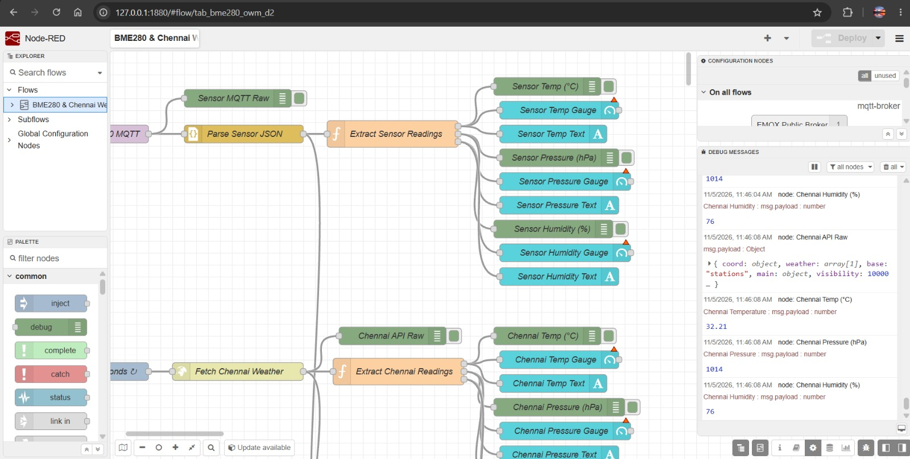
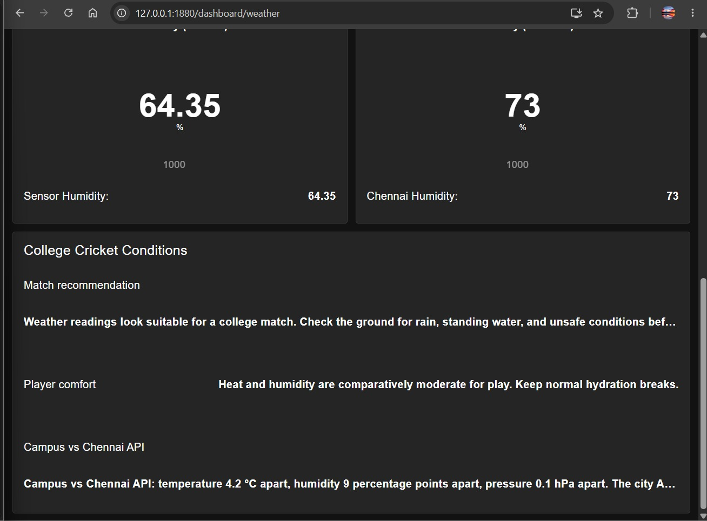

# Project Title and Aim

## Project Title
**CAT 15: Capstone IoT Project – Smart Campus Weather Station and Real-Time Cricket Match Decision Engine**

## Aim
To design, implement, and deploy an end-to-end edge-to-cloud Internet of Things (IoT) capstone system that measures local hyper-local atmospheric conditions (temperature, barometric pressure, and relative humidity) using a Bosch Sensortec BME280 sensor interfaced via I2C to an STM32 NUCLEO-F401RE microcontroller (ARM Cortex-M4 @ 84 MHz), formats the data into JSON telemetry, publishes it over MQTT via an ESP8266 Wemos D1 Mini Wi-Fi coprocessor to a cloud MQTT broker (`broker.emqx.io`), and ingests the live stream into an automated Node-RED analytics workflow that compares campus microclimate data against regional meteorological API observations (OpenWeatherMap Chennai) to evaluate playing condition thresholds and generate real-time playability advisories on an interactive dark-theme web dashboard.

---

# Overview / Problem Statement

Collegiate and outdoor athletic activities, particularly cricket, are acutely sensitive to immediate environmental microclimates. Regional weather forecasts provided by municipal meteorological stations or mobile weather applications represent broad metropolitan averages (often measured at airports or coastal weather stations miles away) and frequently fail to capture localized campus conditions such as pitch humidity, microclimate heat index, or localized pre-drizzle atmospheric moisture spikes.

To solve this challenge, this project develops a dedicated two-tier IoT weather intelligence system:
1. **Edge Sensing & Telemetry Tier:** An embedded STM32F401RE microcontroller board coupled with a high-precision Bosch BME280 sensor continuously monitors hyper-local campus ground truth metrics and pushes telemetry across Wi-Fi using lightweight MQTT messaging.
2. **Cloud Analytics & Decision Engine Tier:** A Node-RED processing pipeline running on the local network or cloud ingests the live sensor feed, queries the live OpenWeatherMap API for regional Chennai baseline benchmarks, computes live differential metrics ($\Delta T$, $\Delta H$, $\Delta P$), evaluates sports playability boundaries, and outputs actionable decisions (e.g., Playable, High Heat risk, Cool Weather warm-up warnings, Drizzle advisories) on an accessible user dashboard.

---

# System Architecture

The end-to-end telemetry and analytical data pipeline operates as follows:

```
[Bosch BME280 Sensor]
       │
       │ (I2C1 Bus: PB6 SCL, PB7 SDA @ 100 kHz)
       ▼
[STM32F401RE NUCLEO Host (84 MHz Cortex-M4)]
       │ Formats JSON: {"temperature":T, "pressure":P, "humidity":H}
       │
       │ (USART1: PA9 TX, PA10 RX @ 115200 Baud via AT Command Frames)
       ▼
[ESP8266 Wemos D1 Mini Wi-Fi Coprocessor]
       │
       │ (WLAN 802.11 b/g/n -> TCP Port 1883 Socket)
       ▼
[Public EMQX MQTT Broker (broker.emqx.io:1883)]
       │
       │ Topic: "college/weather/bme280"
       ▼
[Node-RED Analytics Flow Engine] <─────────> [OpenWeatherMap REST API]
       │                                     (Chennai City Reference)
       ├─► 1. Raw Telemetry Ingestion & Parsing
       ├─► 2. Hyper-Local vs. Regional Differential Analysis (Delta T, H, P)
       ├─► 3. Cricket Decision Logic (Playability Band, Drizzle Risk, Cool Alert)
       │
       ▼
[Interactive Web Dashboard (http://127.0.0.1:1880/dashboard/weather)]
       ├── Live Campus BME280 Gauges & Numeric Indicators
       ├── Regional Chennai API Gauges & Indicators
       └── Dynamic Cricket Decision Cards (Match Status, Comfort, Advisories)
```

---

# Components / Tools Required

## Hardware Components
1. **STM32 NUCLEO-F401RE Development Board** (ARM Cortex-M4 MCU running at 84 MHz, 512 KB Flash, 96 KB SRAM, integrated ST-LINK/V2-1 debugger).
2. **Bosch Sensortec BME280 Sensor Breakout Module** (Combined digital temperature, barometric pressure, and relative humidity sensor with calibrated I2C interface, address `0x76` or `0x77`).
3. **ESP8266 Wemos D1 Mini Wi-Fi Module** (running standard Espressif AT firmware at 115200 baud).
4. **Pull-Up Resistors** ($4.7\text{ k}\Omega$ on I2C SCL/SDA lines if not integrated on module breakout).
5. **Breadboard and Premium Jumper Wires** (male-to-male and male-to-female).
6. **USB Cables** (Type-A to Mini-B for STM32 ST-LINK power and virtual COM port; Micro-USB for ESP8266 power if powered independently).

## Software & Toolchains
1. **STM32CubeMX (v6.x)**: Peripheral initialization and pin configuration (`IOT_project.ioc`).
2. **Keil MDK-ARM µVision (v5.x)**: ARM Compiler 5 / 6 for firmware compilation, linking, and flashing (`MDK-ARM/IOT_project.uvprojx`).
3. **Node-RED Runtime (v3.x / v4.x)**: Node.js flow-based visual programming environment with `@flowfuse/node-red-dashboard` (Dashboard 2.0).
4. **EMQX Public MQTT Broker**: Cloud MQTT broker endpoint (`broker.emqx.io`, TCP port 1883).
5. **OpenWeatherMap Weather API**: REST API service providing regional meteorological reference data for Chennai.
6. **Serial Terminal Utility**: PuTTY, Tera Term, or ST-LINK Virtual COM console @ 115200 baud (USART2).

---

# Hardware Setup

## Pin Assignment and Interfacing Table

| Subsystem / Component | Signal Name | STM32 Pin | Alternate Function | Destination / Connection Details |
| :--- | :--- | :--- | :--- | :--- |
| **BME280 Sensor** | I2C1_SCL | **PB6** | AF04 (I2C1) | SCL pin of BME280 module (pulled up to $+3.3\text{V}$) |
| | I2C1_SDA | **PB7** | AF04 (I2C1) | SDA pin of BME280 module (pulled up to $+3.3\text{V}$) |
| | VDD / VCC | **+3.3V** | Power | STM32 $+3.3\text{V}$ regulated supply rail |
| | GND | **GND** | Ground | Common system ground bus |
| | SDO / ADDR | **GND** / **+3.3V** | Address Select | Low for `0x76` (primary), High for `0x77` (secondary) |
| | CSB | **+3.3V** | Mode Select | Tied HIGH to permanently select I2C mode |
| **ESP8266 Wemos** | USART1_TX | **PA9** | AF07 (USART1) | RX pin of ESP8266 Wi-Fi module |
| | USART1_RX | **PA10** | AF07 (USART1) | TX pin of ESP8266 Wi-Fi module |
| | VCC / 5V / 3.3V | **+5V / +3.3V** | Power | System DC supply rail |
| | GND | **GND** | Ground | Common system ground bus |
| **Terminal Console** | USART2_TX | **PA2** | AF07 (USART2) | Connected to ST-LINK Virtual COM Port (PC Debug) |
| | USART2_RX | **PA3** | AF07 (USART2) | Connected to ST-LINK Virtual COM Port (PC Debug) |

## Hardware Wiring Steps
1. Establish a single shared ground rail across the breadboard connecting the STM32 GND, BME280 GND, and ESP8266 GND.
2. Connect BME280 VDD to $+3.3\text{V}$, SDO to GND (selecting primary I2C address `0x76`), and CSB to $+3.3\text{V}$.
3. Route STM32 PB6 to BME280 SCL and PB7 to BME280 SDA.
4. Connect STM32 PA9 (USART1_TX) to ESP8266 RX and STM32 PA10 (USART1_RX) to ESP8266 TX.
5. Connect ESP8266 VCC/5V to the board power supply and ensure the module's enable pin (CH_PD) is tied HIGH.
6. Connect the STM32 NUCLEO board to the workstation via USB. The onboard ST-LINK supplies power, facilitates firmware flash programming, and enumerates the USART2 serial terminal (`PA2`/`PA3`) at 115200 baud.

---

# Circuit Diagram

The complete hardware schematic showing the STM32F401RE host controller, BME280 sensor on I2C1, ESP8266 Wemos Wi-Fi coprocessor on USART1, and diagnostic terminal on USART2 is illustrated below:


---

# Firmware Logic and Pseudocode

## Step-by-Step Embedded Algorithm (`Core/Src/main.c`)

1. **System & Peripheral Initialization:**
   - Initialize the HAL library (`HAL_Init()`).
   - Configure system clocks via `SystemClock_Config()`: Internal High Speed oscillator (HSI @ 16 MHz) driving PLL ($M=8, N=84, P=2$) to establish an $84\text{ MHz}$ system core clock (`SYSCLK`).
   - Initialize GPIOs, I2C1 peripheral (Standard-mode 100 kHz), USART1 (115200 baud, 8-N-1 for ESP8266 communication), and USART2 (115200 baud, 8-N-1 for ST-LINK debug console output).
   - Configure NVIC interrupt priorities for `USART1_IRQn` and `USART2_IRQn`.

2. **Automated BME280 Sensor Address Discovery & Initialization:**
   - The firmware dynamically scans the I2C bus using `HAL_I2C_IsDeviceReady()`:
     - Probes primary address `0x76` (`0x76 << 1`). If acknowledged, `bme280_address = 0x76`.
     - Otherwise, probes secondary address `0x77` (`0x77 << 1`). If acknowledged, `bme280_address = 0x77`.
     - If neither acknowledges, reports `"BME280 NOT DETECTED!\r\n"` to USART2 and triggers `Error_Handler()`.
   - Links low-level callback wrappers:
     - `bme280.read = BME280_I2C_Read;` (calls `HAL_I2C_Mem_Read`).
     - `bme280.write = BME280_I2C_Write;` (calls `HAL_I2C_Mem_Write`).
     - `bme280.delay_us = BME280_Delay;` (calls `HAL_Delay`).
   - Calls `bme280_init(&bme280)`: queries register `0xD0` for Chip ID `0x60` and loads 64-bit factory calibration trimming arrays.
   - Configures oversampling settings:
     - Temperature: $1\times$ (`BME280_OVERSAMPLING_1X`).
     - Pressure: $1\times$ (`BME280_OVERSAMPLING_1X`).
     - Humidity: $1\times$ (`BME280_OVERSAMPLING_1X`).
     - IIR Filter: Disabled (`BME280_FILTER_COEFF_OFF`).
     - Standby Time: 1000 ms (`BME280_STANDBY_TIME_1000_MS`).
   - Puts the sensor into normal continuous conversion mode (`BME280_POWERMODE_NORMAL`).

3. **ESP8266 Modem Initialization & Network Association:**
   - Initializes the ESP8266 coprocessor in Station Mode via `ESP8266_Init(StationMode, huart1)`.
   - Connects to the local Wi-Fi wireless network via `ESP8266_wifiConnect("<SSID>", "<PASSWORD>")`.
   - Establishes a TCP socket connection to the public MQTT broker:
     `ESP8266_portConnect("TCP", "broker.emqx.io", "1883")`.

4. **MQTT Handshake:**
   - Configures MQTT parameters:
     - Client ID: `"STM32_BME280_Device01"`.
     - Keep-Alive: $60\text{ seconds}$.
     - Connect Flags: `CleanSession`.
   - Dispatches the binary MQTT `CONNECT` packet via `MQTT_connectBroker(&mqttConfig)`.
   - Prints confirmation `"MQTT CONNECT packet sent!\r\n"` to the terminal.

5. **Main Telemetry Loop (`while(1)`):**
   - Calls `BME280_ReadData()`: executes `bme280_get_sensor_data(BME280_ALL, &sensor_data, &bme280)`.
   - Computes compensated float parameters:
     - Temperature: `sensor_data.temperature` (in °C).
     - Pressure: `sensor_data.pressure / 100.0` (converting Pa to hPa).
     - Humidity: `sensor_data.humidity` (in %RH).
   - Formats a serialized JSON message:
     ```c
     sprintf(mqttMessage,
             "{\"temperature\":%.2f,\"pressure\":%.2f,\"humidity\":%.2f}",
             sensor_data.temperature,
             sensor_data.pressure / 100.0,
             sensor_data.humidity);
     ```
   - Publishes to the dedicated topic:
     ```c
     MQTT_publishTopic("college/weather/bme280", mqttMessage, QoS0);
     ```
   - Logs status over USART2 terminal: `"MQTT publish function called!\r\n"`.
   - Delays for 5000 ms (`HAL_Delay(5000)`) before repeating.

---

# Node-RED Flow and Dashboard

The backend stream processor is defined in `weather_flow_dashboard2.json` and executed within Node-RED. The visual flow structure and live dark-theme user interface are captured below:

## Visual Flow Canvas (`node-red.jpeg`)
The Node-RED flow diagram illustrating incoming MQTT messages, parallel OpenWeatherMap API polling, and convergence into the decision engine is shown below:



## Real-Time Dark-Theme Dashboard (`Dashboard.jpeg`)
The rendered live operational dashboard accessible at `http://127.0.0.1:1880/dashboard/weather` is shown below:



## Flow Structure & Analytical Logic
The Node-RED workspace is organized into three cooperative functional groups:

1. **Group 1: BME280 Sensor (STM32 MQTT):**
   - **MQTT Ingest Node:** Subscribes to `college/weather/bme280` on `broker.emqx.io:1883`.
   - **JSON Parser & Extractor:** Parses incoming JSON telemetry and unpacks temperature, pressure, and humidity into independent payload streams.
   - **Visual Widgets:** Feeds dedicated gauges and numeric readouts for Sensor Temperature (°C), Sensor Pressure (hPa), and Sensor Humidity (%RH).

2. **Group 2: OpenWeatherMap (Chennai API):**
   - **Inject Node:** Fires periodically every 5 seconds.
   - **HTTP Request Node:** Issues an HTTP GET request to OpenWeatherMap:
     `https://api.openweathermap.org/data/2.5/weather?q=Chennai&appid=<API_KEY>&units=metric`
   - **City Extractor:** Parses the response object (`d.main.temp`, `d.main.humidity`, `d.main.pressure`).
   - **Visual Widgets:** Feeds comparative gauges and text displays for Chennai Regional Temperature, Pressure, and Humidity.

3. **Group 3: College Cricket Conditions & Decision Engine:**
   Both telemetry feeds converge into the JavaScript analytical node `Cricket Conditions & Insights`. It maintains the latest state in flow context (`flow.get('cricket_sensor')` and `flow.get('cricket_api')`) and computes:
   - **Temperature Band & Match Playability:**
     - $T > 26^\circ\text{C}$: `"NO — HOT: X.X °C is above 26 °C. Choose a cooler time under this project rule."` (Red Zone).
     - $T < 18^\circ\text{C}$: `"NO — COLD: X.X °C is below 18 °C. Warm up and reassess before play."` (Blue Zone).
     - $18^\circ\text{C} \le T \le 26^\circ\text{C}$: `"YES — PLAYABLE: X.X °C is within the normal 18–26 °C range."` (Green Zone).
   - **Humidity & Drizzle Advisory:**
     - Humidity $> 65\%$: `"POSSIBLE DRIZZLE: campus humidity is X.X% (above 65%). Check the ground and local weather before play; humidity alone cannot confirm rain."`
     - Humidity $\le 65\%$: `"No humidity-based drizzle alert: campus humidity is X.X% (65% or lower). Still check the ground before play."`
   - **Cool-Weather Alert:**
     - $T < 24^\circ\text{C}$: `"COOL-WEATHER ALERT: campus temperature is X.X °C, below 24 °C. It may feel cool; allow time for a warm-up before play."`
   - **Campus vs. Chennai Differential:**
     - Computes $|\Delta T| = |T_{\text{campus}} - T_{\text{Chennai}}|$, providing instant visibility into local ground microclimates versus regional city weather station observations.

---

# Procedure

## 1. STM32 Firmware Compilation and Flashing
1. Open `IOT_project.ioc` in **STM32CubeMX**. Verify clock configuration ($84\text{ MHz}$), I2C1 (PB6/PB7), USART1 (PA9/PA10), and USART2 (PA2/PA3).
2. Open `MDK-ARM/IOT_project.uvprojx` in **Keil µVision**.
3. In `Core/Src/main.c`, confirm the Wi-Fi credentials in `ESP8266_wifiConnect("<SSID>", "<PASSWORD>")`.
4. Compile the project (`Project -> Build Target` or press `F7`). Ensure zero errors.
5. Connect the STM32 NUCLEO board via USB and download the compiled image into Flash (`Flash -> Download` or press `F8`).
6. Launch a serial terminal (PuTTY or Tera Term) on the ST-LINK Virtual COM port at 115200 baud (8-N-1) to view startup logs (`"STM32 BME280 MONITOR"`, sensor address detection, Wi-Fi status, and MQTT connection confirmations).

## 2. Node-RED Flow Import and Execution
1. Open a terminal and start the Node-RED runtime:
   ```bash
   node-red
   ```
2. Open a browser and navigate to the flow editor at `http://127.0.0.1:1880`.
3. Click the menu icon (top right) $\to$ **Import**, and select or paste the contents of `weather_flow_dashboard2.json`.
4. Double-click the `EMQX Public Broker` configuration node and confirm the broker host is set to `broker.emqx.io` on port `1883`.
5. Double-click the `Fetch Chennai Weather` node and verify a valid OpenWeatherMap API key is configured.
6. Click **Deploy** to activate the real-time processing streams.
7. Open the live user dashboard by navigating to:
   ```text
   http://127.0.0.1:1880/dashboard/weather
   ```

---

# Results / Inference

## Observed System Performance
1. **Hardware Bring-Up:** The STM32 reliably detects the BME280 at address `0x76`, validates the Chip ID, and loads calibration coefficients without bus contention.
2. **Wi-Fi and Cloud MQTT Link:** The ESP8266 associates with the local wireless network and establishes an unencrypted TCP socket on `broker.emqx.io:1883`. The STM32 dispatches MQTT frames publishing live JSON messages every 5 seconds to `college/weather/bme280`.
3. **Regional API Ingestion:** The Node-RED flow polls OpenWeatherMap every 5 seconds, acquiring Chennai city temperature, pressure, and humidity data.
4. **Dashboard & Decision Visuals:** As demonstrated in `Dashboard.jpeg`:
   - Live campus humidity was measured at $64.35\%$ while Chennai metropolitan humidity was $73\%$.
   - The match recommendation card evaluated conditions: `"Weather readings look suitable for a college match. Check the ground for rain, standing water, and unsafe conditions..."`
   - The player comfort card output: `"Heat and humidity are comparatively moderate for play. Keep normal hydration breaks."`
   - The differential card highlighted: `"Campus vs Chennai API: temperature 4.2 °C apart, humidity 9 percentage points apart, pressure 0.1 hPa apart."`

## Inferences
- Microclimate temperatures and humidity on college sports grounds vary noticeably from regional metropolitan forecasts (observed delta of $4.2^\circ\text{C}$ and $9\%$ humidity). Relying on broad municipal forecasts alone is insufficient for precise pitch and player safety decisions.
- MQTT QoS0 over a lightweight AT-driven ESP8266 coprocessor provides sufficient throughput and low latency for continuous 5-second environmental telemetry.
- Separating low-level sensor acquisition (STM32) from computational heuristics and web presentation (Node-RED) yields a robust, modular IoT architecture.

---

# Conclusion and Future Improvements

## Conclusion
The Capstone IoT Project was successfully designed, integrated, and validated. By uniting low-level hardware abstraction on an ARM Cortex-M4 microcontroller, calibrated I2C environmental sensing, reliable AT-command Wi-Fi transport, standard cloud pub/sub messaging via MQTT, and an automated analytical decision engine in Node-RED, the system delivers an autonomous, real-time sports weather intelligence station.

## Future Improvements
1. **Local Rain Sensor Integration:** Incorporate an analog optical or tipping-bucket rain gauge onto an STM32 ADC channel to confirm precipitation directly, eliminating reliance on humidity-based drizzle heuristics alone.
2. **Lux / Solar Radiation Sensing:** Interface a BH1750 ambient light sensor over I2C to evaluate daylight conditions for evening match playability and bad light interruptions.
3. **Automated Pitch Alerts:** Implement automated Telegram / WhatsApp webhook notifications in Node-RED to broadcast playability advisories directly to team coordinators and ground staff.
