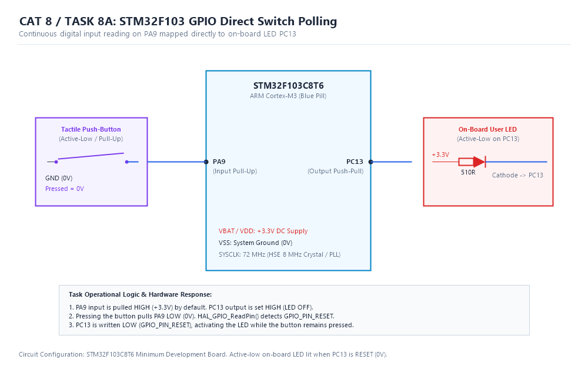

# Experiment 8A: STM32F103 GPIO Direct Push-Button Polling and LED Interfacing

**Course:** Foundations of IoT (FIoT) Lab  
**Student Name:** Venkataprabu V  
**Registration Number:** 25011102114  
**Date:** 18/09/2026  

---

## 1. Experiment Name and Aim
- **Experiment Name:** STM32 Cortex-M3 GPIO Digital Input Polling and Output Control
- **Aim:** To configure General Purpose Input/Output (GPIO) pins on the STM32F103C8T6 microcontroller using the STM32Cube HAL framework, continuously poll a tactile push-button on pin PA9 with internal pull-up enabled, and directly reflect the switch state on the active-low on-board user LED on pin PC13.

---

## 2. Components / Tools Required
### Hardware Components
- STM32F103C8T6 "Blue Pill" ARM Cortex-M3 Development Board
- ST-Link V2 USB In-Circuit Debugger / Programmer
- Tactile Momentary Push-Button Switch
- Breadboard and DuPont jumper wires
- Micro-USB cable (+3.3V / +5V power feed)

### Software / Tools
- STM32CubeMX (Pinout & Clock Configuration utility)
- Keil MDK-ARM v5 / STM32CubeIDE (ARM-GCC / ARMCC toolchain)
- STM32CubeProgrammer / ST-Link Utility

---

## 3. Hardware Setup
### Pin Allocations & Peripheral Map
| STM32 Pin | GPIO Mode | Pull-Up/Down | Peripheral Function | Hardware Connection | Active Level |
|---|---|---|---|---|---|
| PA9 | Input (`GPIO_MODE_INPUT`) | Pull-Up (`GPIO_PULLUP`) | Digital Input | Tactile Push-Button to GND | Active-Low (0V when pressed) |
| PC13 | Output (`GPIO_MODE_OUTPUT_PP`) | No Pull (`GPIO_NOPULL`) | Digital Output | On-Board Green LED (via 510Ω) | Active-Low (0V = LED ON) |
| PD0 / PD1 | Oscillator Input / Output | High-Z | RCC HSE | 8.000 MHz Crystal | - |
| VDD / VSS | Power / Ground | - | System Supply | +3.3V DC / 0V Ground | - |

### System Clock & Bus Configuration
- **HSE Frequency:** 8.0 MHz external quartz crystal.
- **PLL Configuration:** Multiplied by 9 (`RCC_PLL_MUL9`) to yield a 72.0 MHz System Clock (SYSCLK).
- **AHB Bus (HCLK):** Prescaler /1 -> 72.0 MHz core clock.
- **APB1 Peripheral Bus:** Prescaler /2 -> 36.0 MHz.
- **APB2 Peripheral Bus:** Prescaler /1 -> 72.0 MHz (supplying GPIO Port A and Port C clocks).

### Wiring Instructions
1. Mount the STM32F103C8T6 development board onto the breadboard.
2. Wire one terminal of the tactile push-button to pin PA9 (Header Pin A9).
3. Wire the opposite diagonal terminal of the push-button to any system Ground (GND) pin.
4. Pin PC13 is internally routed on the Blue Pill PCB to the cathode of the on-board user LED with an anode pull-up to +3.3V via a 510 Ω resistor.
5. Connect ST-Link V2 to the SWD header: SWDIO to SWDIO, SWCLK to SWCLK, GND to GND, and 3.3V to 3.3V.

---

## 4. Circuit Diagram


---

## 5. Pseudocode and Code Logic
### Operation Sequence
1. In `main()`, initialize the HAL library (`HAL_Init()`), which configures the Flash prefetch buffer, data/instruction caches, and SysTick timer (1 ms base).
2. Configure system oscillators and clocks via `SystemClock_Config()`: enable HSE, lock PLL at 72 MHz, and switch SYSCLK.
3. Call `MX_GPIO_Init()`:
   - Enable peripheral clock gates: `__HAL_RCC_GPIOC_CLK_ENABLE()` and `__HAL_RCC_GPIOA_CLK_ENABLE()`.
   - Configure PC13 as Output Push-Pull with Low output speed (`GPIO_SPEED_FREQ_LOW`).
   - Configure PA9 as Input with internal Pull-Up resistor (`GPIO_PULLUP`).
   - Preset PC13 to `GPIO_PIN_SET` so the active-low LED begins in the OFF state.
4. In the superloop (`while (1)`):
   - Sample PA9 using `HAL_GPIO_ReadPin(GPIOA, GPIO_PIN_9)`.
   - If pin reads `GPIO_PIN_RESET` (button pressed to GND), drive PC13 to `GPIO_PIN_RESET` (LED turns ON).
   - If pin reads `GPIO_PIN_SET` (button released, pulled to 3.3V), drive PC13 to `GPIO_PIN_SET` (LED turns OFF).

### Pseudocode
```text
INITIALIZE HAL
INITIALIZE System Clock (72 MHz via HSE + PLL)
INITIALIZE GPIO:
    ENABLE Port A and Port C clocks
    SET PC13 as Output Push-Pull (Default = HIGH, LED OFF)
    SET PA9 as Input with Pull-Up

LOOP FOREVER:
    raw_state <- HAL_GPIO_ReadPin(Port A, Pin 9)
    IF raw_state == GPIO_PIN_RESET THEN
        HAL_GPIO_WritePin(Port C, Pin 13, GPIO_PIN_RESET)  // Turn LED ON
    ELSE
        HAL_GPIO_WritePin(Port C, Pin 13, GPIO_PIN_SET)    // Turn LED OFF
    END IF
END LOOP
```

---

## 6. Procedure
1. Open the project `Button.uvprojx` located in `STM32/CAT8/TASK8A/MDK-ARM/` using Keil µVision.
2. Confirm the selected target is STM32F103C8.
3. Review project settings under *Options for Target -> C/C++*: confirm preprocessor symbols include `USE_HAL_DRIVER, STM32F103xB`.
4. Review *Options for Target -> Debug*: ensure ST-Link Debugger or CMSIS-DAP is selected.
5. Rebuild target files (**F7**). Verify that compilation finishes with 0 Errors and 0 Warnings.
6. Connect ST-Link V2 to the target board and click **Download (F8)** to flash the binary into on-chip Flash memory.
7. Press the hardware RESET button on the Blue Pill and test switch operation.

---

## 7. Expected Output / Inference
- In idle state (button released), PA9 is pulled to +3.3V by the internal pull-up resistor. PC13 remains driven HIGH, keeping the on-board LED extinguished.
- Pressing and holding the push-button grounds PA9 (`0V`). The condition `HAL_GPIO_ReadPin() == GPIO_PIN_RESET` evaluates to true, immediately pulling PC13 LOW and illuminating the green LED.
- Releasing the switch causes the LED to turn OFF instantaneously.
- Because polling executes at 72 MHz with no filtering, mechanical contact bounce may create microscopic transitions during the initial contact phase [CONFIRM ON BOARD/SIMULATION].

---

## 8. Conclusion
The experiment verified fundamental GPIO input polling and output manipulation using the STM32Cube HAL driver on the ARM Cortex-M3 architecture. Direct reading and writing of peripheral registers through HAL demonstrated real-time digital response.
