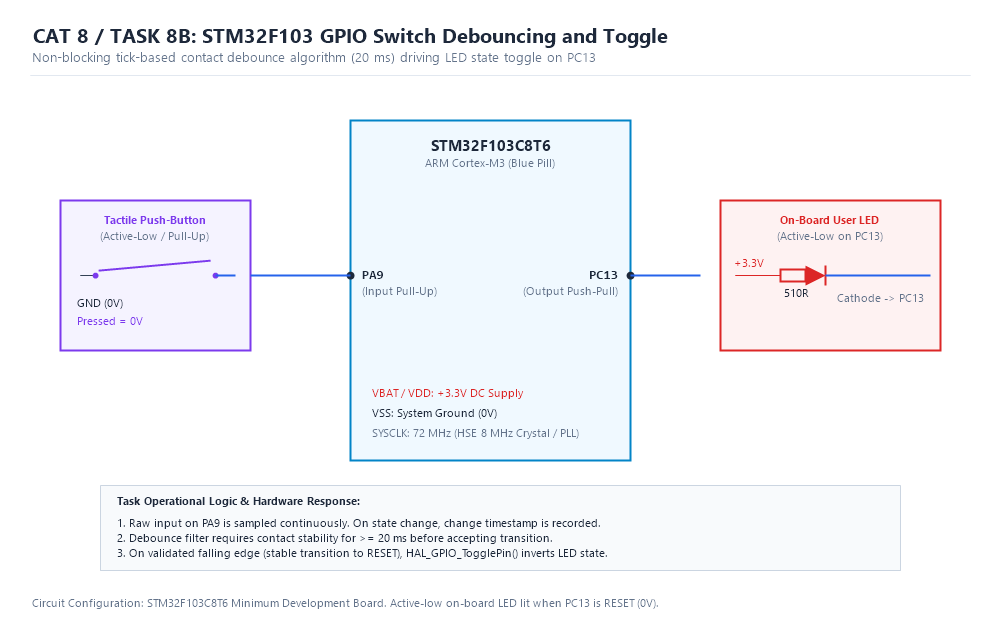

# Experiment 8B: STM32F103 GPIO Switch Debouncing and LED Toggle

**Course:** Foundations of IoT (FIoT) Lab  
**Student Name:** Venkataprabu V  
**Registration Number:** 25011102114  
**Date:** 18/09/2026  

---

## 1. Experiment Name and Aim
- **Experiment Name:** STM32 Non-Blocking Contact Debounce Algorithm and Push-Button LED Toggle
- **Aim:** To implement a robust, non-blocking digital switch debouncing filter on the STM32F103C8T6 microcontroller utilizing the ARM SysTick timer (`HAL_GetTick()`), rejecting mechanical contact bounce on pin PA9 and reliably toggling the state of the PC13 user LED upon each valid button depression.

---

## 2. Components / Tools Required
### Hardware Components
- STM32F103C8T6 ARM Cortex-M3 Minimal Development Board
- ST-Link V2 In-Circuit Programmer/Debugger
- Tactile Momentary Push-Button
- DuPont interconnect wires and breadboard
- +3.3V / +5V USB Power Source

### Software / Tools
- STM32CubeMX
- Keil MDK-ARM v5 / µVision IDE
- STM32CubeProgrammer

---

## 3. Hardware Setup
### Pin Allocations
| MCU Pin | Mode | Pull Configuration | Connected Hardware | Electrical Function |
|---|---|---|---|---|
| PA9 | Input (`GPIO_MODE_INPUT`) | Pull-Up (`GPIO_PULLUP`) | External Push-Button to GND | Switch input (Default = HIGH, Pressed = LOW) |
| PC13 | Output (`GPIO_MODE_OUTPUT_PP`) | No Pull (`GPIO_NOPULL`) | On-board User LED | Active-low indicator (LOW = ON, HIGH = OFF) |
| PD0/PD1 | External Oscillator | - | 8.0 MHz HSE Quartz Crystal | System clock reference |

### Clock Configuration
- **Core Frequency (SYSCLK):** 72.0 MHz derived via HSE (8 MHz) and PLL (x9).
- **Timebase Source:** ARM Cortex-M3 SysTick timer configured to generate a 1.0 ms periodic tick interrupt, incrementing the internal counter accessible via `HAL_GetTick()`.

---

## 4. Circuit Diagram


---

## 5. Pseudocode and Code Logic
### Mechanical Contact Bounce Problem
When physical metallic switch contacts close or open, mechanical elasticity induces high-frequency ringing (rapid transitions between 0V and 3.3V) lasting 5 to 15 ms. Without filtering, an unfiltered polling routine or interrupt triggers multiple false toggle events per single human actuation.

### Software Debounce Algorithm
1. Maintain two tracking states:
   - `button_candidate`: The latest raw reading observed on the pin.
   - `button_stable`: The confirmed, debounced steady-state value of the button.
2. Maintain a timestamp `button_change_tick` capturing when the candidate state last shifted.
3. In `button_task()`:
   - Sample current raw level: `raw = HAL_GPIO_ReadPin(GPIOA, GPIO_PIN_9)`.
   - Read current system time: `now = HAL_GetTick()`.
   - If `raw != button_candidate`, a transition has begun. Update `button_candidate = raw` and reset `button_change_tick = now`.
   - If the candidate remains unchanged for at least 20 ms (`(now - button_change_tick) >= 20`) and differs from the last confirmed stable state (`button_stable != button_candidate`):
     - Update confirmed state: `button_stable = button_candidate`.
     - Detect falling edge (active depression): if `button_stable == GPIO_PIN_RESET`, invoke `HAL_GPIO_TogglePin(GPIOC, GPIO_PIN_13)`.

### Pseudocode
```text
VARIABLES:
    candidate <- GPIO_PIN_SET
    stable <- GPIO_PIN_SET
    change_tick <- 0

FUNCTION button_task():
    raw <- HAL_GPIO_ReadPin(Port A, Pin 9)
    now <- HAL_GetTick()

    IF raw != candidate THEN
        candidate <- raw
        change_tick <- now
    END IF

    IF (now - change_tick >= 20) AND (stable != candidate) THEN
        stable <- candidate
        IF stable == GPIO_PIN_RESET THEN
            HAL_GPIO_TogglePin(Port C, Pin 13)
        END IF
    END IF
END FUNCTION

MAIN:
    INITIALIZE System (HAL, 72 MHz clock, GPIOs)
    LOOP FOREVER:
        button_task()
    END LOOP
```

---

## 6. Procedure
1. Open Keil µVision and load `STM32/CAT8/TASK8B/MDK-ARM/Button.uvprojx`.
2. Inspect `Core/Src/main.c` and confirm that `button_task()` is executed within the infinite loop without any blocking delay calls (`HAL_Delay()`).
3. Compile the firmware with **F7**. Confirm 0 Errors, 0 Warnings.
4. Connect ST-Link V2 to the target board and click **Download (F8)**.
5. Tap the push-button repeatedly at varying speeds, observing the LED response.

---

## 7. Expected Output / Inference
- On boot, PC13 LED is OFF.
- Each individual tap of the push-button toggles the LED state cleanly:
  - 1st tap: LED turns ON.
  - 2nd tap: LED turns OFF.
  - 3rd tap: LED turns ON.
- Contact chatter occurring within the initial 20 ms window is fully suppressed by the timing threshold, guaranteeing strictly one toggle event per button press.
- Long holding of the button does not cause repeated toggling, because the transition triggers exclusively on the initial validated transition to `GPIO_PIN_RESET` [CONFIRM ON BOARD/SIMULATION].

---

## 8. Conclusion
The experiment verified non-blocking software switch debouncing on the STM32 Cortex-M3. Using SysTick timestamps rather than blocking delay loops preserves CPU availability for concurrent peripheral tasks while reliably eliminating mechanical contact noise.
