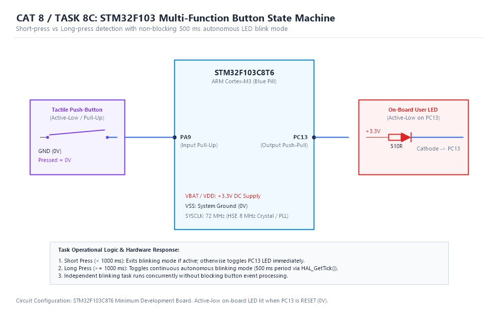

# Experiment 8C: STM32F103 Multi-Function Button State Machine and Non-Blocking Blinker

**Course:** Foundations of IoT (FIoT) Lab  
**Student Name:** Venkataprabu V  
**Registration Number:** 25011102114  
**Date:** 18/09/2026  

---

## 1. Experiment Name and Aim
- **Experiment Name:** STM32 Multi-Function Button State Machine (Short-Press vs. Long-Press Detection)
- **Aim:** To implement an advanced event-driven button handling state machine on the STM32F103C8T6 microcontroller capable of distinguishing between short-press and long-press (>= 1.0 s) gestures, coordinating static LED toggling, and managing an autonomous non-blocking 500 ms periodic blink mode on pin PC13.

---

## 2. Components / Tools Required
### Hardware Components
- STM32F103C8T6 "Blue Pill" ARM Cortex-M3 Board
- ST-Link V2 In-Circuit Programmer/Debugger
- Tactile Push-Button Switch
- Breadboard and DuPont jumper wires
- Micro-USB cable (+3.3V / +5V power feed)

### Software / Tools
- Keil MDK-ARM v5 / µVision IDE
- STM32CubeMX
- ST-Link Utility / STM32CubeProgrammer

---

## 3. Hardware Setup
### Pin Configuration
| Signal | STM32 Pin | Configuration | Hardware Destination | Active State |
|---|---|---|---|---|
| User Button | PA9 | GPIO Input (`GPIO_PULLUP`) | External Push-Button to GND | Low (0V) when pressed |
| User LED | PC13 | GPIO Output Push-Pull | On-Board LED via 510Ω resistor | Low (0V) = LED ON |
| Clock HSE | PD0/PD1 | High-Speed External | 8.0 MHz Quartz Crystal | SYSCLK = 72 MHz |

### Timebase Configuration
- **SysTick Timer:** Configured as a 1 ms interrupt timebase via `HAL_Init()`.
- System time counter accessed via `HAL_GetTick()`, providing non-blocking timing resolution for both debounce filtering (20 ms), gesture duration classification (1000 ms), and periodic blinking (500 ms).

---

## 4. Circuit Diagram


---

## 5. Pseudocode and Code Logic
### Button State Architecture
The button interface is encapsulated within a structured state object:
```c
typedef struct {
    GPIO_PinState candidate;      // Pending pin level
    GPIO_PinState stable;         // Confirmed steady level
    uint32_t change_tick;         // Debounce start timestamp
    uint32_t press_tick;          // Timestamp when button was first pressed
    uint8_t pressed;              // Flag: button is currently depressed
    uint8_t long_handled;         // Flag: long press has already been registered
    int event;                    // 1 = Short Press, 2 = Long Press
} Button;
```

### Multi-Gesture Event Classification Logic
1. **Debounce Stage:** Sample raw pin level. If state differs from candidate, record `change_tick`. Require 20 ms continuous stability before accepting transition into `stable`.
2. **Press Detection:** When `stable` transitions to `GPIO_PIN_RESET`:
   - Set `pressed = 1`.
   - Clear `long_handled = 0`.
   - Record start timestamp: `press_tick = now`.
3. **Long-Press Threshold (Event 2):**
   - While `pressed == 1` and `!long_handled`, test duration: `(now - press_tick) >= 1000`.
   - If 1.0 second elapsed, set `long_handled = 1` and emit `event = 2`.
4. **Short-Press Detection (Event 1):**
   - When button is released (`stable == GPIO_PIN_SET`) while `pressed == 1`:
   - Clear `pressed = 0`.
   - If the long-press threshold was not reached (`!long_handled`), emit `event = 1`.

### Task Dispatcher & Blinker Engine
- **`buttons()` Task:**
  - Evaluates `buttonpress()` for pin PA9.
  - If `event == 1` (Short Press): If the board is actively blinking, exit blinking mode (`blink = 0`); otherwise, toggle the LED state (`HAL_GPIO_TogglePin(GPIOC, GPIO_PIN_13)`).
  - If `event == 2` (Long Press): Toggle the blink mode flag (`blink = !blink`) and synchronize `blink_tick = HAL_GetTick()`.
- **`blinking()` Task:**
  - If `blink == 1` and `(HAL_GetTick() - blink_tick) >= 500`: Toggle PC13 LED and reset `blink_tick`. Both tasks run collaboratively in the superloop without any blocking delays.

### Pseudocode
```text
FUNCTION buttonpress(Pin, btn):
    raw <- READ(Pin)
    now <- HAL_GetTick()
    
    // Debounce
    IF raw != btn.candidate THEN
        btn.candidate <- raw
        btn.change_tick <- now
    END IF
    IF (now - btn.change_tick >= 20) AND (btn.stable != btn.candidate) THEN
        btn.stable <- btn.candidate
        IF btn.stable == RESET THEN
            btn.pressed <- 1
            btn.long_handled <- 0
            btn.press_tick <- now
        ELSE IF btn.pressed THEN
            btn.pressed <- 0
            IF NOT btn.long_handled THEN
                btn.event <- 1
                RETURN 1
            END IF
        END IF
    END IF

    // Long press check
    IF btn.pressed AND (NOT btn.long_handled) AND (now - btn.press_tick >= 1000) THEN
        btn.long_handled <- 1
        btn.event <- 2
        RETURN 1
    END IF

    RETURN 0
END FUNCTION
```

---

## 6. Procedure
1. Open Keil µVision project `STM32/CAT8/TASK8C/MDK-ARM/Button.uvprojx`.
2. Inspect `Core/Src/main.c` to examine the cooperative multi-tasking implementation in the main `while (1)` loop.
3. Build the project using **F7** (0 Errors, 0 Warnings).
4. Download the binary to the STM32F103C8 board using ST-Link V2 (**F8**).
5. Perform user testing:
   - Tap the button briefly (< 1 second) and confirm static LED toggle.
   - Hold the button down for >= 1 second and release, observing entry into 500 ms autonomous blinking mode.
   - Tap briefly during blink mode to stop blinking.

---

## 7. Expected Output / Inference
- Short Tap (< 1 s): Emits Event 1. LED toggles immediately between ON and OFF.
- Long Hold (>= 1 s): Emits Event 2 upon crossing the 1000 ms threshold. The LED enters 500 ms periodic square-wave blinking (1 Hz flash rate).
- Interrupting Blink Mode: A single short press cancels blinking and freezes the current LED state.
- Holding the button indefinitely triggers Event 2 once and does not re-trigger, because `long_handled` latches until switch release [CONFIRM ON BOARD/SIMULATION].

---

## 8. Conclusion
The experiment demonstrated sophisticated multi-gesture human-machine interface (HMI) design on an embedded ARM microcontroller. Encapsulating debouncing and edge-timing logic into a reusable state machine provided clean separation between input detection and peripheral actuation.
