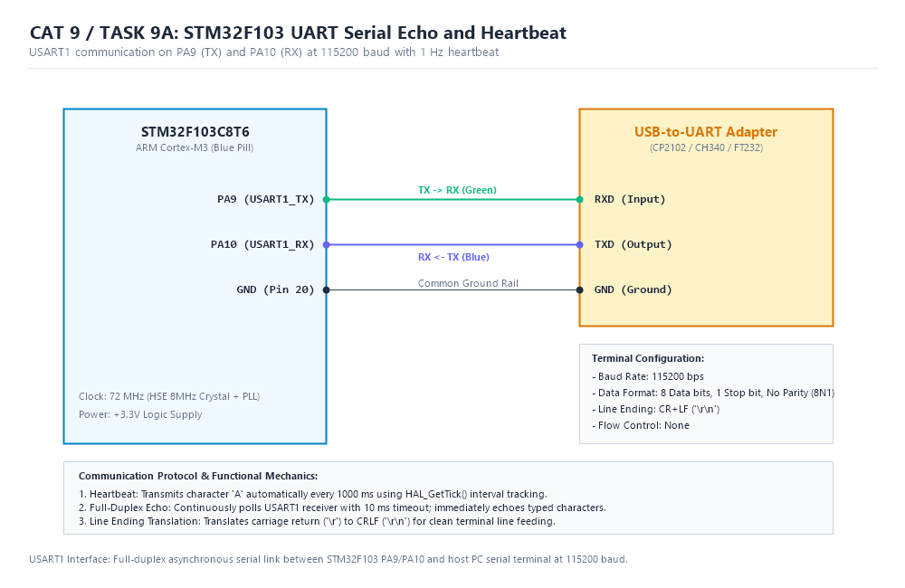

# Experiment 9A: STM32F103 Basic UART Serial Echo and Periodic Heartbeat

**Course:** Foundations of IoT (FIoT) Lab  
**Student Name:** Venkataprabu V  
**Registration Number:** 25011102114  
**Date:** 28/09/2026  

---

## 1. Experiment Name and Aim
- **Experiment Name:** STM32 Cortex-M3 USART Full-Duplex Serial Communication
- **Aim:** To configure the Universal Synchronous Asynchronous Receiver Transmitter (USART1) peripheral on the STM32F103C8T6 microcontroller at 115200 baud (8N1), establish a full-duplex serial link with a host terminal, emit an autonomous 1.0-second periodic heartbeat byte (`'A'`), and synchronously echo received terminal characters with carriage return translation.

---

## 2. Components / Tools Required
### Hardware Components
- STM32F103C8T6 "Blue Pill" ARM Cortex-M3 Development Board
- USB-to-UART Bridge Module (CP2102, CH340, or FT232R)
- ST-Link V2 In-Circuit Debugger
- DuPont jumper wires and breadboard
- Host PC with USB port

### Software / Tools
- Keil MDK-ARM v5 / µVision IDE
- STM32CubeMX
- Serial Terminal Application (PuTTY, Tera Term, minicom, or Arduino Serial Monitor)

---

## 3. Hardware Setup
### Pin Allocations & Signal Wiring
| STM32 Pin | Peripheral Function | Connected Module Pin | Signal Direction | Description |
|---|---|---|---|---|
| PA9 | USART1_TX (Alternate Function) | USB-UART RXD | Output from STM32 | Serial Data Transmit |
| PA10 | USART1_RX (Input Floating) | USB-UART TXD | Input to STM32 | Serial Data Receive |
| GND | System Ground | USB-UART GND | Reference | Common 0V Ground Plane |
| 3.3V | VDD Logic Supply | USB-UART 3V3 (optional) | Power | Logic Reference (+3.3V) |

### Clock & Baud Rate Parameters
- **Clock Tree:** 8.0 MHz HSE Crystal with PLL x9 generating 72.0 MHz System Clock (SYSCLK).
- **USART1 Clock Source:** APB2 Peripheral Bus running at full 72.0 MHz.
- **Baud Rate:** 115200 bps (`USART_BRR = 72000000 / (16 * 115200) = 39.0625 -> BRR = 0x271`).
- **Frame Format:** 8 Data Bits, 1 Stop Bit, No Parity, No Hardware Flow Control (8N1).

---

## 4. Circuit Diagram


---

## 5. Pseudocode and Code Logic
### Communication Architecture
1. Peripherals are initialized via `MX_GPIO_Init()` and `MX_USART1_UART_Init()`.
2. Variables declared:
   - `uint8_t ch`: Single-byte receive buffer.
   - `uint8_t tx = 'A'`: Heartbeat beacon character.
   - `uint32_t tx_tick`: Timestamp of the previous heartbeat transmission.
3. In the superloop (`while (1)`):
   - **Periodic Heartbeat:** Calculate elapsed time `now - tx_tick`. If `>= 1000` ms, transmit character `'A'` using `HAL_UART_Transmit(&huart1, &tx, 1, HAL_MAX_DELAY)` and update `tx_tick = now`.
   - **Echo Polling:** Poll the receiver using `HAL_UART_Receive(&huart1, &ch, 1, 10)` with a short 10 ms timeout.
   - **Character Formatting:**
     - If reception returns `HAL_OK` and character is a Carriage Return (`ch == '\r'`), send `"\r\n"` (Carriage Return + Line Feed) so the host terminal cursor advances to the beginning of the next line.
     - Otherwise, echo the received byte directly back to the transmitter (`HAL_UART_Transmit(&huart1, &ch, 1, HAL_MAX_DELAY)`).

### Pseudocode
```text
INITIALIZE HAL
INITIALIZE System Clock (72 MHz)
INITIALIZE USART1 (115200 Baud, 8N1)

tx <- 'A'
tx_tick <- HAL_GetTick()

LOOP FOREVER:
    now <- HAL_GetTick()

    // 1-second beacon
    IF (now - tx_tick >= 1000) THEN
        HAL_UART_Transmit(USART1, tx, 1)
        tx_tick <- now
    END IF

    // Non-blocking serial receiver poll (10 ms timeout)
    IF HAL_UART_Receive(USART1, ch, 1, 10) == HAL_OK THEN
        IF ch == '\r' THEN
            HAL_UART_Transmit(USART1, "\r\n", 2)
        ELSE
            HAL_UART_Transmit(USART1, ch, 1)
        END IF
    END IF
END LOOP
```

---

## 6. Procedure
1. Launch Keil µVision and load `STM32/CAT9/TASK9A/MDK-ARM/plswork.uvprojx`.
2. Verify target device is STM32F103C8 and crystal configuration matches 8.0 MHz.
3. Build the target project by pressing **F7** (0 Errors, 0 Warnings).
4. Connect ST-Link V2 to the Blue Pill and download the firmware with **F8**.
5. Plug the USB-to-UART converter into the computer and identify its COM port (e.g., COM3) in Windows Device Manager.
6. Open PuTTY / Serial Terminal configured for:
   - Serial Port: Selected COM Port
   - Speed: 115200
   - Data bits: 8, Stop bits: 1, Parity: None, Flow control: None
7. Observe serial output and type text directly into the console.

---

## 7. Expected Output / Inference
- Every second, character `'A'` appears automatically in the terminal console (`AAAAA...`), confirming that the microcontroller is alive and running its internal clock loop.
- When keystrokes are typed in the terminal (e.g., `Hello STM32`), each character is instantly mirrored back by the echo routine.
- Pressing the *Enter* key emits a clean newline on the console rather than overwriting the current line, verifying proper `\r\n` line ending translation [CONFIRM ON BOARD/SIMULATION].

---

## 8. Conclusion
The experiment verified full-duplex asynchronous serial communication on the STM32F103C8T6 using the HAL UART driver. Polling with bounded timeouts permitted concurrent periodic transmissions and responsive user character echoing without thread starvation.
