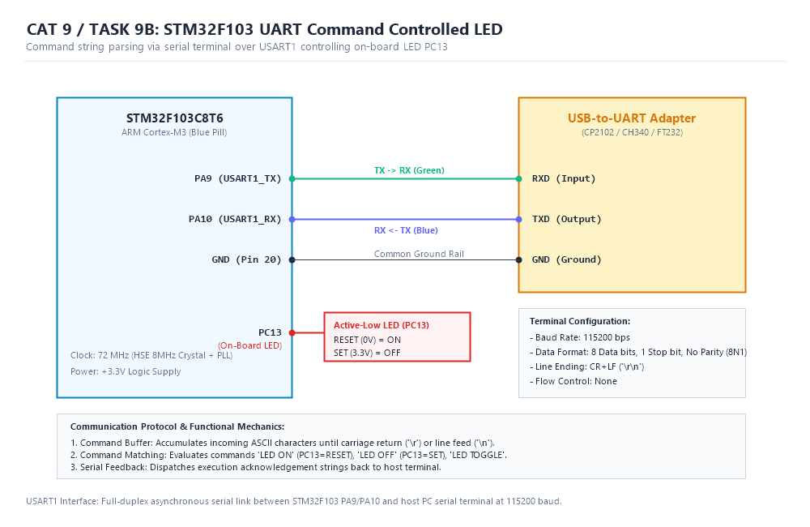

# Experiment 9B: STM32F103 UART Command Controlled LED

**Course:** Foundations of IoT (FIoT) Lab  
**Student Name:** Venkataprabu V  
**Registration Number:** 25011102114  
**Date:** 28/09/2026  

---

## 1. Experiment Name and Aim
- **Experiment Name:** STM32 Text Command Interpreter over USART for GPIO Control
- **Aim:** To implement a serial ASCII command protocol over USART1 on the STM32F103C8T6 microcontroller, accumulating terminal input into a command buffer until a newline delimiter, matching command strings ("LED ON", "LED OFF", "LED TOGGLE"), and dynamically controlling the state of the active-low on-board LED on pin PC13 with feedback responses.

---

## 2. Components / Tools Required
### Hardware Components
- STM32F103C8T6 "Blue Pill" ARM Cortex-M3 Development Board
- USB-to-UART Adapter Module (CP2102 / CH340 / FT232R)
- ST-Link V2 In-Circuit Debugger/Programmer
- Jumper wires and breadboard
- Host PC with Serial Terminal Software

### Software / Tools
- Keil MDK-ARM v5 / µVision IDE
- STM32CubeMX Configuration Tool
- Serial Terminal Application (PuTTY / Tera Term)

---

## 3. Hardware Setup
### Pin Allocations & Peripheral Map
| Pin | Function | Direction | Destination | Signal Description |
|---|---|---|---|---|
| PA9 | USART1_TX | Output | USB-UART RXD | Transmit parsed feedback to terminal |
| PA10 | USART1_RX | Input | USB-UART TXD | Receive keystroke stream from terminal |
| PC13 | GPIO Output | Output | On-Board User LED | Active-low LED drive (LOW = ON, HIGH = OFF) |
| GND | Ground | Reference | USB-UART GND | Common ground reference plane |

### UART Protocol Settings
- **Baud Rate:** 115200 bits per second
- **Word Length:** 8 Data bits
- **Stop Bits:** 1 Stop bit
- **Parity:** None
- **Hardware Flow Control:** Disabled

---

## 4. Circuit Diagram


---

## 5. Pseudocode and Code Logic
### Command Parsing Mechanics
1. **Buffer Storage:** A character array `command[20]` accumulates incoming bytes until an end-of-line marker (`'\r'` or `'\n'`) is encountered.
2. **Character Reception:** Read incoming serial bytes using `HAL_UART_Receive()`.
   - If incoming character is printable and buffer index is within bounds (`index < 19`), append to buffer and advance index.
   - When a carriage return (`'\r'`) or newline (`'\n'`) is received, terminate the string with a null character (`command[index] = '\0'`).
3. **Command Evaluation (`strcmp`):**
   - **`"LED ON"`**: Drive PC13 LOW using `HAL_GPIO_WritePin(GPIOC, GPIO_PIN_13, GPIO_PIN_RESET)`. Send acknowledgment string `"[ACK] LED is ON\r\n"`.
   - **`"LED OFF"`**: Drive PC13 HIGH using `HAL_GPIO_WritePin(GPIOC, GPIO_PIN_13, GPIO_PIN_SET)`. Send acknowledgment string `"[ACK] LED is OFF\r\n"`.
   - **`"LED TOGGLE"`**: Invert PC13 state using `HAL_GPIO_TogglePin(GPIOC, GPIO_PIN_13)`. Send acknowledgment string `"[ACK] LED Toggled\r\n"`.
   - **Unrecognized command**: Send error feedback `"[ERR] Unknown Command\r\n"`.
4. **Buffer Reset:** Clear index back to 0 to await the next instruction line.

### Pseudocode
```text
VARIABLES:
    buffer[20]
    index <- 0

LOOP FOREVER:
    IF HAL_UART_Receive(USART1, ch, 1, 10) == HAL_OK THEN
        IF ch == '\r' OR ch == '\n' THEN
            IF index > 0 THEN
                buffer[index] <- '\0'
                
                IF strcmp(buffer, "LED ON") == 0 THEN
                    HAL_GPIO_WritePin(Port C, Pin 13, GPIO_PIN_RESET)
                    HAL_UART_Transmit(USART1, "LED is ON\r\n")
                ELSE IF strcmp(buffer, "LED OFF") == 0 THEN
                    HAL_GPIO_WritePin(Port C, Pin 13, GPIO_PIN_SET)
                    HAL_UART_Transmit(USART1, "LED is OFF\r\n")
                ELSE IF strcmp(buffer, "LED TOGGLE") == 0 THEN
                    HAL_GPIO_TogglePin(Port C, Pin 13)
                    HAL_UART_Transmit(USART1, "LED Toggled\r\n")
                ELSE
                    HAL_UART_Transmit(USART1, "Unknown Command\r\n")
                END IF
                
                index <- 0
            END IF
        ELSE
            IF index < 19 THEN
                buffer[index] <- ch
                index <- index + 1
            END IF
        END IF
    END IF
END LOOP
```

---

## 6. Procedure
1. Open Keil µVision and load `STM32/CAT9/TASK9B/MDK-ARM/plswork.uvprojx`.
2. Inspect `Core/Src/main.c`. Review the GPIO initialization in `MX_GPIO_Init_2` ensuring PC13 is configured as an output push-pull pin.
3. Note on Compiler Warnings/Compatibility: In the generated CubeMX scaffolding, verify that variable scope definitions for `GPIO_InitStruct` adhere to toolchain C99 declarations.
4. Compile the project (**F7**) and verify target binary generation.
5. Program the STM32F103C8 development board using ST-Link V2 (**F8**).
6. Connect the USB-to-UART adapter and launch PuTTY at 115200 baud.
7. Enter text commands `"LED ON"`, `"LED OFF"`, and `"LED TOGGLE"`, terminating each with the *Enter* key.

---

## 7. Expected Output / Inference
- Typing `LED ON` and pressing Enter drives PC13 to 0V, illuminating the green on-board LED. The terminal receives confirmation `LED is ON`.
- Typing `LED OFF` drives PC13 to 3.3V, turning off the LED. The terminal receives confirmation `LED is OFF`.
- Typing `LED TOGGLE` inverts the current state of the LED upon each submission.
- Unrecognized or malformed strings yield an informative error message, preventing unauthorized state corruption [CONFIRM ON BOARD/SIMULATION].

---

## 8. Conclusion
The experiment verified human-readable ASCII command parsing over a serial UART link on an embedded ARM Cortex-M3 processor. Buffer accumulation, delimiter detection, and lexical command comparison were successfully integrated with GPIO peripheral drivers to realize an interactive remote-control terminal interface.
